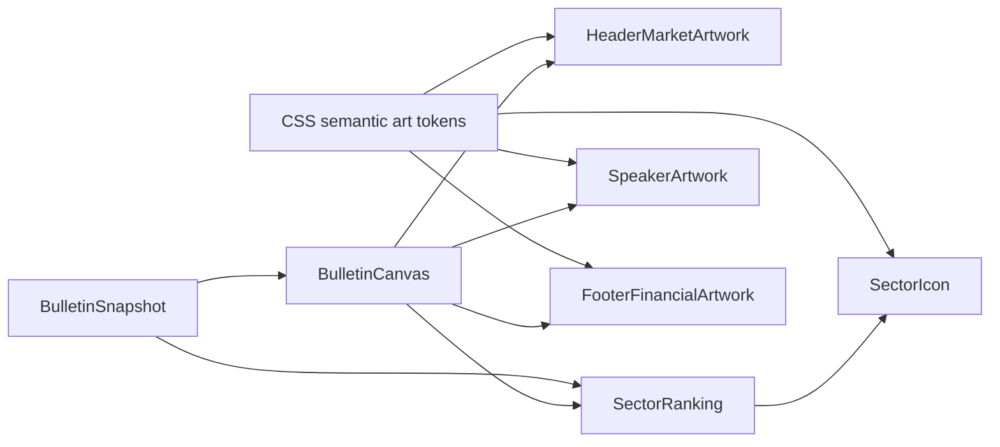
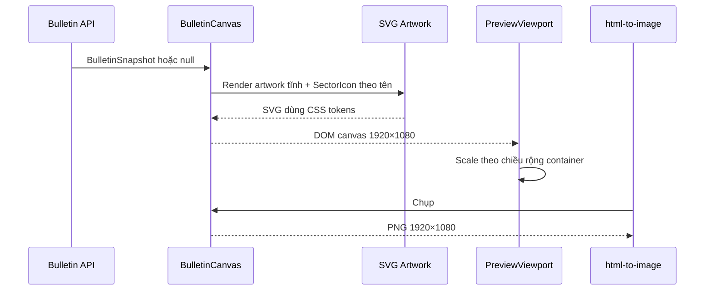

# CNF Green Vector Artwork — Kế hoạch triển khai

## Giai đoạn 0: Làm rõ đầu vào

### 0.1 Bối cảnh đã phê duyệt

- Dự án hiện hữu: Next.js 16.3, React 19.2, TypeScript 6, CSS toàn cục và Vitest.
- Bề mặt thay đổi: canvas bản tin cố định 1920×1080 và preview được scale bởi `PreviewViewport`.
- Hướng được duyệt: SVG vector code-native chi tiết, bảng màu CNF Green, không dùng PNG hoặc dependency đồ họa ngoài.
- Tài liệu đầu vào:
  - `docs/spec/spec_adaptation_cnf-green-vector-artwork_20260811.md`
  - `docs/ui-design/system_design.md`, mục 13.
- Phạm vi bảo vệ: dữ liệu, bộ lọc, API, Google Sheets, trình biên tập nhận định và thuật toán xuất PNG không thay đổi.

### 0.2 Phân loại

- Loại công việc: **Adaptation** — thích nghi giao diện hiện hữu theo ngôn ngữ hình ảnh và bảng màu mới mà không thay công nghệ nền.
- Độ phức tạp: **Complex** — thay đổi 6 file source/test, có tích hợp SVG, CSS token, responsive preview và kiểm tra PNG.
- Workflow: 5 giai đoạn Adaptation.
- TDD: bật; mỗi hành vi mới đi theo Red → Green → Refactor trước review.
- Bảo mật: không có auth, secret, dữ liệu nhập hoặc request mạng mới; rủi ro bảo mật không tăng.
- Hiệu năng: chuẩn, artwork tĩnh và xác định; không animation, không `Math.random()` trong render.

### 0.3 Giả định và giới hạn

- Mỗi trang chỉ có một `#bulletin-canvas`; SVG `defs` dùng tiền tố riêng theo component để tránh xung đột.
- Các tên ngành có thể có dấu hoặc không dấu; mapping phải hỗ trợ cả hai.
- Ba số minh họa `23.18`, `21.04`, `27.53` là nội dung trang trí, không phải dữ liệu thị trường động.
- `html-to-image` tiếp tục chụp DOM hiện hữu; kế hoạch không thay hàm export.
- Không đưa artwork vào config vì đây là hình dạng giao diện cố định, không phải tham số runtime hoặc workflow.

## Giai đoạn 1: Phân tích yêu cầu

### 1.1 Kết quả nghiên cứu codebase

- `components/bulletin-canvas.tsx` hiện chứa `HeaderMarketArt` và `FooterArt` nội tuyến; đây là điểm tách component trực tiếp, không cần lớp abstraction mới.
- `components/sector-ranking.tsx` hiện dùng cùng ký tự `♜` cho mọi ngành; tên ngành đã có sẵn để làm khóa mapping.
- `app/globals.css` đã dùng CSS custom properties trong `:root`; token artwork mới nên mở rộng nguồn sự thật duy nhất này.
- `components/preview-viewport.tsx` scale canvas bằng CSS transform và giữ kích thước logic 1920×1080; không cần sửa.
- Test giao diện hiện dùng `renderToStaticMarkup` trong Vitest với môi trường Node; artwork mới có thể kiểm tra theo cùng mẫu, không cần jsdom hoặc dependency mới.
- Lịch sử Git cho thấy artwork hiện tại được tạo trong bản bootstrap và chưa có lớp icon/artwork tái sử dụng cần bảo toàn.
- Hướng dẫn Next.js cục bộ tại `node_modules/next/dist/docs/01-app/01-getting-started/05-server-and-client-components.md` xác nhận component con không cần thêm `"use client"` khi được nhập dưới client boundary hiện hữu.

### 1.2 Yêu cầu EARS

| ID | Yêu cầu |
|---|---|
| R1 | KHI canvas bản tin render HỆ THỐNG PHẢI hiển thị header SVG gồm địa cầu nhiều lớp, lưới nền, ít nhất 24 nến có thân và wick, đường xu hướng có node và marker mũi tên. |
| R2 | KHI footer bản tin render HỆ THỐNG PHẢI hiển thị biểu đồ cột nhiều lớp, ngân hàng có mái/cột/bậc và mạng dữ liệu có node/đường nối. |
| R3 | KHI nhãn “NHẬN ĐỊNH THỊ TRƯỜNG” render HỆ THỐNG PHẢI dùng loa SVG và không còn ký tự `◖)))`. |
| R4 | KHI một trong 22 tên ngành đã biết render HỆ THỐNG PHẢI chọn biểu tượng SVG riêng tương ứng. |
| R5 | KHI tên ngành có dấu, không dấu, khác hoa thường hoặc có khoảng trắng thừa HỆ THỐNG PHẢI chuẩn hóa và trả cùng biểu tượng. |
| R6 | KHI tên ngành không nằm trong mapping HỆ THỐNG PHẢI render biểu tượng biểu đồ dự phòng và giữ nguyên tên ngành bằng chữ. |
| R7 | KHI artwork render HỆ THỐNG PHẢI tham chiếu semantic CSS tokens CNF Green và không chứa màu xanh dương đậm cũ `#1E68FF`, `#0D59FF`. |
| R8 | KHI SVG trang trí được đưa vào DOM HỆ THỐNG PHẢI đặt `aria-hidden="true"`, `focusable="false"` và không tạo focus target. |
| R9 | KHI snapshot rỗng, lỗi hoặc đang tải HỆ THỐNG PHẢI vẫn render artwork tĩnh mà không thay thế thông báo trạng thái dữ liệu hiện có. |
| R10 | KHI preview thay đổi kích thước HỆ THỐNG PHẢI scale cùng canvas hiện hữu, không tạo layout SVG khác giữa preview và PNG. |
| R11 | KHI xuất PNG HỆ THỐNG PHẢI giữ kích thước 1920×1080, không tải tài nguyên ngoài và không phụ thuộc animation hoặc giá trị ngẫu nhiên. |
| R12 | KHI triển khai hoàn tất HỆ THỐNG PHẢI giữ nguyên API, Google Sheets, bộ lọc, dữ liệu, editor và nội dung chữ hiện tại. |

### 1.3 Yêu cầu phi chức năng

- KISS: hai component mới (`bulletin-artwork.tsx`, `sector-icon.tsx`), không tạo framework SVG hoặc hệ icon tổng quát.
- YAGNI: không thêm theme switcher, animation, chart library, icon package hoặc CMS cho artwork.
- Determinism: mọi hình dạng, mảng nến và node là hằng số module; không sinh số ngẫu nhiên trong render.
- Khả năng tiếp cận: artwork trang trí không tham gia accessibility tree; tên ngành và dữ liệu chữ không đổi.
- Tương thích: chỉ dùng SVG/React/CSS được hỗ trợ trực tiếp; không `foreignObject` và không URL asset ngoài.

## Giai đoạn 2: Đặc tả giải pháp

### 2.1 Kiến trúc tối thiểu



- `bulletin-artwork.tsx` chỉ chứa ba presentational component tĩnh và dữ liệu tọa độ SVG cố định.
- `sector-icon.tsx` chứa hàm chuẩn hóa tên, mapping khóa ngành và component icon.
- `bulletin-canvas.tsx` chỉ lắp ghép artwork; không còn chi tiết SVG dài nội tuyến.
- `sector-ranking.tsx` truyền `sector.name` cho `SectorIcon`; phép tính heatmap giữ nguyên.
- `globals.css` là nguồn token duy nhất cho màu, glow và kích thước render.

### 2.2 Luồng render và xuất ảnh



### 2.3 Hợp đồng component

| Component/API | Đầu vào | Đầu ra | Lỗi/fallback |
|---|---|---|---|
| `HeaderMarketArtwork()` | Không có | Vùng header gồm globe + market SVG | Luôn render tĩnh |
| `FooterFinancialArtwork()` | Không có | SVG tài chính footer | Luôn render tĩnh |
| `SpeakerArtwork()` | Không có | SVG loa | Luôn render tĩnh |
| `normalizeSectorName(name)` | `string` | khóa ASCII, chữ thường, khoảng trắng chuẩn | Chuỗi rỗng nếu đầu vào chỉ có whitespace |
| `getSectorIconKey(name)` | `string` | khóa icon đã biết hoặc `market` | `market` cho tên lạ/rỗng |
| `SectorIcon({ sectorName })` | `string` | SVG 24×24 trang trí | Icon `market` |

### 2.4 Bảng đánh đổi

| Phương án | Ưu điểm | Nhược điểm | Độ phức tạp | Bảo mật | Khuyến nghị |
|---|---|---|---|---|---|
| SVG React code-native | Sắc nét, token hóa, test được, không asset ngoài | Nhiều path/tọa độ | Trung bình | Thấp | Chọn |
| PNG raster | Nhanh nếu có asset hoàn chỉnh | Khó đổi màu, dễ giảm nét, thêm asset | Thấp | Thấp | Không chọn |
| Thư viện icon/chart | Có nhiều hình sẵn | Thêm dependency, khó đồng nhất ảnh mẫu, dư tính năng | Trung bình | Trung bình do chuỗi cung ứng | Không chọn |
| Một SVG sprite tổng | DOM gọn | Mapping và test phức tạp hơn nhu cầu, khó bảo trì path | Cao | Thấp | Không chọn |

Quyết định: dùng component SVG React tĩnh và CSS semantic tokens. Chấp nhận số dòng path cao hơn để đổi lấy độ sắc nét và khả năng kiểm soát, nhưng giới hạn trong hai file presentational để tránh lan rộng.

### 2.5 Edge cases

| Trường hợp | Điều kiện kích hoạt | Hành vi mong đợi | Yêu cầu | Tác động nếu bỏ qua |
|---|---|---|---|---|
| Tên ngành không dấu | Dữ liệu CSV trả `Khoang san` | Chọn icon khoáng sản | R4, R5 | Nhiều ngành dùng fallback |
| Tên ngành có dấu | Dữ liệu tương lai trả `Khoáng sản` | Chọn cùng icon | R4, R5 | Mapping không ổn định |
| Hoa thường/khoảng trắng | `  NGÂN HÀNG  ` | Chuẩn hóa và chọn icon ngân hàng | R5 | Icon sai |
| Tên ngành lạ/rỗng | Mapping chưa có | Icon `market`, tên chữ giữ nguyên | R6 | Render lỗi hoặc mất nhãn |
| Danh sách ngành rỗng | Snapshot null/loading | Giữ empty state, không render row/icon | R9 | Empty state bị phá |
| Snapshot refresh khi đang xem | API cập nhật đồng thời | Artwork tĩnh; row mới tự ánh xạ theo tên | R9, R12 | Flicker/khác DOM |
| Preview rất nhỏ | Container 320 px | Scale toàn canvas; không tràn ngang | R10 | Layout vỡ |
| Export khi glow/filter hiện hữu | `html-to-image` chụp DOM | Filter nội tuyến/CSS token được rasterize ổn định | R11 | PNG mất nét hoặc mất màu |
| Trùng ID SVG defs | Nhiều SVG cùng DOM | Dùng tiền tố `cnf-header-`/`cnf-footer-` | R1, R2 | Gradient/marker tham chiếu sai |
| Hydration server/client | React render hai phía | Mảng tọa độ là hằng số, không random/time | R11 | Hydration mismatch |
| Màu depth tương phản thấp | `#064E2B` trên navy | Chỉ dùng trong gradient/lớp phụ | R7 | Glyph quan trọng khó nhìn |
| Nội dung dài ở footer | Nhận định nhiều chữ | Artwork giữ trong cột riêng, không đổi grid | R12 | Che chữ |

### 2.6 Xử lý ngoại lệ

| Loại | Nguồn | Chiến lược | Ảnh hưởng người dùng | Khôi phục |
|---|---|---|---|---|
| Tên ngành không nhận diện | `SectorIcon` | Fallback đồng bộ sang icon `market`; không throw | Vẫn thấy tên và icon chung | Bổ sung mapping sau nếu cần |
| Chuỗi ngành rỗng | `normalizeSectorName` | Trả khóa rỗng rồi fallback | Không crash | Dữ liệu chữ hiện hữu quyết định row |
| SVG filter không được rasterize | Trình duyệt/`html-to-image` | Artwork vẫn có stroke/fill màu chính; glow chỉ là enhancement | PNG ít glow hơn nhưng vẫn đọc được | Giảm filter trong vòng sửa trực quan |
| Export PNG thất bại | Luồng export hiện hữu | Giữ `try/catch` và thông báo hiện có; không thêm handler mới | Người dùng thấy lỗi xuất ảnh | Thử lại như hiện tại |
| CSS variable thiếu | Lỗi tích hợp | Token có fallback tại semantic declaration/CSS; test markup và visual check | Màu có thể sai | Build/test/review chặn merge |
| React render lỗi do markup SVG | TypeScript/build | Build fail-fast; không swallow lỗi | Không release bản lỗi | Sửa trong task sở hữu component |

Không có exception mạng, DB hoặc auth mới. Lỗi component tĩnh là unrecoverable ở runtime và phải bị chặn bởi build/test trước release.

### 2.7 Race conditions và đồng thời

| Tài nguyên dùng chung | Kịch bản đồng thời | Rủi ro | Giảm thiểu |
|---|---|---|---|
| DOM `#bulletin-canvas` | API refresh trong lúc export | Snapshot DOM có thể phản ánh một trong hai phiên render | Giữ hành vi hiện tại; artwork tĩnh, không thêm mutation riêng |
| CSS custom properties | Nhiều component đọc cùng token | Không có write runtime | Token chỉ khai báo tĩnh trong `:root` |
| SVG defs IDs | Nhiều SVG trên cùng trang | Trỏ nhầm gradient/filter | Tiền tố ID theo component; không dùng ID chung |
| Mapping ngành | Nhiều row render cùng lúc | Không có shared mutation | `Readonly` mapping ở module scope; lookup thuần |
| Tọa độ nến/node | SSR và hydration | Sai khác DOM nếu tạo ngẫu nhiên | Mảng hằng số module, không `Math.random()`/`Date` |

Không cần lock, queue hoặc idempotency key vì không có write operation mới.

### 2.8 Rủi ro và biện pháp

| Rủi ro | Mức | Biện pháp |
|---|---|---|
| SVG quá dày làm header rối | Trung bình | Giới hạn 30–34 nến, grid opacity thấp, visual check ở 1920 và preview nhỏ |
| Icon 22 px khó phân biệt | Trung bình | Một visual language, silhouette khác nhau, test snapshot cấu trúc và kiểm tra ảnh thật |
| Glow che chữ hoặc bị clip | Trung bình | Filter region có giới hạn; giữ overflow hiện hữu; test Cốc Cốc và PNG |
| Test quá bám chi tiết path | Trung bình | Test contract: component, semantic, mapping, count tối thiểu; không snapshot toàn chuỗi path |
| CSS token làm đổi khu vực khác | Thấp | Token mới có namespace `--color-art-*`; không đổi token `--green`/`--cyan` hiện hữu |
| Diff `bulletin-canvas.tsx` khó review | Thấp | Tách toàn bộ SVG sang file mới, canvas chỉ đổi import/lắp ghép |

## Giai đoạn 3: Kế hoạch triển khai

### 3.1 Cây task theo workflow Adaptation

#### Giai đoạn Adaptation 1 — Phân tích phạm vi

Đã hoàn tất trong đặc tả và kế hoạch: xác định file, boundary, EARS và rủi ro. Không sửa code.

#### Giai đoạn Adaptation 2 — Thiết kế chiến lược

Đã hoàn tất trong `docs/ui-design/system_design.md`, mục 13: token, anatomy, accessibility, responsive và acceptance criteria. Không sửa code.

#### Giai đoạn Adaptation 3 — Thiết lập lớp tương thích

##### Task T1.1 — Viết test Red cho biểu tượng ngành

- **Mục tiêu**: khóa hợp đồng chuẩn hóa, 22 mapping riêng, fallback và accessibility.
- **Files**: tạo `tests/sector-icon.test.ts`.
- **Phụ thuộc vào**: không có.
- **Song song an toàn**: có; không chung file với T1.2.
- **Thay đổi tối thiểu**: test import API dự kiến, render một số tên có/không dấu, kiểm tra 22 key duy nhất và fallback.
- **Lệnh kiểm tra**: `npm.cmd run test -- sector-icon`.
- **Kết quả mong đợi**: Red do module/API chưa tồn tại; failure đúng tại import hoặc assertion hợp đồng mới.
- **Rollback**: xóa duy nhất test mới nếu thiết kế bị thu hồi; không đụng source.
- **Truy vết**: R4, R5, R6, R8.

##### Task T1.2 — Viết test Red cho artwork bản tin

- **Mục tiêu**: khóa hợp đồng header/footer/loa, semantic token, SVG trang trí và loại bỏ glyph/màu cũ.
- **Files**: tạo `tests/bulletin-artwork.test.ts`.
- **Phụ thuộc vào**: không có.
- **Song song an toàn**: có; không chung file với T1.1.
- **Thay đổi tối thiểu**: render component dự kiến bằng `renderToStaticMarkup`; assert nến body/wick tối thiểu, marker, footer layers, `aria-hidden`, `focusable` và loa SVG.
- **Lệnh kiểm tra**: `npm.cmd run test -- bulletin-artwork`.
- **Kết quả mong đợi**: Red do module/API chưa tồn tại hoặc markup hiện hữu thiếu hợp đồng.
- **Rollback**: xóa duy nhất test mới nếu thiết kế bị thu hồi.
- **Truy vết**: R1, R2, R3, R7, R8, R9, R11.

##### Task T2.1 — Triển khai `SectorIcon`

- **Mục tiêu**: làm Green test T1.1 bằng normalization thuần, mapping readonly và 22 SVG outline + fallback.
- **Files**: tạo `components/sector-icon.tsx`.
- **Phụ thuộc vào**: T1.1.
- **Song song an toàn**: có với T2.2; không chung file.
- **Thay đổi tối thiểu**: một module chứa API và path cần thiết; không tạo icon framework.
- **Lệnh kiểm tra**: `npm.cmd run test -- sector-icon`.
- **Kết quả mong đợi**: toàn bộ test mapping pass; TypeScript không lỗi.
- **Rollback**: hoàn nguyên file mới; test T1.1 trở lại Red.
- **Truy vết**: R4, R5, R6, R8.

##### Task T2.2 — Triển khai artwork và token CNF Green

- **Mục tiêu**: làm Green test T1.2 bằng ba component SVG tĩnh và token CSS namespace riêng.
- **Files**: tạo `components/bulletin-artwork.tsx`; sửa `app/globals.css`.
- **Phụ thuộc vào**: T1.2.
- **Song song an toàn**: có với T2.1; không chung file.
- **Thay đổi tối thiểu**: tọa độ hằng số, SVG `defs` có tiền tố, token `--color-art-*`; không thay layout khác.
- **Lệnh kiểm tra**: `npm.cmd run test -- bulletin-artwork`.
- **Kết quả mong đợi**: test artwork pass; markup chỉ dùng semantic variables và không có blue cũ.
- **Rollback**: hoàn nguyên hai file trong task; không chạm icon ngành.
- **Truy vết**: R1, R2, R3, R7, R8, R9, R11.

#### Giai đoạn Adaptation 4 — Thích nghi tăng dần

##### Task T3.1 — Tích hợp icon vào bảng ngành

- **Mục tiêu**: thay ký tự `♜` bằng `SectorIcon` mà giữ heatmap, text và layout row.
- **Files**: sửa `components/sector-ranking.tsx`; bổ sung assertion tích hợp trong `tests/sector-icon.test.ts` nếu cần.
- **Phụ thuộc vào**: T2.1.
- **Song song an toàn**: có với T3.2; không chung file.
- **Thay đổi tối thiểu**: import + thay một node icon; không đổi phép tính `strength`, `hue` hoặc `slice(0, 22)`.
- **Lệnh kiểm tra**: `npm.cmd run test -- sector-icon`.
- **Kết quả mong đợi**: 22 row render icon riêng, tên và giá trị giữ nguyên.
- **Rollback**: hoàn nguyên integration; module icon độc lập vẫn tồn tại và test đơn vị pass.
- **Truy vết**: R4, R5, R6, R8, R12.

##### Task T3.2 — Tích hợp artwork vào canvas

- **Mục tiêu**: thay các hàm SVG nội tuyến và ký tự loa bằng component mới, giữ nguyên cấu trúc dữ liệu/canvas.
- **Files**: sửa `components/bulletin-canvas.tsx`; bổ sung assertion tích hợp trong `tests/bulletin-artwork.test.ts` nếu cần.
- **Phụ thuộc vào**: T2.2.
- **Song song an toàn**: có với T3.1; không chung file.
- **Thay đổi tối thiểu**: import ba component, bỏ hai hàm cũ, thay node loa; không sửa props hoặc date formatting.
- **Lệnh kiểm tra**: `npm.cmd run test -- bulletin-artwork bulletin-date`.
- **Kết quả mong đợi**: artwork mới xuất hiện; test ngày hiện hữu vẫn pass; glyph/màu cũ không còn.
- **Rollback**: hoàn nguyên canvas về artwork cũ; component mới không ảnh hưởng module khác.
- **Truy vết**: R1, R2, R3, R7, R8, R9, R12.

#### Giai đoạn Adaptation 5 — Xác minh và hoàn tất

##### Task T4.1 — Xác minh tự động đầy đủ

- **Mục tiêu**: chứng minh build, lint, unit/regression test không có lỗi.
- **Files**: không sửa source; chỉ artifact build bị gitignore.
- **Phụ thuộc vào**: T3.1, T3.2.
- **Song song an toàn**: không; chạy tuần tự theo Tier 2: build → lint → full test.
- **Thay đổi tối thiểu**: không có.
- **Lệnh kiểm tra**: `npm.cmd run build`; `npm.cmd run lint`; `npm.cmd run test`; `git diff --check`.
- **Kết quả mong đợi**: build/lint pass, toàn bộ test pass, diff không có whitespace error.
- **Rollback**: nếu lỗi thuộc task nào, hoàn nguyên patch chưa verified của task đó trước khi thử giải pháp khác.
- **Truy vết**: R1–R12.

##### Task T4.2 — Kiểm tra trực quan và PNG trong Cốc Cốc

- **Mục tiêu**: xác nhận symptom-level rằng màu xanh dương cũ biến mất, hình chi tiết hơn và không che nội dung.
- **Files**: không sửa source; ảnh chụp tạm trong `.next/` hoặc thư mục tạm bị gitignore.
- **Phụ thuộc vào**: T4.1.
- **Song song an toàn**: không; cần build/test Green trước.
- **Thay đổi tối thiểu**: chạy app, chụp screenshot 1600×1000, xem ảnh; kích hoạt xuất PNG 1920×1080 nếu automation cho phép.
- **Lệnh kiểm tra**: mở `http://localhost:3000` bằng Cốc Cốc headless; kiểm tra kích thước PNG bằng công cụ hệ thống.
- **Kết quả mong đợi**: header/footer/icons xanh CNF, 22 icon riêng, không tràn; PNG đúng 1920×1080.
- **Rollback**: không có thay đổi source; nếu visual fail, quay lại bug pipeline với ảnh làm reproduction.
- **Truy vết**: R1, R2, R3, R4, R7, R10, R11, R12.

##### Task T4.3 — Review thay đổi

- **Mục tiêu**: kiểm tra spec compliance, accessibility, deterministic render, phạm vi và chất lượng diff.
- **Files**: read-only trên toàn bộ diff trong phạm vi.
- **Phụ thuộc vào**: T4.2.
- **Song song an toàn**: không; review là cổng cuối.
- **Thay đổi tối thiểu**: không có; `10-review` không tự sửa.
- **Lệnh kiểm tra**: `git status --short`; `git diff --check`; `git diff -- <scoped files>`; chạy lại reproduction trực quan nếu cần.
- **Kết quả mong đợi**: verdict PASS, không finding critical/high và bằng chứng symptom-level có mặt.
- **Rollback**: finding FAILED khởi động bug pipeline tương ứng, không sửa trong review.
- **Truy vết**: R1–R12.

### 3.2 Bản đồ phụ thuộc và song song

| ID task | Tên task | Phụ thuộc vào | Loại | Wave | Phạm vi file |
|---|---|---|---|---:|---|
| T1.1 | Test Red biểu tượng ngành | không có | Độc lập | 1 | `tests/sector-icon.test.ts` |
| T1.2 | Test Red artwork | không có | Độc lập | 1 | `tests/bulletin-artwork.test.ts` |
| T2.1 | Triển khai `SectorIcon` | T1.1 | Phụ thuộc | 2 | `components/sector-icon.tsx` |
| T2.2 | Triển khai artwork + token | T1.2 | Phụ thuộc | 2 | `components/bulletin-artwork.tsx`, `app/globals.css` |
| T3.1 | Tích hợp bảng ngành | T2.1 | Phụ thuộc | 3 | `components/sector-ranking.tsx`, `tests/sector-icon.test.ts` |
| T3.2 | Tích hợp canvas | T2.2 | Phụ thuộc | 3 | `components/bulletin-canvas.tsx`, `tests/bulletin-artwork.test.ts` |
| T4.1 | Xác minh tự động | T3.1, T3.2 | Phụ thuộc | 4 | Không sửa source |
| T4.2 | Kiểm tra Cốc Cốc + PNG | T4.1 | Phụ thuộc | 5 | Artifact tạm, gitignored |
| T4.3 | Review cuối | T4.2 | Phụ thuộc | 6 | Read-only toàn diff |

- Wave 1 (song song): T1.1, T1.2 — hai test file độc lập.
- Wave 2 (song song): T2.1, T2.2 — icon ngành và artwork/token không chung file.
- Wave 3 (song song): T3.1, T3.2 — hai integration surface không chung file.
- Wave 4: T4.1 — hợp nhất và xác minh tự động tuần tự.
- Wave 5: T4.2 — kiểm tra hệ thống thực tế sau Green.
- Wave 6: T4.3 — review read-only và verdict cuối.

### 3.3 Ma trận truy vết

| Yêu cầu | Test/kiểm tra | Task triển khai | Bằng chứng cuối |
|---|---|---|---|
| R1 | Header contract + candlestick count | T2.2, T3.2 | Test + screenshot |
| R2 | Footer contract | T2.2, T3.2 | Test + screenshot |
| R3 | Speaker SVG, legacy glyph absent | T2.2, T3.2 | Test + screenshot |
| R4 | 22 unique icon keys | T2.1, T3.1 | Test + screenshot |
| R5 | Accented/unaccented normalization | T2.1 | Unit test |
| R6 | Unknown fallback | T2.1, T3.1 | Unit/integration test |
| R7 | Semantic vars, old blue absent | T2.2, T3.2 | Render test + `rg` |
| R8 | `aria-hidden`, `focusable` | T2.1, T2.2 | Render test |
| R9 | Snapshot null/empty | T2.2, T3.2 | Integration test |
| R10 | Existing scaled stage retained | T3.2 | Existing regression + responsive screenshot |
| R11 | Deterministic/no external asset, PNG 1920×1080 | T2.2, T4.2 | Static review + PNG proof |
| R12 | API/filter/editor unchanged | T3.1, T3.2 | Diff review + full regression |

### 3.4 Cổng chất lượng

1. Không bắt đầu T2.x trước khi test Red tương ứng đã chạy và thất bại đúng lý do.
2. Không bắt đầu Wave 3 trước khi cả T2.1 và T2.2 Green.
3. Không chấp nhận test snapshot toàn bộ SVG; test contract và hành vi để tránh brittle.
4. Không thêm dependency, asset ngoài hoặc sửa `package.json`.
5. Không thay `PreviewViewport`, dữ liệu, API, bộ lọc hoặc editor.
6. Không hoàn tất trước khi build → lint → full test pass và có screenshot/PNG proof.
7. Review `10-review` phải PASS; nếu FAILED, quay lại pipeline bug theo finding.

### 3.5 Lệnh xác minh dự kiến

```powershell
npm.cmd run test -- sector-icon
npm.cmd run test -- bulletin-artwork bulletin-date
npm.cmd run build
npm.cmd run lint
npm.cmd run test
git diff --check
rg -n "#1e68ff|#0d59ff|◖\)\)\)" components app
```

Kết quả chấp nhận: các lệnh test/build/lint thoát mã 0; `rg` không tìm thấy legacy blue/glyph trong artwork; kiểm tra Cốc Cốc và PNG đạt tiêu chí trực quan.

## Giai đoạn 4: Phê duyệt kế hoạch

Kế hoạch chỉ được chuyển sang thi hành sau khi người dùng phê duyệt. Khi thi hành, orchestrator phải giữ nguyên wave boundary và chạy đúng chu kỳ TDD cho từng nhánh. Không commit hoặc push GitHub nếu người dùng chưa yêu cầu riêng.
