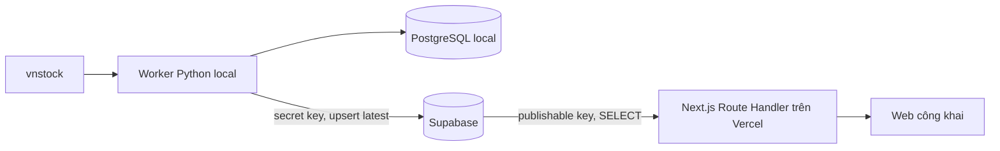
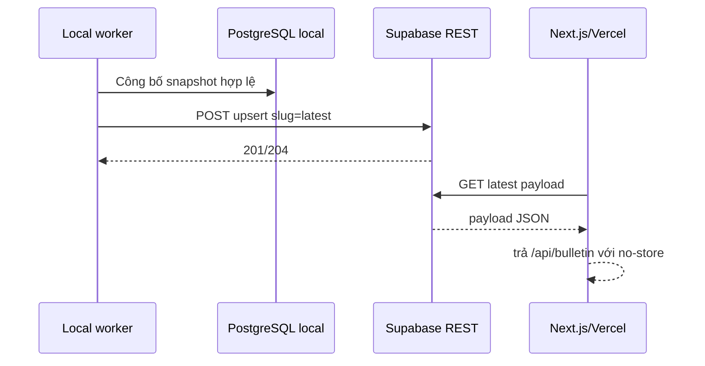

# Đồng bộ snapshot local lên Supabase cho Vercel - Kế hoạch triển khai

## Giai đoạn 0: Làm rõ đầu vào

- Mục tiêu: máy local tiếp tục lấy và tính dữ liệu bằng `vnstock`; sau mỗi lần cập nhật thành công, snapshot mới nhất được đưa lên Supabase để web Next.js trên Vercel phục vụ công khai.
- Codebase hiện có: Next.js 16, FastAPI/Python 3.12, PostgreSQL local, snapshot JSON đã có hợp đồng ổn định.
- Phạm vi: đồng bộ snapshot định lượng. Nội dung nhận định thủ công hiện vẫn lưu trong từng trình duyệt.
- Mức truy cập: mọi người được đọc snapshot; chỉ máy local giữ khóa bí mật và được ghi.
- Hiệu năng: một lần ghi sau mỗi phiên; nhiều lượt đọc, dữ liệu nhỏ, không cần realtime subscription.
- Giả định: người dùng sẽ tạo một Supabase project và cung cấp URL, publishable key, secret key qua biến môi trường; các giá trị này không được commit.

## Giai đoạn 1: Phân tích yêu cầu

### 1.1. Yêu cầu EARS

- **R1** — KHI local hoàn tất một snapshot hợp lệ, HỆ THỐNG PHẢI upsert snapshot đó vào đúng một bản ghi `latest` trên Supabase.
- **R2** — KHI Supabase tạm lỗi, HỆ THỐNG PHẢI giữ nguyên snapshot local và báo lỗi đồng bộ để có thể chạy lại mà không tải lại toàn bộ dữ liệu.
- **R3** — KHI chạy `publish-latest`, HỆ THỐNG PHẢI đọc snapshot đã công bố gần nhất từ PostgreSQL local và đồng bộ lại lên Supabase.
- **R4** — KHI Vercel có đủ cấu hình Supabase, HỆ THỐNG PHẢI đọc `payload` của bản ghi `latest` qua Supabase REST API.
- **R5** — KHI Vercel chưa có cấu hình Supabase, HỆ THỐNG PHẢI giữ đường đọc FastAPI hiện tại để local tiếp tục hoạt động.
- **R6** — KHI khách công khai truy cập Supabase, HỆ THỐNG PHẢI chỉ cho phép `SELECT`; `INSERT`, `UPDATE`, `DELETE` phải bị từ chối.
- **R7** — KHI máy local ghi dữ liệu, HỆ THỐNG PHẢI dùng Supabase secret key từ biến môi trường và không đưa khóa này vào bundle trình duyệt hoặc Git.
- **R8** — KHI không có bản ghi `latest` hoặc phản hồi sai cấu trúc, API Next.js PHẢI trả lỗi dữ liệu chưa sẵn sàng thay vì phát nội dung không hợp lệ.
- **R9** — KHI hai lần publish trùng nhau, HỆ THỐNG PHẢI cho kết quả idempotent bằng khóa chính cố định `latest`; bản hoàn tất sau cùng là bản được phục vụ.
- **R10** — KHI dữ liệu trên Supabase đã đổi, trang web PHẢI nhận bản mới ở chu kỳ tải lại hiện có tối đa 5 phút hoặc khi người dùng tải lại trang.

### 1.2. Kết quả nghiên cứu

- Supabase khuyến nghị bật RLS cho mọi bảng trong schema được API công khai, đồng thời cấu hình cả `GRANT` và policy; policy một mình không thu hồi quyền đã cấp sẵn.
- Publishable key ánh xạ tới vai trò `anon`; secret key ánh xạ tới `service_role` và bỏ qua RLS. Secret key chỉ được giữ ở thành phần tin cậy.
- Supabase đang chuyển từ tên khóa legacy `anon/service_role` sang `publishable/secret`; thiết kế dùng tên mới.
- Next.js trên Vercel có thể đọc biến môi trường server-side trong Route Handler. Không biến nào mang tiền tố `NEXT_PUBLIC_` trong thiết kế này.

Nguồn: [Supabase RLS](https://supabase.com/docs/guides/database/postgres/row-level-security), [Supabase API keys](https://supabase.com/docs/guides/getting-started/api-keys), [Vercel environment variables](https://vercel.com/docs/environment-variables).

### 1.3. Ràng buộc đơn giản

- Chỉ lưu snapshot mới nhất; chưa lưu lịch sử trên Supabase vì PostgreSQL local đã giữ lịch sử.
- Dùng REST API sẵn có và thư viện chuẩn Python; không thêm SDK Supabase hoặc dependency mới.
- Không chuyển pipeline tính toán lên cloud trong giai đoạn này.

## Giai đoạn 2: Đặc tả giải pháp

### 2.1. Kiến trúc đã chọn

### 2.2. Mô hình dữ liệu Supabase

`public.bulletin_publications`:

| Cột | Kiểu | Quy tắc |
|---|---|---|
| `slug` | `text` | khóa chính, chỉ dùng `latest` |
| `as_of_date` | `date` | bắt buộc, phục vụ kiểm tra vận hành |
| `generated_at` | `timestamptz` | bắt buộc, lấy từ payload |
| `payload` | `jsonb` | bắt buộc, toàn bộ `BulletinSnapshot` |
| `published_at` | `timestamptz` | mặc định `now()`, cập nhật khi upsert |

RLS được bật. `anon` và `authenticated` chỉ có `SELECT`; chỉ có policy đọc công khai. Quyền ghi của hai role này bị thu hồi. Máy local dùng secret key để upsert.

### 2.3. Hợp đồng cấu hình

| Nơi chạy | Biến | Mục đích |
|---|---|---|
| Local Python | `SUPABASE_URL` | URL project, ví dụ `https://<ref>.supabase.co` |
| Local Python | `SUPABASE_SECRET_KEY` | ghi snapshot; lưu trong `backend/.env.local` |
| Vercel | `SUPABASE_URL` | gọi REST API |
| Vercel | `SUPABASE_PUBLISHABLE_KEY` | chỉ đọc snapshot công khai |

### 2.4. So sánh phương án

| Phương án | Ưu điểm | Nhược điểm | Độ phức tạp | Bảo mật | Khuyến nghị |
|---|---|---|---|---|---|
| Một bảng JSONB qua Supabase REST | Ít code, không thêm dependency, hợp đồng snapshot giữ nguyên | Chỉ truy vấn cả snapshot | Thấp | Cao khi RLS/grant đúng | Chọn |
| Sao chép toàn bộ schema local sang Supabase | Truy vấn chi tiết, giữ lịch sử cloud | Nhiều bảng, migration và đồng bộ phức tạp | Cao | Trung bình | Không chọn lúc này |
| Supabase Storage lưu tệp JSON | Dễ ghi tệp | Cache/quyền object và atomic replace khó quản lý hơn | Trung bình | Trung bình | Không chọn |

### 2.5. Tình huống biên

| Tình huống | Điều kiện | Hành vi mong đợi | Truy vết |
|---|---|---|---|
| Chưa cấu hình Supabase local | Thiếu URL hoặc secret key | Bỏ qua cloud publish và local vẫn chạy; lệnh `publish-latest` báo cấu hình thiếu | R2, R3 |
| Chưa có bản ghi cloud | Bảng rỗng | Vercel trả `NO_SNAPSHOT`/503 | R8 |
| Supabase timeout | Không phản hồi trong giới hạn | Publish thất bại rõ ràng; snapshot local không đổi | R2 |
| Phản hồi cloud sai cấu trúc | Không có `payload` hợp lệ | Vercel từ chối và trả lỗi dữ liệu | R8 |
| Publish lặp lại | Cùng hoặc khác phiên | Upsert duy nhất theo `slug=latest` | R9 |
| Local tắt máy | Không có lượt publish mới | Web tiếp tục hiển thị snapshot cloud gần nhất | R1, R4 |
| Secret bị đặt nhầm ở Vercel/public | Cấu hình sai | Quy trình review chặn tên biến secret và scan bundle/Git | R7 |

### 2.6. Xử lý ngoại lệ

| Ngoại lệ | Nguồn | Xử lý | Ảnh hưởng | Phục hồi |
|---|---|---|---|---|
| `HTTPError` 401/403 | Khóa/quyền Supabase | Không log khóa; báo mã trạng thái | Cloud chưa cập nhật | Sửa key/RLS rồi chạy `publish-latest` |
| Timeout/mạng | REST API | Dừng publish trong thời gian hữu hạn | Giữ bản cloud cũ | Chạy lại `publish-latest` |
| Không có snapshot local | PostgreSQL local | Không gọi Supabase | Không có dữ liệu mới | Chạy `refresh` trước |
| JSON không hợp lệ | Payload | Chặn trước request | Không ghi cloud | Sửa dữ liệu nguồn rồi refresh |
| Supabase trả mảng rỗng | Next.js | Ánh xạ `NO_SNAPSHOT` | Web hiện dữ liệu chưa sẵn sàng | Publish snapshot đầu tiên |

### 2.7. Đồng thời và tính idempotent

| Tài nguyên | Kịch bản | Rủi ro | Cách giảm thiểu |
|---|---|---|---|
| Row `latest` | CLI và worker cùng publish | Ghi chồng | Atomic upsert theo khóa chính; snapshot hoàn tất sau cùng thắng |
| Snapshot local | Đang ingest trong lúc publish-latest | Đọc dữ liệu dở | Repository chỉ đọc snapshot thuộc run `SUCCEEDED` |
| Vercel cache | Đọc trong lúc upsert | Thấy bản cũ trong một request | Upsert một row nguyên tử; request kế tiếp nhận bản mới |

## Giai đoạn 3: Kế hoạch triển khai

Phân loại: **Adaptation**. Quy trình: kế hoạch → TDD Red → triển khai Green/Refactor → review.

### T1 — Khóa hợp đồng đồng bộ local

Mục tiêu: định nghĩa publisher REST idempotent và hành vi khi cấu hình thiếu/lỗi mạng.  
Files: `backend/tests/test_supabase_publisher.py`.  
Phụ thuộc: none.  
Song song an toàn: có.  
Thay đổi tối thiểu: test request URL/header/body, không lộ secret và lỗi có kiểm soát.  
Xác minh: `.venv\Scripts\python.exe -m pytest backend/tests/test_supabase_publisher.py -q`.  
Kết quả: Red vì module publisher chưa tồn tại.  
Hoàn tác: bỏ test mới trước khi có implementation.  
Truy vết: R1–R3, R7, R9.

### T2 — Khóa hợp đồng đọc Supabase trên Vercel

Mục tiêu: Next.js ưu tiên Supabase khi đủ cấu hình và giữ FastAPI làm đường local.  
Files: `tests/backend-bulletin.test.ts`.  
Phụ thuộc: none.  
Song song an toàn: có với T1.  
Thay đổi tối thiểu: thêm test URL/header, payload rỗng/sai và fallback cấu hình.  
Xác minh: `npm test -- tests/backend-bulletin.test.ts`.  
Kết quả: Red vì client chưa hỗ trợ Supabase.  
Hoàn tác: revert phần test mới.  
Truy vết: R4, R5, R8, R10.

### T3 — Tạo schema bảo mật Supabase

Mục tiêu: cung cấp SQL có thể chạy trong SQL Editor để tạo bảng, grant và RLS.  
Files: `supabase/migrations/202609240001_create_bulletin_publications.sql`.  
Phụ thuộc: T1, T2.  
Song song an toàn: có với T4 sau khi Red hoàn tất; không chung file.  
Thay đổi tối thiểu: một bảng, một policy SELECT, revoke quyền ghi.  
Xác minh: static SQL review và chạy trên Supabase project khi có thông tin project.  
Kết quả: `anon` đọc được; ghi bị từ chối; secret key upsert được.  
Hoàn tác: migration đảo chiều chỉ thực hiện khi người dùng yêu cầu xóa bảng.  
Truy vết: R6, R7, R9.

### T4 — Cài publisher và CLI local

Mục tiêu: `refresh` tự publish khi có cấu hình và `publish-latest` cho phép retry không tải lại vnstock.  
Files: `backend/app/config.py`, `backend/app/supabase_publisher.py`, `backend/app/cli.py`, `backend/.env.example`.  
Phụ thuộc: T1, T2.  
Song song an toàn: có với T3; không chung file.  
Thay đổi tối thiểu: dùng `urllib.request`, timeout từ config, không thêm dependency.  
Xác minh: Python test liên quan và `compileall`.  
Kết quả: T1 chuyển Green; local không cấu hình vẫn chạy như trước.  
Hoàn tác: bỏ publisher và khôi phục CLI/config.  
Truy vết: R1–R3, R7, R9.

### T5 — Cài reader Supabase cho Vercel

Mục tiêu: Route Handler đọc Supabase khi cấu hình mới tồn tại.  
Files: `lib/backend-bulletin.ts`, `.env.example`.  
Phụ thuộc: T3, T4.  
Song song an toàn: không; `.env.example` dùng chung với T4 nên thực hiện sau.  
Thay đổi tối thiểu: giữ public interface `getBackendBulletinSnapshot`; chọn provider theo cấu hình.  
Xác minh: test TypeScript, lint và Next build.  
Kết quả: T2 chuyển Green; không khóa nào xuất hiện trong response/client bundle.  
Hoàn tác: bỏ nhánh Supabase và dùng lại FastAPI.
Truy vết: R4, R5, R8, R10.

### T6 — Kiểm chứng tích hợp và hướng dẫn vận hành

Mục tiêu: chạy schema, publish snapshot thật, kiểm tra REST public và Vercel build; ghi đúng các biến cần nhập.  
Files: `docs/evidence/supabase-vercel-verification.md`, `README.md` hoặc hướng dẫn vận hành hiện có.  
Phụ thuộc: T5 và thông tin Supabase project.  
Song song an toàn: không.  
Thay đổi tối thiểu: chỉ tài liệu đúng với lệnh đã chạy.  
Xác minh: `publish-latest`, GET public, full Python/TypeScript tests, lint, build.  
Kết quả: snapshot phiên mới nhất đọc được qua API Vercel/local với `dataStatus.source=vnstock`.  
Hoàn tác: gỡ biến Supabase trên Vercel để quay về backend hiện tại.  
Truy vết: R1–R10.

### 3.1. Bản đồ phụ thuộc và wave

| ID task | Tên task | Phụ thuộc vào | Loại | Wave | Phạm vi file |
|---|---|---|---|---|---|
| T1 | Test publisher Python | none | Độc lập | 1 | `backend/tests/test_supabase_publisher.py` |
| T2 | Test reader Next.js | none | Độc lập | 1 | `tests/backend-bulletin.test.ts` |
| T3 | Schema/RLS Supabase | T1, T2 | Phụ thuộc | 2 | `supabase/migrations/...sql` |
| T4 | Publisher và CLI local | T1, T2 | Phụ thuộc | 2 | `backend/app/*`, `backend/.env.example` |
| T5 | Reader cho Vercel | T3, T4 | Phụ thuộc | 3 | `lib/backend-bulletin.ts`, `.env.example` |
| T6 | E2E và tài liệu | T5, credentials | Phụ thuộc | 4 | evidence/runbook |

- Wave 1: T1 và T2 có thể chạy song song, không chung file.
- Wave 2: T3 và T4 có thể chạy song song, không chung file.
- Wave 3: T5 tích hợp hợp đồng cloud với frontend.
- Wave 4: T6 chỉ chạy khi Supabase project đã sẵn sàng.

### 3.2. Ma trận truy vết

| Yêu cầu | Task | Bằng chứng |
|---|---|---|
| R1–R3 | T1, T4, T6 | test publisher + `publish-latest` thật |
| R4–R5 | T2, T5, T6 | test provider selection + API response |
| R6–R7 | T3, T6 | kiểm tra public SELECT và deny write; secret scan |
| R8 | T2, T5 | test empty/malformed response |
| R9 | T1, T3, T4 | hai upsert vẫn còn một row `latest` |
| R10 | T2, T5, T6 | API no-store và refresh UI hiện có |

### 3.3. Cổng nghiệm thu

- Test mới phải Red đúng nguyên nhân trước implementation và Green sau implementation.
- Secret key không được xuất hiện trong Git, response hoặc bundle trình duyệt.
- Full test Python/TypeScript, lint và Next build phải đạt.
- Chỉ coi tích hợp thật hoàn tất sau khi chạy SQL trên project Supabase và publish/read snapshot thật.
- Vercel deployment cần `SUPABASE_URL` và `SUPABASE_PUBLISHABLE_KEY`; local cần `SUPABASE_URL` và `SUPABASE_SECRET_KEY`.

