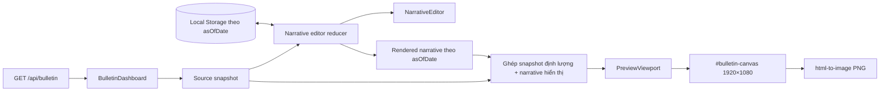
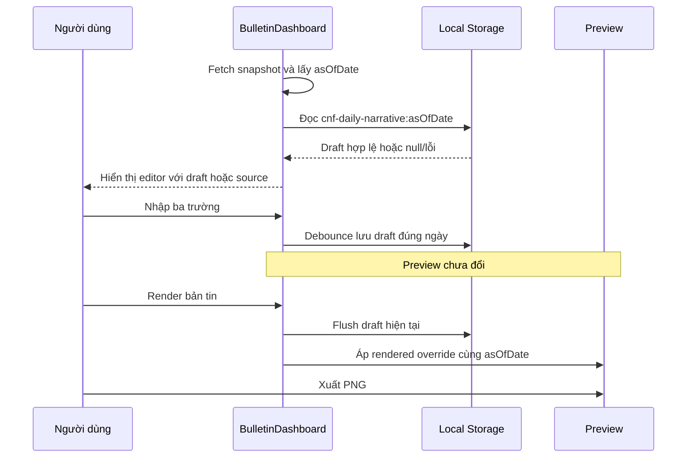

# Trình biên tập nhận định trực tiếp trên web - Kế hoạch triển khai

## Giai đoạn 0: Làm rõ đầu vào

### Bối cảnh đã được phê duyệt

- Ứng dụng hiện có dùng Next.js 16.3 App Router, React 19.2, TypeScript 6 và CSS thuần.
- `BulletinDashboard` đã là Client Component, tải `/api/bulletin` định kỳ và xuất riêng `#bulletin-canvas` thành PNG 1920×1080.
- `BulletinSnapshot.narrative` gồm ba trường `conclusion`, `action`, `footer`; khi nguồn không có narrative, canvas đang dùng nội dung mặc định.
- Người dùng đã phê duyệt giao diện editor trái, preview phải và cách lưu hoàn toàn trong trình duyệt.
- Ba trường được sửa: Kết luận, Hành động, Nhận định thị trường.
- Bản nháp lưu theo `asOfDate`, tự lưu khi nhập, chỉ thay preview sau khi nhấn **Render bản tin**.
- Nút **Khôi phục nội dung gốc** xóa bản nháp ngày hiện tại và quay về narrative nguồn hoặc fallback.
- Editor, dialog và toolbar phải nằm ngoài `#bulletin-canvas` để không xuất hiện trong PNG.

### Phạm vi thực hiện

Trong phạm vi:

- Mô hình trạng thái source → draft → rendered cho đúng ngày bản tin.
- Lớp đọc/ghi/xóa Local Storage có kiểm tra schema và bắt ngoại lệ.
- Component editor, xác nhận khôi phục và vùng trạng thái lưu/render.
- Component viewport scale preview theo container nhưng không đổi kích thước canvas logic.
- Tích hợp vào dashboard, chuẩn hóa fallback narrative và CSS responsive.
- Kiểm thử đơn vị cho state/storage, kiểm thử render tĩnh cho cấu trúc editor, build/lint/test và kiểm tra trình duyệt.

Ngoài phạm vi:

- Ghi ngược Google Sheets, database, đăng nhập, phân quyền hoặc đồng bộ nhiều thiết bị.
- Sửa dữ liệu định lượng, bộ lọc cổ phiếu, API `/api/bulletin` hoặc cache server.
- Nhập/xuất JSON, rich-text, lịch sử phiên bản, autosave lên server.
- Thêm dependency UI hoặc test DOM.

### Giả định và ràng buộc

- Local Storage là dữ liệu không nhạy cảm và chỉ có hiệu lực theo origin/trình duyệt hiện tại.
- Trình duyệt mục tiêu là phiên bản gần đây của Cốc Cốc/Chromium; vẫn có fallback khi storage, `ResizeObserver` hoặc `<dialog>` không khả dụng.
- Không dùng `dangerouslySetInnerHTML`; nội dung người dùng luôn đi qua text node của React.
- Không thay đổi `package.json`, `.env*` hoặc cấu hình triển khai.
- TDD áp dụng cho state machine, phân vùng ngày và storage. Các chi tiết layout/ResizeObserver được xác minh bằng build và kiểm tra trình duyệt vì dự án chưa có môi trường DOM test và kế hoạch không thêm dependency.

## Giai đoạn 1: Phân tích yêu cầu

### Yêu cầu EARS

| ID | Yêu cầu |
|---|---|
| R1 | KHI snapshot có `asOfDate`, HỆ THỐNG PHẢI nạp đúng bản nháp của ngày đó hoặc dùng narrative nguồn/fallback nếu không có bản nháp hợp lệ. |
| R2 | KHI người dùng sửa một trường, HỆ THỐNG PHẢI cập nhật draft và tự lưu theo đúng ngày nhưng KHÔNG ĐƯỢC thay nội dung preview trước khi Render. |
| R3 | KHI người dùng chọn Render, HỆ THỐNG PHẢI áp dụng đồng thời cả ba trường draft vào preview và lưu ngay draft hiện tại. |
| R4 | KHI người dùng xác nhận Khôi phục, HỆ THỐNG PHẢI xóa draft của đúng ngày hiện tại, trả form và preview về narrative nguồn/fallback, không ảnh hưởng ngày khác. |
| R5 | KHI ngày snapshot thay đổi, HỆ THỐNG PHẢI bỏ rendered override của ngày cũ và không được ghi draft cũ vào key ngày mới. |
| R6 | KHI API refresh cùng ngày, HỆ THỐNG PHẢI cập nhật dữ liệu định lượng mà không xóa nội dung draft hoặc rendered override đang dùng. |
| R7 | KHI Local Storage bị chặn, đầy quota hoặc ném ngoại lệ, HỆ THỐNG PHẢI giữ nội dung trong phiên, cho phép Render và hiển thị cảnh báo cụ thể. |
| R8 | KHI dữ liệu lưu bị hỏng, sai phiên bản, sai ngày hoặc sai schema, HỆ THỐNG PHẢI bỏ qua dữ liệu đó và dùng narrative nguồn/fallback an toàn. |
| R9 | KHI xuất PNG, HỆ THỐNG PHẢI chỉ chụp `#bulletin-canvas` ở 1920×1080; editor, dialog và toolbar không được xuất hiện. |
| R10 | KHI màn hình ở 320–1023 px, HỆ THỐNG PHẢI xếp editor và preview theo một cột; KHI đủ rộng, HỆ THỐNG PHẢI hiển thị editor trái và preview phải. |
| R11 | KHI dùng bàn phím hoặc công nghệ hỗ trợ, HỆ THỐNG PHẢI cung cấp label, focus-visible, live status, thao tác Enter/Space/Escape và Ctrl/Cmd+Enter cho Render. |
| R12 | KHI người dùng nhập chuỗi chứa HTML/script, HỆ THỐNG PHẢI hiển thị nó như văn bản và không thực thi markup. |

### User stories

- Là người vận hành bản tin, tôi muốn nhập ba phần nhận định ngay trên web để không phải sửa mã hoặc Google Sheets.
- Là người vận hành, tôi muốn draft tồn tại sau khi reload để không mất phần đang viết.
- Là người kiểm duyệt nội dung, tôi muốn preview chỉ đổi khi Render để có ranh giới rõ giữa bản nháp và bản xuất ảnh.
- Là người xuất bản, tôi muốn PNG chỉ chứa bản tin để có thể chia sẻ ngay.

### Nghiên cứu codebase

- `components/bulletin-dashboard.tsx` là nơi phù hợp để giữ trạng thái client, vì đã có `"use client"`, `useEffect`, refresh API và export.
- `components/bulletin-canvas.tsx` và `components/narrative-panel.tsx` đang chứa fallback riêng; cần dùng chung một hằng số để editor, preview và reset không lệch nội dung.
- `lib/types.ts` đã có `BulletinNarrative`; không cần mở rộng API contract.
- Vitest chạy môi trường Node và chỉ nhận `tests/**/*.test.ts`; có thể kiểm thử reducer/storage thuần và dùng `react-dom/server` để kiểm tra markup mà không thêm `jsdom`.
- CSS hiện cố định canvas 1920×1080 và chỉ scale ở dưới 1024 px; bố cục hai cột cần viewport đo container để preview vừa phần còn lại ở PC.

### Nghiên cứu tài liệu chính thức

- Next.js quy định Client Components là nơi dùng state, event handler, `useEffect` và browser-only API như `localStorage`; dashboard hiện đã đúng ranh giới này: https://nextjs.org/docs/app/getting-started/server-and-client-components
- Chỉ file tạo client boundary cần `"use client"`; các component được import phía dưới nằm trong client module graph, nên không cần lặp directive không cần thiết: https://nextjs.org/docs/app/api-reference/directives/use-client
- Web Storage lưu theo origin và thao tác đồng bộ; truy cập có thể không bền trong private browsing, vì vậy storage chỉ là tiện ích cục bộ và lỗi phải có fallback: https://developer.mozilla.org/en-US/docs/Web/API/Web_Storage_API
- `storage` event chỉ phát ở document khác cùng storage area; phiên bản đầu không đồng bộ nhiều tab để giữ KISS, và chấp nhận “lần ghi cuối thắng” sau reload: https://developer.mozilla.org/en-US/docs/Web/API/Window/storage_event

### Ràng buộc KISS/YAGNI

- Một reducer/state module nhỏ, một editor component và một preview viewport; không tạo context/global store.
- Không thêm validation schema library; kiểm tra payload bằng type guard thuần.
- Không thêm debounce/package; dùng `setTimeout` trình duyệt với thời gian trong config hiện có.
- Không thêm test framework; kiểm thử logic thuần bằng Vitest hiện có.
- Không tạo API ghi, queue, analytics, logging hoặc cơ chế đồng bộ chưa được yêu cầu.

### Yêu cầu phi chức năng

- Khả năng tiếp cận: hướng tới WCAG 2.1 AA theo `docs/ui-design/system_design.md`.
- Tương thích: Chromium/Cốc Cốc gần nhất; fallback hợp lý khi API trình duyệt thiếu.
- Hiệu năng: payload draft nhỏ, autosave debounce; không render lại canvas do mỗi phím gõ.
- Tin cậy: mọi override đều gắn `asOfDate`; không có đường dẫn áp nội dung ngày cũ sang ngày mới.

## Giai đoạn 2: Đặc tả giải pháp

### Kiến trúc tối giản



### Trách nhiệm module

| Module | Trách nhiệm | Không làm |
|---|---|---|
| `lib/narrative-editor-state.ts` | Fallback, reducer, so sánh narrative, key/payload Local Storage, safe read/write/remove | Không gọi React, API hoặc DOM layout |
| `components/narrative-editor.tsx` | Form ba textarea, status, Render, dialog Khôi phục, keyboard/a11y | Không fetch API, không trực tiếp sửa snapshot |
| `components/preview-viewport.tsx` | Đo container, scale canvas và giữ stage đúng chiều cao | Không thay kích thước logic canvas hoặc export |
| `components/bulletin-dashboard.tsx` | Điều phối API/source/draft/rendered, autosave, ghép preview snapshot và export | Không parse Google Sheets |
| `components/bulletin-canvas.tsx`, `narrative-panel.tsx` | Dùng fallback dùng chung và render narrative | Không biết Local Storage/editor |
| `app/globals.css` | Token semantic, shell/editor/dialog/viewport và responsive | Không chứa logic state |

### Hợp đồng dữ liệu

```ts
type NarrativeDraftPayload = {
  version: 1;
  asOfDate: string;
  narrative: BulletinNarrative;
  savedAt: string;
};

type RenderedNarrativeOverride = {
  asOfDate: string;
  narrative: BulletinNarrative;
} | null;

type StorageResult<T> =
  | { ok: true; value: T }
  | { ok: false; value: T; message: string };
```

- Key: `cnf-daily-narrative:${asOfDate}`.
- Payload có `version: 1` để dữ liệu sai schema được bỏ qua có kiểm soát.
- `asOfDate` trong payload phải trùng suffix của key.
- Ba trường cho phép chuỗi rỗng vì yêu cầu chưa quy định trường bắt buộc; React vẫn render text an toàn.
- `savedAt` chỉ phục vụ microcopy “Đã tự lưu lúc …”.

### Giao diện hàm dự kiến

```ts
export const DEFAULT_BULLETIN_NARRATIVE: BulletinNarrative;
export function narrativeStorageKey(asOfDate: string): string;
export function resolveSourceNarrative(source: BulletinNarrative | null): BulletinNarrative;
export function readNarrativeDraft(storage: Pick<Storage, "getItem">, asOfDate: string): StorageResult<NarrativeDraftPayload | null>;
export function writeNarrativeDraft(storage: Pick<Storage, "setItem">, payload: NarrativeDraftPayload): StorageResult<NarrativeDraftPayload>;
export function removeNarrativeDraft(storage: Pick<Storage, "removeItem">, asOfDate: string): StorageResult<null>;
export function narrativeEditorReducer(state: NarrativeEditorState, action: NarrativeEditorAction): NarrativeEditorState;
```

Tên cuối có thể rút gọn khi triển khai, nhưng contract phải giữ: date-scoped, không ném storage exception ra UI và reducer không có side effect.

### State transitions

| Sự kiện | Draft | Preview | Storage | Trạng thái UI |
|---|---|---|---|---|
| Snapshot ngày mới | Draft đúng ngày nếu hợp lệ, nếu không source/fallback | Source/fallback ngày mới | Chỉ đọc key ngày mới | `ready` hoặc cảnh báo đọc |
| Nhập textarea | Cập nhật ngay | Giữ nguyên | Debounce ghi đúng key | `saving` → `saved`; đồng thời `unrendered` |
| Render | Giữ nguyên | Copy cả ba trường vào override cùng ngày | Flush ghi ngay | `rendered` |
| Khôi phục đã xác nhận | Source/fallback | Source/fallback | Xóa đúng key | `reset-success` |
| Refresh cùng ngày | Giữ draft/override cục bộ | Định lượng mới + narrative override hiện tại | Không đọc/ghi lại ngoài autosave | Không nhấp nháy form |
| Storage lỗi | Giữ draft trong memory | Vẫn Render được | Không retry vòng lặp | Cảnh báo cụ thể |

### Luồng chính



### Phân tích đánh đổi

| Phương án | Ưu điểm | Nhược điểm | Độ phức tạp | An toàn/tin cậy | Khuyến nghị |
|---|---|---|---|---|---|
| Local Storage + reducer date-scoped | Không credential, reload còn draft, kiểm thử logic thuần, đúng yêu cầu | Không đồng bộ thiết bị, có thể bị xóa/chặn | Thấp | Cao trong phạm vi một origin | **Chọn** |
| State React không lưu | Tối giản nhất | Reload mất toàn bộ nội dung | Rất thấp | Thấp | Không chọn |
| Session Storage | Không lan sang phiên sau | Đóng tab mất draft | Thấp | Trung bình | Không chọn |
| IndexedDB | Dung lượng và transaction tốt | Quá mức cần thiết cho ba chuỗi nhỏ | Trung bình | Cao | Không chọn |
| Ghi Google Sheets qua backend | Đồng bộ thiết bị | Cần auth, API ghi, bảo mật và quyền Google | Cao | Chưa đủ điều kiện | Ngoài phạm vi |
| Thêm `jsdom` + Testing Library | Test tương tác DOM tốt hơn | Thay dependency, tăng cấu hình và phạm vi | Trung bình | Cao | Không chọn ở phiên bản đầu |

### Trường hợp biên

| Trường hợp | Điều kiện kích hoạt | Hành vi mong đợi | Ảnh hưởng nếu bỏ qua | Truy vết |
|---|---|---|---|---|
| Chưa có snapshot | API đang tải/lỗi | Editor disabled, không chạm storage, preview giữ trạng thái chờ | Ghi key rỗng/sai ngày | R1, R7 |
| Không có narrative nguồn | `snapshot.narrative=null` | Form/preview dùng fallback dùng chung | Editor và canvas khác nội dung | R1 |
| Draft JSON hỏng | `JSON.parse` lỗi | Bỏ qua, cảnh báo và dùng source/fallback | Trang crash | R8 |
| Draft sai version/schema | Payload thiếu trường/sai kiểu | Bỏ qua như draft không hợp lệ | Dữ liệu cũ phá UI | R8 |
| Draft sai ngày | Payload date khác key/snapshot | Không dùng | Nhận định sai phiên | R5, R8 |
| Storage bị chặn/quota | `getItem/setItem/removeItem` ném | Giữ memory, vẫn Render; cảnh báo | Mất toàn bộ chức năng editor | R7 |
| Đổi ngày khi debounce đang chờ | API trả `asOfDate` mới | Hủy timer/guard bằng loaded date; không ghi draft cũ vào key mới | Nhiễm dữ liệu giữa ngày | R5 |
| Refresh cùng ngày khi đang gõ | Polling 5 phút | Không reset draft/override; chỉ cập nhật định lượng | Mất nội dung đang viết | R6 |
| Render trước khi debounce chạy | Người dùng gõ rồi nhấn Render ngay | Flush draft hiện tại rồi áp preview | Reload có thể mất ký tự cuối | R3 |
| Reset khi source null | Không có `Web_Bulletin` | Form/preview về fallback | Form rỗng hoặc không nhất quán | R4 |
| Hai tab cùng origin | Cùng ngày được sửa ở hai tab | Không live-sync; lần ghi cuối thắng sau reload, mỗi tab giữ memory riêng | Hành vi khó đoán | R2; giới hạn đã chấp nhận |
| HTML/script trong textarea | Chuỗi `<script>…` | Render như text; không dùng HTML injection | XSS | R12 |
| Nội dung quá dài | Vượt không gian panel cố định | Canvas tiếp tục overflow-hidden hiện có; kiểm tra preview trước export; không tự cắt dữ liệu draft | Chữ có thể bị cắt trong PNG | R3, R9 |
| `ResizeObserver` thiếu | Trình duyệt quá cũ | Fallback scale an toàn/scroll, export vẫn 1920×1080 | Preview không vừa màn hình | R9, R10 |

### Xử lý ngoại lệ

| Ngoại lệ | Nguồn | Phân loại | Chiến lược | Ảnh hưởng người dùng | Khôi phục |
|---|---|---|---|---|---|
| API snapshot lỗi | `/api/bulletin` | Có thể khôi phục | Giữ flow hiện tại, hiển thị lỗi, refresh sau | Editor disabled khi chưa có ngày | Thử lại/đợi polling |
| `SecurityError` | Local Storage access | Có thể khôi phục trong phiên | Catch tại adapter, không throw | Không lưu qua reload | Cho Render trong memory |
| `QuotaExceededError` | `setItem` | Có thể khôi phục trong phiên | Catch, báo không thể lưu | Draft vẫn ở tab hiện tại | Xóa bớt site data/thử lại |
| JSON/schema invalid | Draft cũ/hỏng | Không cần retry | Bỏ qua payload | Dùng source/fallback | Reset/ghi draft mới |
| `removeItem` lỗi | Reset | Có thể khôi phục | Không giả báo thành công; giữ form hiện tại | Chưa reset được draft bền vững | Người dùng thử lại |
| `toPng` lỗi | Export | Có thể khôi phục | Giữ handling hiện có | Không tải ảnh | Thử lại |
| `ResizeObserver` lỗi/thiếu | Preview | Có fallback | Dùng scale 1 hoặc resize window fallback | Có thể cần cuộn | Export không ảnh hưởng |

### Race conditions và concurrency

| Tài nguyên dùng chung | Kịch bản đồng thời | Rủi ro | Giảm thiểu | Idempotency |
|---|---|---|---|---|
| `snapshot.asOfDate` và timer autosave | Ngày đổi trước khi timer cũ chạy | Draft cũ ghi sang key mới | Capture ngày lúc schedule + kiểm tra `loadedDate === snapshot.asOfDate`; cleanup timer | Ghi cùng payload/key là idempotent |
| Draft và Render | Click Render ngay sau input | Preview mới nhưng storage còn bản cũ | Render flush đồng bộ payload state hiện tại trước khi set override | Render lặp cho cùng draft cho cùng kết quả |
| API refresh và local override | Polling cùng lúc người dùng gõ | Reset editor hoặc mất override | Reducer phân biệt refresh cùng ngày và load ngày mới | Refresh cùng snapshot không đổi local state |
| Hai tab Local Storage | Cùng key bị ghi từ hai tab | Last-write-wins | Chấp nhận trong v1, không `storage` event/BroadcastChannel; mô tả giới hạn | Mỗi `setItem` thay toàn payload atomically |
| Export và refresh | Snapshot cập nhật khi `toPng` bắt đầu | Ảnh có DOM tại thời điểm capture | Disable click lặp; dùng DOM canvas hiện tại, không thay source trong export callback | Mỗi click tạo một file độc lập |

### Bảo mật và quyền riêng tư

- Không lưu token, credential hoặc dữ liệu cá nhân; chỉ ba đoạn nhận định thị trường.
- React text rendering tự escape; cấm `dangerouslySetInnerHTML`.
- Local Storage cùng origin có thể được script cùng origin đọc; vì nội dung không nhạy cảm, rủi ro chấp nhận được.
- Không mở API ghi công khai nên không phát sinh auth/CSRF mới.

## Giai đoạn 3: Kế hoạch triển khai

### Phân loại và workflow

- Loại: `Add Feature`.
- Pipeline: phức tạp có UI — `03-brainstorm → 04-ui-design → 05-plan → approval → 09-test (Red) → 06-implement (Green + Refactor) → 10-review`.
- Workflow Add Feature sáu pha: Phân tích và lập kế hoạch → Thiết lập cấu trúc → Triển khai lõi → Tích hợp → Tối ưu và xác minh → Tài liệu và hoàn tất.
- TDD: bắt buộc cho reducer, date scoping, storage và contract markup; visual/browser wiring dùng build + kiểm tra thủ công do không thêm DOM test dependency.

### Pha 1 — Phân tích và lập kế hoạch

#### T1.1 — Chốt baseline và phạm vi thay đổi

- **ID**: T1.1
- **Mục tiêu**: Ghi nhận build/test hiện tại và đảm bảo không sửa API, filter hoặc dependency.
- **Files**: chỉ đọc `components/`, `lib/`, `config/`, `tests/`, `package.json`.
- **Phụ thuộc**: không có.
- **Song song an toàn**: không; đây là cổng mở đầu.
- **Thay đổi tối thiểu**: không sửa file.
- **Xác minh**: `npm.cmd run test`; `npm.cmd run build`.
- **Kết quả mong đợi**: baseline PASS; lỗi có sẵn nếu có được ghi riêng, không quy cho feature.
- **Rollback**: không cần vì chỉ đọc/chạy kiểm tra.
- **Truy vết**: R1–R12.

### Pha 2 — Thiết lập cấu trúc

#### T2.1 — Viết kiểm thử đỏ cho state và Local Storage

- **ID**: T2.1
- **Mục tiêu**: Mô tả bằng test các contract fallback, load draft, edit không đổi preview, Render, Reset, đổi ngày và storage exception.
- **Files**: tạo `tests/narrative-editor-state.test.ts`.
- **Phụ thuộc**: T1.1.
- **Song song an toàn**: không; production helper phải chờ Red.
- **Thay đổi tối thiểu**: dùng mock `Storage` nhỏ bằng `Map`; không thêm package.
- **Xác minh**: `npm.cmd run test -- narrative-editor-state`.
- **Kết quả mong đợi**: FAIL đúng lý do module/hành vi chưa tồn tại; không fail vì cấu hình test.
- **Rollback**: giữ test đỏ làm contract; không xóa hoặc giảm assertion.
- **Truy vết**: R1–R8, R12.

### Pha 3 — Triển khai lõi

#### T3.1 — Cài đặt state machine và adapter storage

- **ID**: T3.1
- **Mục tiêu**: Làm test T2.1 chuyển xanh bằng module thuần, date-scoped và không ném ngoại lệ.
- **Files**: tạo `lib/narrative-editor-state.ts`.
- **Phụ thuộc**: T2.1.
- **Song song an toàn**: không; là Green của test đỏ T2.1.
- **Thay đổi tối thiểu**: hằng fallback, type guard payload v1, read/write/remove result, reducer không side effect.
- **Xác minh**: `npm.cmd run test -- narrative-editor-state`.
- **Kết quả mong đợi**: toàn bộ test state/storage PASS.
- **Rollback**: hoàn nguyên module; test trở lại Red để phản ánh feature chưa có.
- **Truy vết**: R1–R8, R12.

#### T3.2 — Viết kiểm thử đỏ cho contract editor và viewport

- **ID**: T3.2
- **Mục tiêu**: Chốt ba label/textarea, nút, live region, dialog và wrapper preview bằng render tĩnh React.
- **Files**: tạo `tests/narrative-editor.test.ts`.
- **Phụ thuộc**: T3.1.
- **Song song an toàn**: không; component phải chờ Red.
- **Thay đổi tối thiểu**: dùng `react-dom/server`; không cần DOM environment.
- **Xác minh**: `npm.cmd run test -- narrative-editor`.
- **Kết quả mong đợi**: FAIL vì component chưa tồn tại hoặc thiếu contract markup dự kiến.
- **Rollback**: giữ test contract; không thay dependency.
- **Truy vết**: R9–R12.

#### T3.3 — Tạo editor và preview viewport

- **ID**: T3.3
- **Mục tiêu**: Làm test T3.2 xanh với component có props rõ ràng và browser fallback.
- **Files**: tạo `components/narrative-editor.tsx`, `components/preview-viewport.tsx`.
- **Phụ thuộc**: T3.2.
- **Song song an toàn**: không; cả hai cùng được bao bởi contract markup và sẽ dùng chung integration kế tiếp.
- **Thay đổi tối thiểu**: form controlled, `<dialog>`/fallback confirm, `ResizeObserver` scale, không fetch/storage trực tiếp ngoài callback được truyền.
- **Xác minh**: `npm.cmd run test -- narrative-editor`; `npm.cmd run build`.
- **Kết quả mong đợi**: test markup PASS, TypeScript/build PASS.
- **Rollback**: hoàn nguyên hai component, giữ test đỏ.
- **Truy vết**: R9–R12.

### Pha 4 — Tích hợp

#### T4.1 — Kết nối editor, autosave, preview và export boundary

- **ID**: T4.1
- **Mục tiêu**: Điều phối source/draft/rendered theo ngày trong dashboard, dùng fallback chung và giữ export chỉ canvas.
- **Files**: sửa `components/bulletin-dashboard.tsx`, `components/bulletin-canvas.tsx`, `components/narrative-panel.tsx`, `config/filters.ts`.
- **Phụ thuộc**: T3.3.
- **Song song an toàn**: không; các file cùng một state flow và config kích thước/debounce.
- **Thay đổi tối thiểu**: thêm `canvasWidth`, `canvasHeight`, `narrativeAutosaveDelayMs` vào config; reducer + effect storage có date guard; merge narrative override theo date; import fallback chung.
- **Xác minh**: `npm.cmd run test`; `npm.cmd run build`.
- **Kết quả mong đợi**: test PASS; build không có lỗi hydration/type; editor không nằm trong `#bulletin-canvas` theo markup.
- **Rollback**: hoàn nguyên integration/config, component/helper có thể giữ cô lập cho vòng sửa tiếp theo.
- **Truy vết**: R1–R9, R12.

#### T4.2 — Áp dụng shell và responsive theo thiết kế đã duyệt

- **ID**: T4.2
- **Mục tiêu**: Hoàn thiện editor trái/preview phải trên PC và xếp dọc trên Tablet/Mobile.
- **Files**: sửa `app/globals.css`.
- **Phụ thuộc**: T4.1.
- **Song song an toàn**: không; cần markup integration ổn định trước khi viết selector.
- **Thay đổi tối thiểu**: mở rộng token semantic hiện có; style editor/form/status/dialog/viewport; breakpoint 1280 và 1024/640; touch target ≥44 px; reduced motion.
- **Xác minh**: `npm.cmd run build`; kiểm tra viewport 320, 360, 768, 1024, 1280, 1440, 1920 px.
- **Kết quả mong đợi**: không tràn ngang, preview đúng tỷ lệ, editor không che toolbar/canvas.
- **Rollback**: hoàn nguyên block CSS feature; markup vẫn hoạt động không style.
- **Truy vết**: R9–R11.

### Pha 5 — Tối ưu và xác minh

#### T5.1 — Xác minh browser flow và PNG

- **ID**: T5.1
- **Mục tiêu**: Chứng minh symptom-level toàn bộ luồng người dùng trên bản chạy thật.
- **Files**: không sửa production trừ khi quay lại đúng task gây lỗi.
- **Phụ thuộc**: T4.2.
- **Song song an toàn**: không; cần bản tích hợp hoàn chỉnh.
- **Thay đổi tối thiểu**: không có.
- **Xác minh**: chạy `npm.cmd run dev`; trong Cốc Cốc nhập ba trường → reload → kiểm tra draft → Render → reset → export PNG; kiểm tra editor không có trong ảnh; mô phỏng storage lỗi bằng adapter test.
- **Kết quả mong đợi**: autosave đúng ngày, draft không tự đổi preview, Render/Reset đúng, PNG 1920×1080 sạch.
- **Rollback**: nếu fail, quay lại task sở hữu behavior; không xếp chồng patch chưa xác minh.
- **Truy vết**: R1–R12.

#### T5.2 — Chạy verification đầy đủ

- **ID**: T5.2
- **Mục tiêu**: Đảm bảo feature không gây hồi quy compile, lint và test.
- **Files**: không sửa source; khôi phục `next-env.d.ts` nếu Next build chỉ thay đường dẫn generated types.
- **Phụ thuộc**: T5.1.
- **Song song an toàn**: không; các lệnh dùng chung build artifacts.
- **Thay đổi tối thiểu**: không có.
- **Xác minh**: `npm.cmd run build`; `npm.cmd run lint`; `npm.cmd run test`; `git diff --check`.
- **Kết quả mong đợi**: tất cả PASS, không có whitespace error hoặc file ngoài scope.
- **Rollback**: nếu fail, áp dụng retry policy theo skill đang sở hữu lỗi.
- **Truy vết**: R1–R12.

### Pha 6 — Tài liệu và hoàn tất

#### T6.1 — Review độc lập và bàn giao

- **ID**: T6.1
- **Mục tiêu**: Rà soát diff về đúng yêu cầu, race ngày, storage exception, a11y, export boundary và scope.
- **Files**: chỉ đọc toàn bộ diff; cập nhật execution log qua orchestrator.
- **Phụ thuộc**: T5.2.
- **Song song an toàn**: không; review là cổng cuối.
- **Thay đổi tối thiểu**: `10-review` không sửa code; nếu FAIL, mở bug pipeline tương ứng.
- **Xác minh**: `git status --short`; `git diff --check`; review theo R1–R12 và `docs/ui-design/system_design.md`.
- **Kết quả mong đợi**: verdict PASS, không có finding mức blocking/high.
- **Rollback**: nếu review FAIL, không công bố hoàn tất; route về test/fix theo orchestrator.
- **Truy vết**: R1–R12.

### Bản đồ phụ thuộc và song song

| ID task | Tên task | Phụ thuộc vào | Loại | Wave | Phạm vi file |
|---|---|---|---|---:|---|
| T1.1 | Chốt baseline | Không có | Độc lập | 1 | Chỉ đọc |
| T2.1 | Test đỏ state/storage | T1.1 | Phụ thuộc | 2 | `tests/narrative-editor-state.test.ts` |
| T3.1 | State machine/storage Green | T2.1 | Phụ thuộc | 3 | `lib/narrative-editor-state.ts` |
| T3.2 | Test đỏ editor/viewport | T3.1 | Phụ thuộc | 4 | `tests/narrative-editor.test.ts` |
| T3.3 | Editor + viewport Green | T3.2 | Phụ thuộc | 5 | `components/narrative-editor.tsx`, `components/preview-viewport.tsx` |
| T4.1 | Tích hợp dashboard/canvas | T3.3 | Phụ thuộc | 6 | dashboard, canvas, narrative panel, config |
| T4.2 | CSS responsive | T4.1 | Phụ thuộc | 7 | `app/globals.css` |
| T5.1 | Browser/PNG proof | T4.2 | Phụ thuộc | 8 | Không ghi source |
| T5.2 | Verification đầy đủ | T5.1 | Phụ thuộc | 9 | Không ghi source |
| T6.1 | Review và bàn giao | T5.2 | Phụ thuộc | 10 | Chỉ đọc diff |

- Wave 1–10 chạy tuần tự. Không có task cùng wave vì các bước tạo thành chuỗi TDD và integration dùng chung state/markup/CSS; chạy song song sẽ phá ranh giới Red → Green hoặc tạo xung đột file.
- Một task tương ứng một skill-run; không gộp hai task độc lập.

### Ma trận truy vết

| Yêu cầu | Task triển khai | Xác minh chính |
|---|---|---|
| R1 | T2.1, T3.1, T4.1 | Test initial state/draft/source |
| R2 | T2.1, T3.1, T4.1 | Test edit không đổi rendered + browser flow |
| R3 | T2.1, T3.1, T4.1, T5.1 | Test Render + flush và preview thật |
| R4 | T2.1, T3.1, T3.3, T4.1, T5.1 | Test remove/reset + dialog/browser |
| R5 | T2.1, T3.1, T4.1 | Test chuyển ngày và date guard |
| R6 | T2.1, T3.1, T4.1 | Test refresh cùng ngày, full suite |
| R7 | T2.1, T3.1, T4.1, T5.1 | Mock Storage ném + browser warning |
| R8 | T2.1, T3.1 | Test malformed/version/date/schema |
| R9 | T3.2, T3.3, T4.1, T4.2, T5.1 | Static markup + PNG dimensions/boundary |
| R10 | T3.3, T4.2, T5.1 | Viewport matrix |
| R11 | T3.2, T3.3, T4.2, T5.1 | Markup/a11y + keyboard walk-through |
| R12 | T2.1, T3.1, T3.2, T5.1 | String render test, không HTML injection |

### Tiêu chí hoàn tất

- [ ] Red được chứng minh cho state/storage và markup trước Green tương ứng.
- [ ] Draft phân vùng tuyệt đối theo `asOfDate`; đổi ngày không có flash/ghi nhầm override.
- [ ] Tự lưu không làm preview đổi; Render và Reset đúng contract.
- [ ] Storage lỗi không làm mất khả năng nhập/Render trong phiên.
- [ ] Editor/toolbar/dialog ngoài `#bulletin-canvas`; PNG đúng 1920×1080.
- [ ] PC/Tablet/Mobile bám `docs/ui-design/system_design.md`.
- [ ] Build, lint, toàn bộ test và `git diff --check` PASS.
- [ ] Review cuối PASS; không sửa dependency, API, Google Sheets, `.env` hoặc filter.

## Kiểm tra tính hoàn chỉnh của kế hoạch

- PASS — đủ bốn giai đoạn của `05-plan`, yêu cầu EARS, nghiên cứu codebase và tài liệu chính thức.
- PASS — có kiến trúc, data contract, state transitions, sequence diagram và phân tích bảo mật.
- PASS — có bảng đánh đổi, edge cases, ngoại lệ, race conditions và truy vết R1–R12.
- PASS — workflow Add Feature đủ sáu pha, mọi task có file scope, dependency, lệnh verify, expected output và rollback.
- PASS — dependency map không có cycle hoặc collision trong cùng wave.
- PASS — KISS/YAGNI: không thêm package, backend, auth, store toàn cục hoặc tính năng ngoài phạm vi.

## Verification Report

- Build: SKIPPED — `05-plan` chỉ tạo tài liệu; baseline build gần nhất đã PASS ở pha UI design.
- Lint: SKIPPED (Tier 1) — không sửa source code.
- Tests: SKIPPED (Tier 1) — không sửa source code.
- Regression: SKIPPED (Tier 1) — được lập kế hoạch ở T5.2.
- Proof-of-fix (symptom-level): SKIPPED (Tier 1) — feature chưa được triển khai.
- Benchmark: N/A.
- Tier applied: 1.
- Verdict: VERIFIED.
