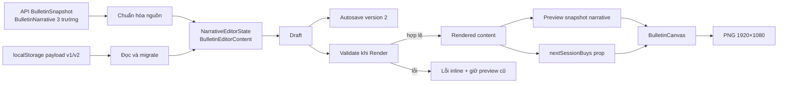
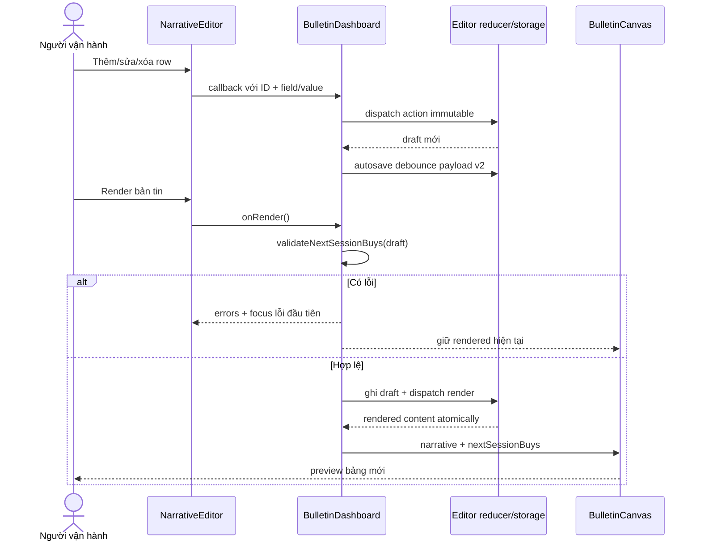

# Bảng cổ phiếu xuất hiện điểm mua cho phiên tới — Kế hoạch triển khai

- **Loại kế hoạch**: Add Feature
- **Ngày lập**: 11/08/2026
- **Đặc tả đầu vào**: `docs/spec/spec_add_feature_next-session-buy-table_20260811.md`
- **Thiết kế UI đầu vào**: `docs/ui-design/system_design.md`, mục 14
- **Nền tảng**: Next.js 16.3 App Router, React 19.2, TypeScript 6, CSS toàn cục, Vitest 4
- **Phạm vi bảo mật**: Ứng dụng nội bộ, dữ liệu thủ công chỉ lưu trong trình duyệt
- **Mức độ phức tạp**: Complex — thay đổi xuyên kiểu dữ liệu client, storage migration, reducer, editor, canvas, CSS và test
- **Chiến lược**: TDD Red → Green → Refactor; không thêm dependency

## Giai đoạn 0: Làm rõ đầu vào

### 0.1 Bối cảnh đã xác nhận

Ứng dụng hiện lấy dữ liệu định lượng và nội dung nhận định đã xuất bản từ API/Google Sheets. Người vận hành có thể chỉnh Kết luận, Hành động và Nhận định thị trường trong `NarrativeEditor`; bản nháp được lưu theo `asOfDate` trong `localStorage`, còn canvas chỉ thay đổi sau thao tác Render.

Tính năng mới bổ sung một danh sách thủ công tối đa 4 mục. Mỗi mục gồm Mã cổ phiếu và Vùng mua. Trình nhập phải giống kiểu danh sách “Nhóm ngành” của BCCL: khởi tạo rỗng, thêm từng dòng, xóa từng dòng. Danh sách đã Render thay thế `FooterFinancialArtwork` tại góc phải dưới của canvas.

### 0.2 Quyết định đã được phê duyệt

- Trạng thái ban đầu không có dòng.
- Mỗi dòng có `Mã cổ phiếu`, `Vùng mua`, `Xóa`.
- Nút `Thêm dòng` tạo dòng mới; tối đa 4 dòng.
- Canvas hiển thị bảng hai cột `MÃ CP` và `VÙNG MUA`.
- Dữ liệu đi cùng vòng đời tự lưu/Render/Khôi phục của phần nhận định.
- Không đọc/ghi danh sách này từ Google Sheets.
- Không tự động tính điểm mua và không thay đổi bộ lọc cổ phiếu.

### 0.3 Giả định triển khai không làm đổi sản phẩm

- `Mã cổ phiếu` được trim và chuyển uppercase trong state.
- `Vùng mua` là chuỗi tự do, chỉ trim đầu/cuối; ví dụ `145–150`, không ép kiểu số.
- Để bảo vệ layout, ticker giới hạn 12 ký tự và vùng mua 32 ký tự ở UI; không áp đặt regex nghiệp vụ.
- Bản nháp đang nhập dở vẫn được tự lưu; validation chỉ chặn Render, không chặn autosave.
- Khi xóa dòng, không mở dialog xác nhận vì dữ liệu nhỏ và có thể thêm lại.
- Nhiều tab cùng sửa một ngày tiếp tục theo quy tắc “lần ghi cuối thắng”; đồng bộ thời gian thực ngoài phạm vi.

### 0.4 Phạm vi file dự kiến

Production:

- `lib/types.ts`
- `lib/narrative-editor-state.ts`
- `components/narrative-editor.tsx`
- `components/bulletin-dashboard.tsx`
- `components/bulletin-canvas.tsx`
- `components/next-session-buy-table.tsx` — file mới
- `components/bulletin-artwork.tsx`
- `app/globals.css`

Test:

- `tests/narrative-editor-state.test.ts`
- `tests/narrative-editor.test.ts`
- `tests/bulletin-artwork.test.ts`

Tài liệu/quy trình:

- `docs/harness-logs/add_feature_next_session_buy_table_20260811_170603.md`
- `docs/harness-state/add_feature_next_session_buy_table_20260811_170603.json`

Không sửa:

- `lib/bulletin-service.ts`, `config/sheet-mapping.ts`, API route và hợp đồng Google Sheets.
- `config/filters.ts` và logic hai bộ lọc cổ phiếu.
- `package.json`, trừ khi phát hiện framework kiểm thử hiện tại không thể kiểm tra yêu cầu cốt lõi; kế hoạch mặc định không thêm dependency.

## Giai đoạn 1: Phân tích yêu cầu

### 1.1 Kết quả nghiên cứu codebase

| Khu vực | Hiện trạng | Hệ quả cho kế hoạch |
|---|---|---|
| `BulletinNarrative` | Hợp đồng API gồm 3 chuỗi `conclusion`, `action`, `footer` | Không thêm danh sách thủ công vào hợp đồng server/API |
| `NarrativeEditorState` | `source`, `draft`, `rendered`; equality hiện so sánh 3 chuỗi | Tạo nội dung biên tập client riêng và equality sâu cho danh sách |
| Storage | Payload version 1, key `cnf-daily-narrative:${asOfDate}` | Nâng version 2 nhưng giữ key; đọc và chuyển đổi payload v1 |
| Autosave | Debounce 350 ms; lỗi storage trả kết quả recoverable | Giữ cơ chế; bản nháp không hợp lệ vẫn được lưu |
| Render | Copy toàn bộ draft sang rendered atomically | Validation trước dispatch Render; nếu lỗi giữ rendered gần nhất |
| Refresh API | Cùng ngày giữ local work, ngày mới load state mới | Danh sách thủ công phải tuân cùng quy tắc |
| Canvas | `BulletinCanvas` nhận `snapshot`; footer render artwork SVG | Truyền danh sách đã Render bằng prop riêng, không đổi API snapshot |
| Export PNG | Chụp `#bulletin-canvas` bằng `html-to-image` | Bảng phải nằm trong canvas, không dùng asset ngoài/animation |
| Test | Vitest môi trường Node + `renderToStaticMarkup`; chưa có Testing Library | Kiểm thử reducer/validation thuần và markup tĩnh; thao tác focus kiểm thử thủ công |
| Artwork | `FooterFinancialArtwork` chỉ được dùng ở canvas và test artwork | Có thể xóa export, hằng dữ liệu footer và thay test bằng bảng mới |

### 1.2 Nghiên cứu tài liệu Next.js cục bộ

- `node_modules/next/dist/docs/01-app/01-getting-started/05-server-and-client-components.md`: state, event handler và `localStorage` thuộc Client Component; `NarrativeEditor`/`BulletinDashboard` đã có đúng ranh giới `"use client"`.
- `node_modules/next/dist/docs/01-app/02-guides/testing/vitest.md`: Vitest phù hợp cho unit test component đồng bộ; dự án hiện đã cấu hình Vitest và không cần thay framework.
- `node_modules/next/dist/docs/01-app/01-getting-started/11-css.md`: dự án đang dùng Global CSS được import tại root; mở rộng `app/globals.css` phù hợp với convention hiện tại, nhưng phải giữ selector có namespace rõ để tránh xung đột.

Không cần nghiên cứu web bên ngoài: tính năng không thêm dependency, không giao tiếp mạng mới, không xử lý secret và không thay đổi API. Tài liệu chính thức đi kèm đúng phiên bản Next.js trong `node_modules` là nguồn ưu tiên.

### 1.3 Baseline kỹ thuật

| Kiểm tra | Lệnh | Kết quả ngày 11/08/2026 |
|---|---|---|
| Unit tests | `npm.cmd test` | PASS — 10 files, 40 tests |
| Lint | `npm.cmd run lint` | PASS |
| Cảnh báo | Vitest/Vite config loader | Không chặn; ngoài phạm vi tính năng |

### 1.4 Yêu cầu EARS

| ID | Yêu cầu |
|---|---|
| R1 | KHI không có bản nháp danh sách cho ngày hiện tại HỆ THỐNG PHẢI khởi tạo danh sách điểm mua rỗng. |
| R2 | KHI người dùng bấm `Thêm dòng` và danh sách có dưới 4 mục HỆ THỐNG PHẢI thêm đúng một dòng rỗng ở cuối danh sách và đưa focus vào trường Mã cổ phiếu mới. |
| R3 | KHI danh sách đã có 4 mục HỆ THỐNG PHẢI không thêm mục thứ 5, vô hiệu hóa nút `Thêm dòng` và hiển thị thông báo giới hạn bằng chữ. |
| R4 | KHI người dùng nhập Mã cổ phiếu HỆ THỐNG PHẢI trim dữ liệu và chuẩn hóa thành chữ hoa mà không diễn giải HTML. |
| R5 | KHI người dùng xóa một dòng HỆ THỐNG PHẢI xóa đúng dòng theo ID ổn định và chuyển focus tới control hợp lý gần nhất. |
| R6 | KHI một dòng thiếu Mã cổ phiếu hoặc Vùng mua tại thời điểm Render HỆ THỐNG PHẢI chặn Render, hiển thị lỗi inline và focus lỗi đầu tiên. |
| R7 | KHI hai dòng có cùng Mã cổ phiếu không phân biệt hoa/thường HỆ THỐNG PHẢI chặn Render và thông báo mã đã xuất hiện. |
| R8 | KHI danh sách rỗng hoặc hợp lệ HỆ THỐNG PHẢI cho phép Render atomically cùng ba trường nhận định. |
| R9 | KHI draft thay đổi HỆ THỐNG PHẢI tự lưu toàn bộ nội dung biên tập theo đúng `asOfDate`, kể cả draft đang nhập dở. |
| R10 | KHI đọc payload version 1 hợp lệ HỆ THỐNG PHẢI chuyển đổi thành nội dung version 2 với danh sách điểm mua rỗng mà không mất ba trường nhận định. |
| R11 | KHI Google Sheets refresh cùng ngày HỆ THỐNG PHẢI giữ draft và rendered override cục bộ; KHI ngày thay đổi HỆ THỐNG PHẢI không mang danh sách ngày cũ sang ngày mới. |
| R12 | KHI người dùng Khôi phục nội dung gốc HỆ THỐNG PHẢI xóa draft của ngày hiện tại, phục hồi ba trường nguồn và đặt danh sách điểm mua về rỗng. |
| R13 | KHI canvas có 0–4 mục đã Render HỆ THỐNG PHẢI hiển thị bảng tiêu đề cố định, hai cột `MÃ CP`/`VÙNG MUA`, trạng thái rỗng hoặc đúng tối đa 4 dòng trong vùng 420×140. |
| R14 | KHI xuất PNG HỆ THỐNG PHẢI chụp bảng điểm mua trong canvas 1920×1080 và không chụp editor. |
| R15 | KHI storage bị chặn/hết quota HỆ THỐNG PHẢI giữ khả năng sửa và Render trong phiên, đồng thời thông báo lỗi có thể phục hồi. |
| R16 | KHI nội dung chứa ký tự giống HTML/script HỆ THỐNG PHẢI render dưới dạng text đã escape. |

### 1.5 Yêu cầu phi chức năng

- Không thêm request mạng hoặc dependency runtime.
- Không tăng số lần fetch API.
- Tương tác editor phải dùng được bằng bàn phím; touch target tối thiểu 44×44 px.
- Mọi trạng thái lỗi không được biểu đạt chỉ bằng màu.
- Canvas giữ kích thước logic 1920×1080 và footer cao 140 px.
- Nội dung user không được đưa vào `dangerouslySetInnerHTML`.
- Code giữ immutable updates để React/reducer phát hiện thay đổi chính xác.

## Giai đoạn 2: Đặc tả giải pháp

### 2.1 Kiến trúc được chọn

Tạo kiểu client-only `BulletinEditorContent` bao gồm `BulletinNarrative` và `nextSessionBuys`. `BulletinNarrative`/`BulletinSnapshot` phía server giữ nguyên. Dashboard chuyển narrative nguồn thành editor content với danh sách rỗng, quản lý draft/rendered, rồi tách kết quả đã Render thành:

- `narrative` để gắn lại vào `previewSnapshot` như hiện tại.
- `nextSessionBuys` để truyền trực tiếp vào `BulletinCanvas`.



### 2.2 Mô hình dữ liệu

```text
NextSessionBuy
├─ id: string                 # ID ổn định cho key/focus, không hiển thị
├─ ticker: string             # trim + uppercase, tối đa 12 ký tự ở UI
└─ buyZone: string            # trim, tối đa 32 ký tự ở UI

BulletinEditorContent
├─ conclusion: string
├─ action: string
├─ footer: string
└─ nextSessionBuys: NextSessionBuy[]  # 0..4

NarrativeDraftPayloadV2
├─ version: 2
├─ asOfDate: string
├─ narrative: BulletinEditorContent   # giữ tên field để giảm migration surface
└─ savedAt: string
```

`BulletinNarrative` và `BulletinSnapshot` không đổi. Helper chuyển đổi phải loại trường client-only trước khi tạo `previewSnapshot.narrative`.

### 2.3 Reducer và validation

Các action hiện có được giữ cho text và vòng đời; bổ sung:

- `add-buy`: nhận row đã có ID; bỏ qua khi đủ 4.
- `edit-buy`: nhận `id`, field `ticker|buyZone`, value; ticker uppercase.
- `remove-buy`: xóa row theo ID.
- `render`: chỉ được dashboard dispatch sau khi validation trả rỗng.

Validation là pure function trong `lib/narrative-editor-state.ts` để test trong môi trường Node:

- Danh sách rỗng hợp lệ.
- Row tồn tại thì cả hai trường bắt buộc.
- Ticker sau trim/uppercase phải duy nhất.
- Nếu storage chứa trên 4 row hoặc shape lạ, payload không được đi thẳng vào state; normalizer chỉ nhận tối đa 4 row hợp lệ về shape, còn dữ liệu hỏng hoàn toàn trả fallback an toàn.

### 2.4 Luồng Render



### 2.5 Bảng đánh đổi

| Phương án | Ưu điểm | Nhược điểm | Độ phức tạp | Bảo mật/độ tin cậy | Khuyến nghị |
|---|---|---|---|---|---|
| A. Thêm `nextSessionBuys` vào `BulletinNarrative` | Ít kiểu mới, truyền dữ liệu đơn giản | Làm thay đổi hợp đồng API/server bằng dữ liệu chỉ có ở client; lan sang service/tests Google Sheets | Trung bình | Dễ trộn nguồn server và local | Không chọn |
| B. Tạo `BulletinEditorContent` client-only, giữ `BulletinNarrative` | Giữ API ổn định; ranh giới nguồn rõ; migration cục bộ dễ kiểm soát | Cần helper chuyển đổi/tách narrative trước preview | Trung bình | Tốt nhất; giảm coupling và regression | **Chọn** |
| C. State riêng hoàn toàn cho danh sách điểm mua | Không đụng reducer narrative | Hai autosave/render/reset song song dễ lệch trạng thái và không atomic | Cao | Rủi ro race và mất đồng bộ | Không chọn |

Đánh đổi chấp nhận: thêm một kiểu client-only và vài helper chuyển đổi để đổi lại việc không sửa API/Google Sheets. Đây là thay đổi nhỏ nhất bảo toàn ranh giới dữ liệu hiện tại.

### 2.6 Edge cases và truy vết EARS

| Trường hợp biên | Điều kiện kích hoạt | Hành vi mong đợi | Ảnh hưởng nếu bỏ qua | EARS |
|---|---|---|---|---|
| Danh sách rỗng | Chưa bấm Thêm dòng | Render hợp lệ; canvas hiện “Chưa có dữ liệu” | Người dùng bị ép nhập dữ liệu không có | R1, R8, R13 |
| Bấm Thêm nhanh nhiều lần | Danh sách gần giới hạn | Reducer chặn ở 4, không có row thứ 5 | Overflow editor/canvas | R2, R3 |
| Row chỉ có ticker | Bỏ trống vùng mua | Chặn Render, báo lỗi vùng mua | Bảng thiếu thông tin | R6 |
| Row chỉ có vùng mua | Bỏ trống ticker | Chặn Render, báo lỗi ticker | Không xác định cổ phiếu | R6 |
| Ticker khác kiểu chữ | `fpt` và `FPT` | Chuẩn hóa uppercase, phát hiện trùng | Hiển thị trùng mã | R4, R7 |
| Khoảng trắng | `  FPT  `, ` 145–150 ` | Trim trước so sánh/render | Sai duplicate và layout xấu | R4, R7, R13 |
| HTML/script | `<script>` trong field | React escape thành text | XSS/DOM injection | R16 |
| Draft v1 | Payload cũ không có list | Migrate in-memory sang v2 với list rỗng | Mất nhận định cũ hoặc báo draft hỏng | R10 |
| Draft JSON hỏng | Parse lỗi/shape sai | Bỏ qua, báo draft không hợp lệ, dùng source | Crash editor | R15 |
| Storage có >4 row | Dữ liệu bị sửa ngoài ứng dụng | Không cho vượt giới hạn; normalize/fallback an toàn | Canvas tràn | R3, R13 |
| Refresh API cùng ngày | Polling sau khi đã sửa/render | Giữ local work | Mất nội dung đang soạn | R11 |
| Chuyển ngày | Snapshot có `asOfDate` mới | Load source/draft đúng ngày mới, list không rò sang ngày khác | Đưa mã cũ vào bản tin mới | R11 |
| Reset | Có draft và rendered list | Xóa đúng key ngày, text về source, list rỗng | Nội dung cũ còn trên preview | R12 |
| Export khi draft chưa Render | Có thay đổi chưa Render | PNG dùng rendered gần nhất | Preview/PNG không nhất quán | R8, R14 |
| Tiêu đề/vùng mua dài | Nội dung chạm giới hạn | Input giới hạn; canvas không tràn | Chữ cắt hoặc phá footer | R13, R14 |

### 2.7 Xử lý ngoại lệ

| Loại ngoại lệ | Nguồn | Chiến lược xử lý | Ảnh hưởng người dùng | Khôi phục |
|---|---|---|---|---|
| `SecurityError` | `localStorage` bị chặn | Bắt lỗi như hiện tại, giữ state trong RAM | Thấy cảnh báo; vẫn Render được trong phiên | Cho phép tiếp tục, không retry tự động |
| `QuotaExceededError` | Storage đầy | Bắt lỗi, không crash | Draft có thể mất sau reload | Thông báo cụ thể; vẫn Render |
| JSON parse/shape invalid | Draft bị hỏng | Trả `ok:false`, dùng source + list rỗng | Không nạp draft hỏng | Người dùng nhập lại/Reset |
| Payload v1 hợp lệ | Bản nháp cũ | Migrate sang v2 in-memory | Không gián đoạn | Lần autosave sau ghi v2 |
| ID generator không khả dụng | Browser cũ | Fallback ID timestamp + sequence cục bộ | Không thấy khác biệt | ID chỉ cần duy nhất trong draft |
| Validation thất bại | Row thiếu/trùng | Không dispatch Render; giữ preview cũ | Lỗi inline, focus lỗi đầu | Sửa row rồi Render lại |
| `html-to-image` thất bại | Export PNG | Giữ catch/status hiện tại | Không tải được ảnh | Thử lại sau khi Render/refresh |

Ngoại lệ storage/export là recoverable. Payload hỏng là unrecoverable cho chính payload đó nhưng không được làm hỏng ứng dụng; fallback là narrative nguồn và danh sách rỗng.

### 2.8 Race conditions và đồng thời

| Tài nguyên dùng chung | Kịch bản đồng thời | Rủi ro | Giảm thiểu |
|---|---|---|---|
| Draft state | Nhập nhanh trong lúc debounce cũ đang chờ | Ghi draft cũ sau draft mới | Cleanup timer trong `useEffect`; mỗi effect ghi snapshot draft tương ứng mới nhất |
| Snapshot polling | API refresh cùng ngày khi đang nhập | Source ghi đè draft/rendered | Giữ logic `hasRenderedOverride`/`hasUnrenderedChanges`; equality bao gồm list |
| Ngày bản tin | `asOfDate` đổi khi autosave timer đang chờ | Ghi nội dung ngày cũ vào key ngày mới | Timer đóng trên `asOfDate`, cleanup khi effect đổi; guard state date |
| Render và autosave | Render ngay trước khi debounce chạy | Hai lần ghi cùng payload | Ghi idempotent cùng key/value; chấp nhận vì không gây sai trạng thái |
| Nhiều tab | Hai tab sửa cùng ngày | Last-write-wins | Giữ hành vi hiện tại, ghi rõ ngoài phạm vi; không thêm locking |
| Export và draft | Export trong khi có thay đổi chưa Render | Xuất draft chưa duyệt | Export chỉ đọc DOM rendered; nhãn “Có thay đổi chưa render” cảnh báo |
| Add liên tiếp | Hai event Add trước render | Vượt 4 | Reducer kiểm tra length atomically trên state hiện tại |

Không cần lock, transaction hoặc queue vì state nằm trong một React reducer trên một tab. Các ghi `localStorage.setItem` là atomic cho một key; idempotency áp dụng cho autosave/Render cùng nội dung.

### 2.9 Bảo mật và độ tin cậy

- User text chỉ đi qua React text nodes/input values; cấm `dangerouslySetInnerHTML`.
- Không đưa dữ liệu thủ công vào URL, log server hoặc Google Sheets.
- Không dùng nội dung user làm CSS class, selector, filename hoặc HTML attribute không kiểm soát.
- Validation sản phẩm không thay thế escaping; cả hai phải tồn tại độc lập.
- Giới hạn số row và độ dài input bảo vệ layout/PNG, không phải kiểm soát quyền.
- Không có secret, auth hoặc network mutation mới.

## Giai đoạn 3: Kế hoạch triển khai

### 3.1 Phân loại và workflow

- **Phân loại**: Add Feature.
- **Workflow 6 giai đoạn**:
  1. Phân tích và lập kế hoạch — tài liệu này.
  2. Chuẩn bị cấu trúc — kiểu dữ liệu, migration, reducer.
  3. Triển khai cốt lõi — editor row và bảng canvas.
  4. Tích hợp — dashboard, CSS, Render/Reset/Export.
  5. Tối ưu và xác thực — test/lint/build, responsive, PNG.
  6. Tài liệu và hoàn tất — review, execution log, handoff.

### 3.2 Chu kỳ TDD và task thực thi

#### Task T1.1 — Viết test Red cho state, migration và validation

- **Mục tiêu**: Mô tả bằng test các hành vi R1–R12, R15–R16 trước khi sửa production logic.
- **Files**: `tests/narrative-editor-state.test.ts`
- **Phụ thuộc vào**: Không có — đặc tả và UI đã được phê duyệt.
- **Song song an toàn**: Không; đây là Red đầu tiên và là hợp đồng cho kiểu dữ liệu chung.
- **Thay đổi tối thiểu**: Bổ sung fixtures editor content, test add/edit/remove/max-4, uppercase, duplicate/missing validation, render atomic, refresh/reset và migrate payload v1.
- **Lệnh kiểm tra**: `npm.cmd test -- tests/narrative-editor-state.test.ts`
- **Kết quả mong đợi**: FAIL vì production chưa có type/action/helper mới; failure phải đúng tên symbol/hành vi mới.
- **Rollback**: Revert riêng thay đổi test này nếu yêu cầu sản phẩm thay đổi trước Green.

#### Task T1.2 — Green/Refactor mô hình editor và storage v2

- **Mục tiêu**: Làm toàn bộ test T1.1 pass mà không đổi API server.
- **Files**: `lib/types.ts`, `lib/narrative-editor-state.ts`
- **Phụ thuộc vào**: T1.1.
- **Song song an toàn**: Không; hai file tạo contract cho mọi task sau.
- **Thay đổi tối thiểu**: Thêm `NextSessionBuy`, `BulletinEditorContent`, default/normalizer, reducer actions, equality sâu, validation, payload v2 và migration v1.
- **Lệnh kiểm tra**: `npm.cmd test -- tests/narrative-editor-state.test.ts`
- **Kết quả mong đợi**: PASS; test cũ về autosave/date/refresh vẫn pass.
- **Rollback**: Revert hai production files; storage key không đổi nên không cần data cleanup.

#### Task T2.1 — Viết test Red cho editor và bảng canvas

- **Mục tiêu**: Khóa markup/semantics R2–R7, R13–R16 và thay thế kỳ vọng artwork footer cũ.
- **Files**: `tests/narrative-editor.test.ts`, `tests/bulletin-artwork.test.ts`
- **Phụ thuộc vào**: T1.2.
- **Song song an toàn**: Không; một Red chung xác nhận hai bề mặt dùng cùng contract.
- **Thay đổi tối thiểu**: Test fieldset/list/Add/Delete/errors/limit; test bảng empty/populated/escape; đổi test canvas từ `data-artwork="footer-financial"` sang bảng mới và giữ header/speaker artwork.
- **Lệnh kiểm tra**: `npm.cmd test -- tests/narrative-editor.test.ts tests/bulletin-artwork.test.ts`
- **Kết quả mong đợi**: FAIL vì component/props/table mới chưa tồn tại.
- **Rollback**: Revert hai test files nếu thiết kế UI thay đổi trước Green.

#### Task T2.2 — Green/Refactor trình nhập danh sách động

- **Mục tiêu**: Render UI nhập 0–4 row với labels, Add/Delete, lỗi inline và accessibility hooks.
- **Files**: `components/narrative-editor.tsx`
- **Phụ thuộc vào**: T2.1.
- **Song song an toàn**: Có; chạy song song T2.3 vì không chung file và cùng đọc contract đã khóa ở T1.2.
- **Thay đổi tối thiểu**: Mở rộng props/callbacks; fieldset + ordered list; input IDs từ row ID; maxLength; button disabled/helper; reset copy cập nhật.
- **Lệnh kiểm tra**: `npm.cmd test -- tests/narrative-editor.test.ts`
- **Kết quả mong đợi**: Các assertion editor pass; test canvas có thể còn fail tới khi T2.3 xong.
- **Rollback**: Revert file component; core state/storage vẫn độc lập.

#### Task T2.3 — Green/Refactor bảng canvas và loại artwork footer

- **Mục tiêu**: Thay hình minh họa footer bằng bảng presentational 0–4 row.
- **Files**: `components/next-session-buy-table.tsx`, `components/bulletin-canvas.tsx`, `components/bulletin-artwork.tsx`
- **Phụ thuộc vào**: T2.1.
- **Song song an toàn**: Có; không chung file với T2.2.
- **Thay đổi tối thiểu**: Tạo component table semantic; thêm prop danh sách cho canvas; bỏ `FooterFinancialArtwork` và hằng dữ liệu chỉ phục vụ nó; giữ header/speaker nguyên vẹn.
- **Lệnh kiểm tra**: `npm.cmd test -- tests/bulletin-artwork.test.ts`
- **Kết quả mong đợi**: Test bảng/canvas pass; test header/speaker vẫn pass.
- **Rollback**: Khôi phục artwork import/function và xóa component bảng mới.

#### Task T3.1 — Tích hợp state, validation, Render và focus trong dashboard

- **Mục tiêu**: Nối editor content vào autosave, Render, Reset và canvas mà không đổi API.
- **Files**: `components/bulletin-dashboard.tsx`
- **Phụ thuộc vào**: T2.2, T2.3.
- **Song song an toàn**: Có; có thể chạy song song T3.2 vì không chung file.
- **Thay đổi tối thiểu**: Chuyển source narrative thành editor content; callbacks add/edit/remove; tạo stable ID; giữ errors transient; validate trước Render; tách narrative/list khi preview; truyền list đã Render vào canvas.
- **Lệnh kiểm tra**: `npm.cmd test -- tests/narrative-editor-state.test.ts tests/narrative-editor.test.ts tests/bulletin-artwork.test.ts`
- **Kết quả mong đợi**: Toàn bộ test mục tiêu pass; TypeScript compile không báo prop/type lỗi khi chạy build sau đó.
- **Rollback**: Revert dashboard; core/components mới chưa được lắp vào runtime.

#### Task T3.2 — Tích hợp CSS editor và bảng 420×140

- **Mục tiêu**: Áp dụng thiết kế mục 14 mà không phá responsive hoặc footer 1920×1080.
- **Files**: `app/globals.css`
- **Phụ thuộc vào**: T2.2, T2.3.
- **Song song an toàn**: Có; không chung file với T3.1.
- **Thay đổi tối thiểu**: Semantic aliases, fieldset/row/input/button/error/empty styles; table title/header/body; container/media rules; xóa selector `.footer-art svg` không còn phù hợp.
- **Lệnh kiểm tra**: `npm.cmd run lint`
- **Kết quả mong đợi**: PASS; không có selector syntax lỗi; visual được xác nhận tại T4.2.
- **Rollback**: Revert riêng CSS; markup/logic vẫn test được nhưng chưa đạt thiết kế.

#### Task T4.1 — Xác thực tự động toàn bộ

- **Mục tiêu**: Chứng minh không regression ở data pipeline, filters, dates, editor và artwork còn lại.
- **Files**: Không sửa production; chỉ sửa test nếu phát hiện test mới sai yêu cầu, không làm yếu assertion.
- **Phụ thuộc vào**: T3.1, T3.2.
- **Song song an toàn**: Không; quality gate sau toàn bộ integration.
- **Thay đổi tối thiểu**: Chạy targeted tests, full tests, lint và production build.
- **Lệnh kiểm tra**: `npm.cmd test`; `npm.cmd run lint`; `npm.cmd run build`.
- **Kết quả mong đợi**: 100% test pass, lint exit 0, Next build exit 0.
- **Rollback**: Không áp dụng; nếu fail, quay lại đúng task tạo regression và giữ test Red.

#### Task T4.2 — Xác thực trình duyệt, responsive và PNG

- **Mục tiêu**: Chứng minh hành vi tương tác/focus và pixel output không thể bao phủ bằng Vitest Node.
- **Files**: Không sửa production trong bước xác thực; screenshot/PNG tạm không commit nếu không được yêu cầu.
- **Phụ thuộc vào**: T4.1.
- **Song song an toàn**: Không; cần build/dev runtime ổn định.
- **Thay đổi tối thiểu**: Chạy web; thử empty, add 4, add thứ 5, duplicate, missing field, delete, reload, reset, Ctrl+Enter, export PNG; kiểm tra 320/360/768/1280/1920.
- **Lệnh kiểm tra**: `npm.cmd run dev` và kiểm tra thủ công trên Cốc Cốc; xác nhận file PNG 1920×1080.
- **Kết quả mong đợi**: Không scroll ngang editor, focus đúng, title/4 rows không tràn, footer/narrative không lệch, PNG có bảng và không có editor.
- **Rollback**: Nếu visual fail, quay lại T3.2; nếu flow fail, quay lại T3.1 và thêm regression test khả thi.

#### Task T5.1 — Review và hoàn tất bàn giao

- **Mục tiêu**: Review diff theo requirement, loại dead code và hoàn thiện execution log/state.
- **Files**: Toàn bộ diff trong phạm vi; `docs/harness-logs/add_feature_next_session_buy_table_20260811_170603.md`; `docs/harness-state/add_feature_next_session_buy_table_20260811_170603.json`.
- **Phụ thuộc vào**: T4.2.
- **Song song an toàn**: Không; final gate.
- **Thay đổi tối thiểu**: `10-review` kiểm tra correctness, security, regression, dead `FooterFinancialArtwork`, requirement traceability; cập nhật log/state sau PASS.
- **Lệnh kiểm tra**: `git diff --check`; `git diff --stat`; chạy lại command thất bại nếu review phát hiện vấn đề.
- **Kết quả mong đợi**: Review PASS, không file ngoài phạm vi bị đưa vào commit, log/state phản ánh đúng kết quả.
- **Rollback**: Nếu review FAIL, mở bug pipeline đúng mức; không sửa ad-hoc trong review.

### 3.3 Bản đồ phụ thuộc và song song

| ID task | Tên task | Phụ thuộc vào | Loại | Wave | Phạm vi file |
|---|---|---|---|---:|---|
| T1.1 | Test Red state/migration/validation | Không có | Độc lập | 1 | `tests/narrative-editor-state.test.ts` |
| T1.2 | Green core state/storage | T1.1 | Phụ thuộc | 2 | `lib/types.ts`, `lib/narrative-editor-state.ts` |
| T2.1 | Test Red editor/canvas | T1.2 | Phụ thuộc | 3 | `tests/narrative-editor.test.ts`, `tests/bulletin-artwork.test.ts` |
| T2.2 | Green editor list | T2.1 | Phụ thuộc | 4 | `components/narrative-editor.tsx` |
| T2.3 | Green canvas table | T2.1 | Phụ thuộc | 4 | `components/next-session-buy-table.tsx`, `components/bulletin-canvas.tsx`, `components/bulletin-artwork.tsx` |
| T3.1 | Dashboard integration | T2.2, T2.3 | Phụ thuộc | 5 | `components/bulletin-dashboard.tsx` |
| T3.2 | CSS integration | T2.2, T2.3 | Phụ thuộc | 5 | `app/globals.css` |
| T4.1 | Automated quality gate | T3.1, T3.2 | Phụ thuộc | 6 | Không sửa production |
| T4.2 | Browser/PNG validation | T4.1 | Phụ thuộc | 7 | Không sửa production |
| T5.1 | Review/handoff | T4.2 | Phụ thuộc | 8 | Diff + harness docs |

- **Wave 1**: T1.1.
- **Wave 2**: T1.2.
- **Wave 3**: T2.1.
- **Wave 4 chạy song song**: T2.2 và T2.3 — không chung file production.
- **Wave 5 chạy song song**: T3.1 và T3.2 — không chung file.
- **Wave 6**: T4.1.
- **Wave 7**: T4.2.
- **Wave 8**: T5.1.

Không bắt đầu Wave N cho tới khi toàn bộ task Wave N−1 hoàn tất. Hai task cùng wave không được sửa file của nhau.

### 3.4 Ma trận truy vết

| Yêu cầu | Test/validation chính | Task triển khai | Tiêu chí bàn giao |
|---|---|---|---|
| R1–R5 | State reducer tests + editor markup + browser focus | T1.1–T3.1 | Empty/add/remove/max/uppercase đúng |
| R6–R8 | Pure validation tests + Render flow manual | T1.1, T1.2, T3.1, T4.2 | Invalid không đổi preview; valid render atomic |
| R9–R12 | Storage/date/refresh/reset tests | T1.1, T1.2, T3.1 | Draft v1/v2, ngày và reset đúng |
| R13 | Static table/canvas test + screenshot | T2.1, T2.3, T3.2, T4.2 | Table 0–4 rows vừa 420×140 |
| R14 | Manual PNG + DOM boundary test hiện có | T2.1, T2.3, T4.2 | PNG 1920×1080 có bảng, không có editor |
| R15 | Storage exception tests | T1.1, T1.2 | Storage lỗi không chặn in-memory Render |
| R16 | Static escaping tests | T2.1, T2.2, T2.3 | Không render user HTML/script |

### 3.5 Quality gates

#### Gate Red 1

- Test state mới fail vì thiếu type/action/migration/validation.
- Không sửa production trước khi lưu failure output vào execution log.

#### Gate Green 1

- `tests/narrative-editor-state.test.ts` pass.
- Test cũ date/refresh/storage vẫn pass.

#### Gate Red 2

- Test editor/canvas mới fail vì chưa có list/table.
- Kỳ vọng artwork footer cũ được thay bằng kỳ vọng bảng mới, không xóa assertion mà không có thay thế.

#### Gate Green 2

- Targeted editor/artwork tests pass sau T2.2 + T2.3.
- Không còn import/export/use của `FooterFinancialArtwork`.

#### Gate Integration

- Full test, lint, build pass.
- Không thay đổi snapshot API hoặc Google Sheets parser.

#### Gate Visual

- Empty và 4 rows rõ ở preview/PNG.
- Responsive không scroll ngang và focus usable.
- Title không bị cắt, bảng không đè Nhận định thị trường.

#### Gate Review

- `10-review` PASS.
- Không commit `next-env.d.ts` hoặc harness artifacts cũ không thuộc task.

### 3.6 Rủi ro và giảm thiểu

| Rủi ro | Xác suất | Tác động | Giảm thiểu |
|---|---:|---:|---|
| Mở rộng `BulletinNarrative` vô tình đổi API | Thấp sau plan | Cao | Dùng `BulletinEditorContent` client-only; test service không đổi |
| Payload v1 bị xem là hỏng | Trung bình | Cao | Test migration trước code; giữ storage key |
| Equality bỏ sót list | Trung bình | Cao | Test `hasUnrenderedChanges`, refresh và render với list |
| ID row không ổn định gây focus/key lỗi | Trung bình | Trung bình | ID persistent trong payload; callback theo ID; browser validation |
| Validation chặn autosave | Thấp | Trung bình | Validate chỉ ở Render; autosave mọi draft shape nội bộ hợp lệ |
| Bảng 4 row tràn footer | Trung bình | Cao | Kích thước cố định theo UI spec; manual PNG gate |
| Xóa footer artwork làm hỏng test/accessibility | Thấp | Thấp | Thay assertion bằng table semantics; giữ header/speaker tests |
| Global CSS xung đột | Trung bình | Trung bình | Namespace `.buy-opportunity-*`/`.next-session-buy-*`; lint/build/visual |

### 3.7 Tiêu chuẩn hoàn thành

Tính năng chỉ được coi là hoàn tất khi:

- Hai chu kỳ TDD có bằng chứng Red và Green.
- Full test, lint và production build pass.
- Manual flow trên Cốc Cốc pass cho empty/add/delete/max/invalid/reset/reload/export.
- PNG đúng 1920×1080 và bảng rõ, không tràn.
- Review PASS và không có file ngoài phạm vi trong diff bàn giao.
- Execution log/state được cập nhật; không yêu cầu sửa README vì tài liệu spec/UI/plan đã mô tả đầy đủ tính năng nội bộ.

## Phê duyệt kế hoạch

Kế hoạch này phải được người dùng phê duyệt trước khi bắt đầu `09-test` Red. Sau phê duyệt, thực thi đúng wave và không mở rộng phạm vi ngoài các file đã liệt kê nếu chưa xin xác nhận.
