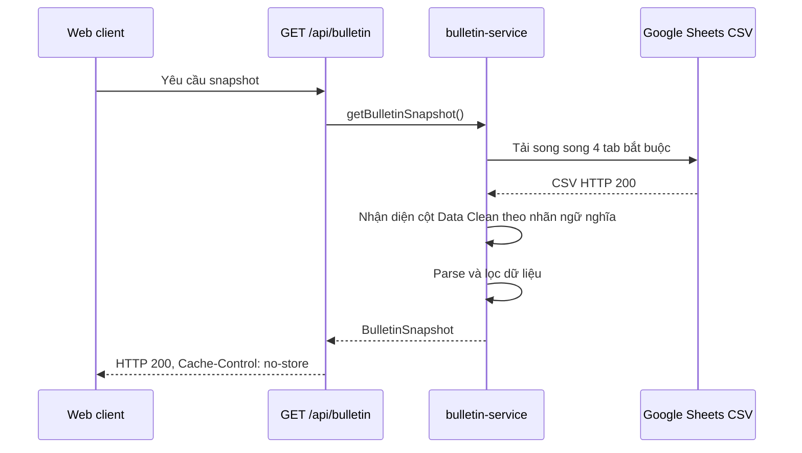

# Lỗi không cập nhật dữ liệu do tiêu đề Google Sheets thay đổi - Kế hoạch triển khai

## Giai đoạn 0: Làm rõ đầu vào

### Bối cảnh

- Yêu cầu gốc bằng tiếng Anh: **Inspect, identify, and fix the web application's inability to refresh data from Google Sheets.**
- Hệ thống hiện tại là ứng dụng web Next.js 16.3.0, Node.js 24.19.0 và TypeScript.
- Dữ liệu được đọc theo thời gian thực qua `GET /api/bulletin` từ các tab CSV công khai của Google Sheets.
- Phạm vi là lỗi tích hợp dữ liệu phía máy chủ; không thay đổi giao diện, logic bộ lọc cổ phiếu, nội dung nhập tay hoặc cấu hình nguồn.
- Mức độ: cao vì toàn bộ dữ liệu định lượng của bản tin không hiển thị khi một nguồn bắt buộc bị từ chối.
- Tần suất: có điều kiện; luôn xảy ra với cấu trúc tiêu đề `Data Clean` hiện tại.

### Bằng chứng tái hiện

- Gọi trực tiếp `GET /api/bulletin` trên máy phát triển nhiều lần đều trả HTTP `503`.
- Phản hồi chứa `SOURCE_SCHEMA_INVALID`, nguồn `Data Clean` và `retryable: false`.
- Bốn tab bắt buộc `Data Clean`, `Ngành`, `Đếm MA`, `Data_26D` đều tải trực tiếp thành công với HTTP `200` và có dữ liệu.
- Dòng tiêu đề sống của `Data Clean` hiện có các ô đã được Google CSV làm phẳng từ vùng gộp, ví dụ:
  - `Thông tin định danh và Ngành Cổ Phiếu`
  - `Khối lượng giao dịch KLGD`
  - `MA50-TB5D MA50-TB5D`
- Mã hiện tại tại `lib/bulletin-service.ts:54-56` và `lib/bulletin-service.ts:107` yêu cầu nhãn chính xác `Cổ Phiếu`, `KLGD`, `MA50-TB5D`; vì vậy không nhận ra dòng tiêu đề và từ chối nguồn.
- Bộ test hiện tại đỗ `10/10`, chứng tỏ chưa có regression test mô phỏng đúng hình dạng CSV sống nói trên.

### Phạm vi thay đổi được phép

- `tests/bulletin-service.test.ts`: thêm regression test ở pha Red.
- `lib/bulletin-service.ts`: sửa tối thiểu cơ chế nhận diện cột `Data Clean` ở pha Green/Refactor.
- Không bổ sung dependency, không thay đổi API contract, không thay đổi các tab khác.

## Giai đoạn 1: Phân tích yêu cầu

### Nghiên cứu codebase và nền tảng

- `app/api/bulletin/route.ts` đã là Route Handler động và trả `Cache-Control: no-store`.
- `lib/published-csv.ts` đã dùng `cache: "no-store"`, timeout và retry cho lỗi mạng tạm thời.
- Tài liệu Next.js cục bộ xác nhận Route Handler không cache mặc định và `cache: "no-store"` luôn lấy lại nguồn; do đó cache không phải nguyên nhân và không cần đổi.
- `lib/bulletin-service.ts` là điểm duy nhất ánh xạ dòng CSV thành `StockRow` và là vị trí thích hợp nhất để xử lý biến thể nhãn cột.
- Các test từ chối tab fallback rộng nhưng không liên quan phải tiếp tục đỗ để tránh nhận nhầm tab Google trả về với HTTP `200`.

### Yêu cầu theo EARS

- **R1** — KHI `Data Clean` dùng bộ tiêu đề chính xác kiểu cũ, HỆ THỐNG PHẢI tiếp tục tạo snapshot như hiện tại.
- **R2** — KHI Google CSV làm phẳng tiền tố của ô gộp vào nhãn cột hợp lệ, HỆ THỐNG PHẢI nhận diện đúng các cột bắt buộc theo ngữ nghĩa.
- **R3** — KHI một nhãn cột bị lặp trong cùng ô như `MA50-TB5D MA50-TB5D`, HỆ THỐNG PHẢI nhận diện đúng cột đó.
- **R4** — KHI một tab rộng nhưng không chứa đủ bộ cột `Data Clean` được trả về, HỆ THỐNG PHẢI từ chối bằng `SOURCE_SCHEMA_INVALID`.
- **R5** — KHI một cột ngữ nghĩa bắt buộc thực sự bị thiếu hoặc dữ liệu không có hàng cổ phiếu hợp lệ, HỆ THỐNG PHẢI giữ nguyên hành vi lỗi an toàn hiện tại.
- **R6** — KHI nguồn hiện tại hợp lệ được gọi qua `GET /api/bulletin`, HỆ THỐNG PHẢI trả HTTP `200` và snapshot định lượng thay vì thông báo “Dữ liệu bản tin chưa sẵn sàng”.
- **R7** — KHI triển khai bản sửa, HỆ THỐNG PHẢI giữ nguyên logic chọn cổ phiếu, parse số, parse ngày, narrative và các nguồn ngoài `Data Clean`.

### Ràng buộc đơn giản hóa

- Chỉ mở rộng cơ chế nhận diện nhãn cột; không thiết kế lại pipeline dữ liệu.
- Không dùng vị trí cột cố định làm hợp đồng chính.
- Không thêm thư viện chuẩn hóa chuỗi.
- Không tự động chấp nhận mọi chuỗi chứa tên cột; phải tránh nhầm `MA50` với `MA50-TB5D` và tránh tab fallback không liên quan.

## Giai đoạn 2: Đặc tả giải pháp

### Kiến trúc và luồng dữ liệu

### Thiết kế được chọn

Tạo một cơ chế nội bộ tối thiểu để chuẩn hóa/đối sánh nhãn cột theo danh sách alias có kiểm soát. Cơ chế này phải ưu tiên khớp chính xác sau chuẩn hóa, sau đó chỉ chấp nhận dạng tiền tố do ô gộp của Google tạo ra khi token ngữ nghĩa xuất hiện ở ranh giới hợp lệ. Tất cả cột bắt buộc phải được giải quyết trước khi parse hàng dữ liệu.

### Bảng đánh đổi

| Phương án | Ưu điểm | Nhược điểm | Độ phức tạp | An toàn dữ liệu | Khuyến nghị |
|---|---|---|---|---|---|
| A. Resolver nhãn ngữ nghĩa có alias và ranh giới kiểm soát | Chịu được tiêu đề cũ và dạng ô gộp hiện tại; vẫn từ chối tab sai | Cần test kỹ trường hợp tên cột chồng lấn | Thấp | Cao | Chọn |
| B. Dùng cố định chỉ số cột hiện tại | Sửa rất nhanh cho bản CSV hôm nay | Dễ hỏng khi thêm, xóa hoặc dịch cột; khó phát hiện dữ liệu gán sai | Thấp | Thấp | Không chọn |
| C. Yêu cầu chỉnh lại Google Sheet về hai dòng tiêu đề cũ | Không đổi mã nguồn | Phụ thuộc thao tác thủ công; lỗi sẽ quay lại khi sheet được định dạng lại | Thấp | Trung bình | Không chọn |

Phương án A được chọn vì là thay đổi nhỏ nhất giải quyết đúng root cause mà vẫn bảo toàn hàng rào schema hiện có.

### Trường hợp biên và truy vết

| Trường hợp biên | Điều kiện kích hoạt | Hành vi mong đợi | Ảnh hưởng nếu bỏ qua | Yêu cầu |
|---|---|---|---|---|
| Tiêu đề legacy chính xác | Hàng đầu chứa `Cổ Phiếu`, `KLGD`, `MA50-TB5D` | Parse như trước | Regression dữ liệu cũ | R1, R7 |
| Tiền tố từ ô gộp | Nhãn thành `Thông tin định danh và Ngành Cổ Phiếu` | Nhận đúng cột mã | Toàn API trả 503 | R2, R6 |
| Nhãn mô tả kèm tên cột | Nhãn thành `Khối lượng giao dịch KLGD` | Nhận đúng cột khối lượng | Không có hàng cổ phiếu hợp lệ | R2, R6 |
| Nhãn bị lặp | Nhãn thành `MA50-TB5D MA50-TB5D` | Nhận đúng cột slope | Bộ lọc tiềm năng sai hoặc API lỗi | R3, R6 |
| Tên cột chồng lấn | Có cả `MA50` và `MA50-TB5D` | Mỗi trường ánh xạ đúng cột riêng | Gán slope vào MA50 hoặc ngược lại | R2, R3, R7 |
| Tab fallback rộng | Google trả tab khác có nhiều cột | Từ chối `SOURCE_SCHEMA_INVALID` | Hiển thị dữ liệu sai nguồn | R4 |
| Thiếu cột bắt buộc | Không có một trường ngữ nghĩa cần thiết | Từ chối an toàn | Dữ liệu sai âm thầm | R5 |
| Dòng dữ liệu hỏng | Mã trống hoặc giá trị số bắt buộc không hợp lệ | Bỏ dòng; lỗi nếu không còn dòng hợp lệ | Snapshot không đáng tin cậy | R5 |

### Xử lý ngoại lệ

| Loại ngoại lệ | Nguồn | Chiến lược xử lý | Ảnh hưởng người dùng | Khôi phục |
|---|---|---|---|---|
| `SOURCE_UNAVAILABLE` có thể retry | Mạng/Google HTTP 5xx, timeout | Giữ nguyên retry hiện tại | Chờ ngắn, sau đó báo nguồn chưa sẵn sàng | Yêu cầu kế tiếp thử lại |
| `SOURCE_UNAVAILABLE` không retry | Google HTTP 4xx/quyền truy cập | Fail-fast như hiện tại | Thông báo nguồn cụ thể | Sửa quyền/chia sẻ nguồn |
| `SOURCE_SCHEMA_INVALID` | Thiếu bộ cột bắt buộc sau khi resolve | Từ chối toàn snapshot | Không hiển thị dữ liệu có thể sai | Sửa schema nguồn hoặc bổ sung alias đã kiểm chứng |
| Hàng cổ phiếu không hợp lệ | Parse số hoặc mã thất bại | Bỏ hàng; lỗi nếu không còn hàng hợp lệ | Giữ dữ liệu còn lại đáng tin cậy | Sửa dữ liệu Sheet |
| Lỗi không xác định | Route Handler | Giữ phản hồi `DATA_UNAVAILABLE` hiện tại | Thông báo chung | Kiểm tra server log |

### Điều kiện tranh chấp và truy cập đồng thời

| Tài nguyên dùng chung | Kịch bản đồng thời | Rủi ro | Biện pháp |
|---|---|---|---|
| Bốn request CSV trong một snapshot | `Promise.all` đọc các tab cùng lúc | Các tab có thể được người dùng cập nhật lệch thời điểm | Giữ hành vi hiện tại; lấy `asOfDate` từ dữ liệu và không ghi trạng thái dùng chung |
| Nhiều client gọi API cùng lúc | Các Route Handler cùng đọc nguồn | Tăng số request nhưng không có ghi đè dữ liệu | Hàm parse thuần, không lock; GET idempotent |
| Resolver nhãn | Nhiều request dùng cùng logic | Không có mutable state | Dùng hàm thuần, không cache mutable |

Không cần optimistic/pessimistic lock vì hệ thống chỉ đọc, không có shared write và endpoint là GET idempotent.

## Giai đoạn 3: Kế hoạch triển khai

### Phân loại và workflow

- Loại yêu cầu: **Debug/Fix**.
- Quy trình 5 giai đoạn: Thu thập thông tin → Phân tích nguyên nhân gốc → Thiết kế giải pháp → Triển khai bản sửa → Xác minh.
- TDD bắt buộc: `09-test` tạo test thất bại trước, sau đó `08-fix` mới sửa production code.

### Cây task

#### Giai đoạn 1 — Thu thập thông tin

Task: Ghi nhận reproduction và hợp đồng dữ liệu sống  
ID: T1.1  
Mục tiêu: Khóa bằng chứng HTTP, schema và cấu trúc CSV hiện tại.  
Tệp: Không sửa source; bằng chứng đã ghi trong harness log.  
Phụ thuộc: không có (độc lập)  
Có thể song song: có — chỉ đọc.  
Thay đổi tối thiểu: Không có thay đổi production.  
Lệnh xác minh: `Invoke-WebRequest http://127.0.0.1:3100/api/bulletin`  
Kết quả mong đợi: Trước sửa trả HTTP `503`, `SOURCE_SCHEMA_INVALID`, nguồn `Data Clean`.  
Ghi chú hoàn tác: Không cần rollback.

#### Giai đoạn 2 — Phân tích nguyên nhân gốc

Task: Xác nhận divergence point và loại trừ nguyên nhân thay thế  
ID: T2.1  
Mục tiêu: Chứng minh lỗi do nhãn cột thay đổi, không phải mạng, cache hay quyền.  
Tệp: Không sửa source; bằng chứng đã ghi trong harness log.  
Phụ thuộc: T1.1  
Có thể song song: có — chỉ đọc.  
Thay đổi tối thiểu: Không có thay đổi production.  
Lệnh xác minh: `npm.cmd test -- tests/bulletin-service.test.ts`  
Kết quả mong đợi: Test cũ đỗ `10/10` trong khi API sống vẫn lỗi, xác nhận coverage gap.  
Ghi chú hoàn tác: Không cần rollback.

#### Giai đoạn 3 — Thiết kế giải pháp

Task: Khóa resolver nhãn và hàng rào schema  
ID: T3.1  
Mục tiêu: Chọn quy tắc ánh xạ semantic an toàn cho tiêu đề legacy và dạng ô gộp.  
Tệp: `docs/plan/plan_debug_fix_google_sheet_header_refresh_20260818.md`  
Phụ thuộc: T2.1  
Có thể song song: không — là gate thiết kế trước TDD.  
Thay đổi tối thiểu: Chỉ lập đặc tả, chưa sửa source.  
Lệnh xác minh: `rg -n "R1|R2|R3|R4|R5|R6|R7" docs/plan/plan_debug_fix_google_sheet_header_refresh_20260818.md`  
Kết quả mong đợi: Có đủ yêu cầu và truy vết trường hợp biên.  
Ghi chú hoàn tác: Xóa/revert riêng tài liệu kế hoạch nếu bị từ chối.

#### Giai đoạn 4 — Triển khai bản sửa

Task: Viết regression test Red cho tiêu đề CSV sống  
ID: T4.1  
Mục tiêu: Tái hiện lỗi trong test bằng đúng nhãn đã quan sát từ Google CSV.  
Tệp: `tests/bulletin-service.test.ts`  
Phụ thuộc: T3.1 và phê duyệt kế hoạch  
Có thể song song: không — phải hoàn tất Red trước khi sửa code.  
Thay đổi tối thiểu: Thêm một test tích hợp cấp service, đồng thời khẳng định ánh xạ mã, khối lượng và slope đúng.  
Lệnh xác minh: `npm.cmd test -- tests/bulletin-service.test.ts`  
Kết quả mong đợi: Test mới thất bại vì `SOURCE_SCHEMA_INVALID`; các test cũ vẫn thể hiện baseline.  
Ghi chú hoàn tác: Revert riêng test mới nếu đặc tả thay đổi.

Task: Sửa resolver tiêu đề Data Clean  
ID: T4.2  
Mục tiêu: Làm test Red đỗ mà vẫn từ chối tab fallback không liên quan.  
Tệp: `lib/bulletin-service.ts`  
Phụ thuộc: T4.1  
Có thể song song: không — phụ thuộc test Red và chạm luồng parse trung tâm.  
Thay đổi tối thiểu: Bổ sung helper nội bộ và dùng nó cho schema gate/column resolution của `Data Clean`; không đổi API hoặc bộ lọc.  
Lệnh xác minh: `npm.cmd test -- tests/bulletin-service.test.ts`  
Kết quả mong đợi: Toàn bộ test service đỗ, gồm test legacy, test merged-header mới và hai test từ chối fallback.  
Ghi chú hoàn tác: Revert thay đổi trong `lib/bulletin-service.ts`; test Red sẽ chứng minh lỗi quay lại.

#### Giai đoạn 5 — Xác minh

Task: Chạy quality gates và proof-of-fix sống  
ID: T5.1  
Mục tiêu: Chứng minh bản sửa đúng ở unit, toàn dự án, build và Google Sheets thật.  
Tệp: Không sửa thêm source.  
Phụ thuộc: T4.2  
Có thể song song: không — xác minh sau implementation.  
Thay đổi tối thiểu: Không có thay đổi production.  
Lệnh xác minh: `npm.cmd test`, `npm.cmd run lint`, `npm.cmd run build`, sau đó chạy app và gọi `GET /api/bulletin` ít nhất 5 lần.  
Kết quả mong đợi: Tất cả lệnh exit `0`; 5/5 API trả HTTP `200`, có `asOfDate`, dữ liệu ngành và market breadth; không còn `SOURCE_SCHEMA_INVALID`.  
Ghi chú hoàn tác: Nếu bất kỳ gate nào thất bại, không bàn giao và quay lại T4.2 theo retry policy.

Task: Review regression và phạm vi thay đổi  
ID: T5.2  
Mục tiêu: Xác nhận không nới schema quá mức, không lộ dữ liệu nhạy cảm và không đổi hành vi ngoài phạm vi.  
Tệp: `lib/bulletin-service.ts`, `tests/bulletin-service.test.ts`  
Phụ thuộc: T5.1  
Có thể song song: không — review cuối.  
Thay đổi tối thiểu: Chỉ review diff.  
Lệnh xác minh: `git diff --check` và `git diff -- lib/bulletin-service.ts tests/bulletin-service.test.ts`  
Kết quả mong đợi: Không có whitespace error; diff chỉ chứa resolver tối thiểu và regression test.  
Ghi chú hoàn tác: Revert riêng thay đổi không đạt review rồi chạy lại T5.1.

### Bản đồ phụ thuộc và song song

| ID task | Tên task | Phụ thuộc vào | Loại | Wave | Phạm vi file |
|---|---|---|---|---|---|
| T1.1 | Ghi nhận reproduction và hợp đồng dữ liệu sống | none | Độc lập | 1 | Chỉ đọc |
| T2.1 | Xác nhận divergence point | T1.1 | Phụ thuộc | 2 | Chỉ đọc |
| T3.1 | Khóa resolver và hàng rào schema | T2.1 | Phụ thuộc | 3 | `docs/plan/...` |
| T4.1 | Viết regression test Red | T3.1 + phê duyệt | Phụ thuộc | 4 | `tests/bulletin-service.test.ts` |
| T4.2 | Sửa resolver Data Clean | T4.1 | Phụ thuộc | 5 | `lib/bulletin-service.ts` |
| T5.1 | Chạy quality gates và proof-of-fix | T4.2 | Phụ thuộc | 6 | Chỉ đọc/chạy lệnh |
| T5.2 | Review regression và phạm vi | T5.1 | Phụ thuộc | 7 | Chỉ đọc diff |

- Wave 1: T1.1.
- Wave 2: T2.1.
- Wave 3: T3.1.
- Wave 4: T4.1; không song song với implementation vì TDD Red bắt buộc.
- Wave 5: T4.2.
- Wave 6: T5.1.
- Wave 7: T5.2.

### Ma trận truy vết

| Yêu cầu | Task triển khai | Bằng chứng chấp nhận |
|---|---|---|
| R1 | T4.1, T4.2 | Test legacy tiếp tục đỗ |
| R2 | T4.1, T4.2 | Test nhãn có tiền tố đỗ |
| R3 | T4.1, T4.2 | Test nhãn lặp và slope đỗ |
| R4 | T4.1, T4.2, T5.1 | Test fallback rộng tiếp tục bị từ chối |
| R5 | T4.2, T5.1 | Test nguồn sai schema và dữ liệu rỗng tiếp tục lỗi an toàn |
| R6 | T5.1 | 5/5 request sống trả HTTP `200` |
| R7 | T5.1, T5.2 | Full test, lint, build và review diff đều đạt |

### Gate phê duyệt

Chưa được phép sửa `tests/bulletin-service.test.ts` hoặc `lib/bulletin-service.ts` cho đến khi người dùng phê duyệt kế hoạch này. Sau phê duyệt, thực hiện đúng thứ tự `09-test` Red → `08-fix` Green/Refactor → `10-review`.
