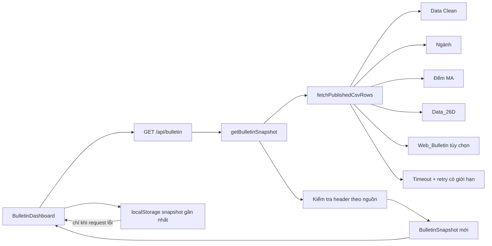
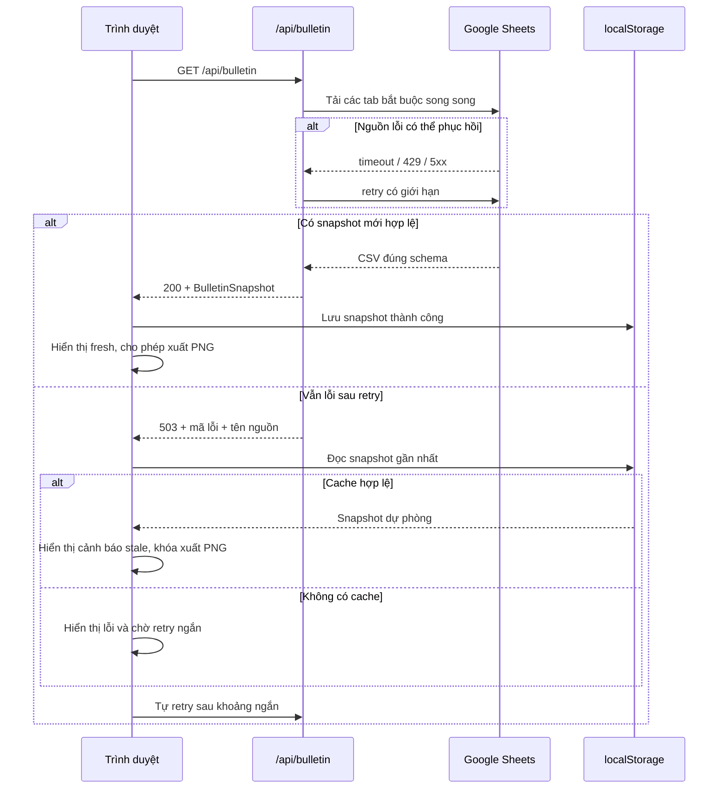

# Lỗi dữ liệu Google Sheets tái diễn - Kế hoạch triển khai

## Giai đoạn 0: Làm rõ đầu vào

### Bối cảnh

- Ứng dụng Next.js 16.3.0 đọc bốn tab bắt buộc từ một Google Sheet công khai qua Google Visualization CSV: `Data Clean`, `Ngành`, `Đếm MA`, `Data_26D`.
- API hiện tải đồng thời bằng `Promise.all`; một lỗi nguồn làm toàn bộ snapshot thất bại với HTTP `503`.
- Route và client đều thay nguyên nhân thật bằng thông báo chung `Dữ liệu bản tin chưa sẵn sàng.`.
- Nếu request đầu tiên thất bại, giao diện không có snapshot và chỉ thử lại theo chu kỳ 300 giây.
- Production hiện hoạt động trở lại; 20/20 lần gọi API liên tiếp trả HTTP `200`. Đây là lỗi có điều kiện, không phải lỗi parser cố định.
- Tab tùy chọn `Web_Bulletin` hiện không tồn tại đúng cấu trúc; Google GViz trả tab đầu tiên với HTTP `200`. Trạng thái này phải được phát hiện bằng kiểm tra schema, nhưng không được làm hỏng dữ liệu định lượng.

### Phạm vi đã chốt

- Tăng độ bền của việc tải CSV bằng timeout, retry có giới hạn và lỗi có định danh nguồn.
- Kiểm tra schema tối thiểu của từng tab trước khi dựng snapshot.
- Giữ snapshot thành công gần nhất trong trình duyệt để trang không trắng sau một lỗi tạm thời; dữ liệu dự phòng phải được gắn cảnh báo và không được xuất PNG.
- Sau lỗi, client tự thử lại sớm; sau thành công quay về chu kỳ bình thường.
- Không thêm database, dịch vụ cache, dependency hoặc thay đổi biến môi trường.
- Không thay đổi tiêu chí lọc cổ phiếu, cách nhập nhận định, định dạng ngày thủ công hoặc bố cục bản tin.

### Phân loại

- **Loại**: Debug/Fix.
- **Độ phức tạp**: Phức tạp, liên quan nguồn ngoài, server API, state trình duyệt và hành vi phục hồi.
- **Workflow**: Information Gathering → Root Cause Analysis → Solution Design → Fix Implementation → Verification.
- **TDD**: Bắt buộc, theo thứ tự `09-test` Red → `08-fix` Green/Refactor → `10-review`.

## Giai đoạn 1: Phân tích yêu cầu

### Yêu cầu EARS

- **R1** — KHI một lần gọi Google CSV gặp lỗi network, timeout, HTTP `408`, `425`, `429` hoặc `5xx`, HỆ THỐNG PHẢI thử lại với số lần hữu hạn trước khi kết luận nguồn không sẵn sàng.
- **R2** — KHI Google trả lỗi không thể phục hồi như `400`, `401`, `403` hoặc `404`, HỆ THỐNG PHẢI dừng retry và trả lỗi có tên nguồn cùng HTTP status, không để lộ URL Sheet hay cấu hình môi trường.
- **R3** — KHI CSV trả HTTP `200` nhưng không có header tối thiểu của tab được yêu cầu, HỆ THỐNG PHẢI xem đó là sai schema/fallback nhầm tab và chỉ rõ nguồn bị sai.
- **R4** — KHI tab tùy chọn `Web_Bulletin` thiếu hoặc sai schema, HỆ THỐNG PHẢI tiếp tục dựng snapshot định lượng với `narrative: null`.
- **R5** — KHI một tab bắt buộc vẫn lỗi sau retry, API PHẢI trả lỗi có cấu trúc, mã ổn định và tên tab an toàn để chẩn đoán.
- **R6** — KHI client tải snapshot thành công, HỆ THỐNG PHẢI lưu snapshot thành công gần nhất trong `localStorage` theo schema có phiên bản.
- **R7** — KHI request đầu tiên thất bại nhưng có snapshot dự phòng hợp lệ, HỆ THỐNG PHẢI hiển thị snapshot đó kèm cảnh báo rõ rằng dữ liệu chưa được làm mới.
- **R8** — KHI đang dùng snapshot dự phòng, HỆ THỐNG PHẢI vô hiệu hóa xuất PNG để tránh phát hành bản tin từ dữ liệu chưa xác nhận mới nhất.
- **R9** — KHI tải dữ liệu thất bại, client PHẢI thử lại sau khoảng ngắn; KHI thành công, client PHẢI quay về chu kỳ cập nhật bình thường.
- **R10** — KHI `localStorage` thiếu, hỏng JSON hoặc sai schema, HỆ THỐNG PHẢI bỏ qua an toàn và tiếp tục cơ chế tải mạng.
- **R11** — KHI người dùng nhập ngày hiển thị, nhận định hoặc danh sách điểm mua, HỆ THỐNG PHẢI giữ nguyên hành vi hiện tại trong cả trạng thái dữ liệu mới và dữ liệu dự phòng.
- **R12** — KHI production đọc Sheet hiện tại, HỆ THỐNG PHẢI vẫn trả 22 ngành, dữ liệu MA và các danh sách cổ phiếu theo bộ lọc hiện hành.

### Kết quả nghiên cứu

- Next.js Route Handlers không cache response `GET` theo mặc định; route hiện còn khai báo `force-dynamic`, phù hợp với việc response API luôn được tạo tại request time.
- Next.js mở rộng `fetch` với Data Cache, nhưng cache server có thể che giấu độ cũ của dữ liệu. Với bản tin tài chính, phương án dự phòng phải hiển thị rõ trạng thái stale; vì vậy kế hoạch không dựa vào server cache ngầm.
- `AbortSignal.timeout()` cung cấp timeout chuẩn cho `fetch` mà không cần thêm dependency.
- Google Visualization query sử dụng URL nguồn và query parameters; HTTP `200` không đảm bảo đã chọn đúng tab, như quan sát thực tế với `Web_Bulletin`. Do đó schema validation là điều kiện bắt buộc.
- Code hiện có đã dùng `localStorage` an toàn cho nội dung nhận định; có thể áp dụng cùng nguyên tắc versioned payload cho snapshot mà không thêm hạ tầng.

### Tham chiếu

- `node_modules/next/dist/docs/01-app/01-getting-started/15-route-handlers.md`
- `node_modules/next/dist/docs/01-app/03-api-reference/04-functions/fetch.md`
- `node_modules/next/dist/docs/01-app/01-getting-started/10-error-handling.md`
- https://nextjs.org/docs/app/api-reference/functions/fetch
- https://developer.mozilla.org/en-US/docs/Web/API/AbortSignal/timeout_static
- https://developers.google.com/chart/interactive/docs/querylanguage

### Ràng buộc đơn giản hóa

- Không thêm Redis, Vercel KV, database hoặc service worker.
- Không xây hệ thống logging bên thứ ba; chỉ trả lỗi API an toàn và log server có ngữ cảnh.
- Không cache âm thầm một snapshot cũ như dữ liệu mới.
- Không thay đổi public shape của `BulletinSnapshot`; trạng thái fresh/stale thuộc client.
- Chỉ retry lỗi có khả năng phục hồi; tránh retry vô ích với lỗi quyền hoặc URL.

## Giai đoạn 2: Đặc tả giải pháp

### Kiến trúc được chọn



### Luồng thành công và phục hồi



### Hợp đồng lỗi tối thiểu

API lỗi dự kiến giữ HTTP `503` cho nguồn tạm thời và trả payload an toàn:

```text
error.code: SOURCE_UNAVAILABLE | SOURCE_SCHEMA_INVALID | DATA_UNAVAILABLE
error.message: thông báo tiếng Việt cho người dùng
error.source: Data Clean | Ngành | Đếm MA | Data_26D | Web_Bulletin
error.retryable: true | false
```

Không trả spreadsheet ID, URL đầy đủ, stack trace hoặc giá trị environment.

### Hợp đồng snapshot dự phòng phía client

```text
version: 1
savedAt: ISO timestamp
snapshot: BulletinSnapshot
```

Payload chỉ được chấp nhận khi có các trường cốt lõi đúng kiểu: `asOfDate`, `generatedAt`, `sectors`, `strongStocks`, `potentialStocks`, `marketBreadth`. Dữ liệu hỏng bị bỏ qua.

### Bảng đánh đổi

| Phương án | Ưu điểm | Nhược điểm | Độ phức tạp | Rủi ro dữ liệu | Khuyến nghị |
|---|---|---|---|---|---|
| A. Chỉ retry Google CSV | Thay đổi ít, xử lý lỗi rất ngắn | Vẫn trắng nếu cold start hoặc outage kéo dài | Thấp | Trung bình | Không đủ |
| B. Retry + schema validation + cache trình duyệt có cảnh báo | Không thêm hạ tầng; người dùng hằng ngày vẫn thấy bản gần nhất; stale minh bạch | Trình duyệt mới chưa có cache vẫn phải chờ nguồn phục hồi | Trung bình | Thấp vì khóa xuất PNG khi stale | **Chọn** |
| C. Durable cache ngoài như KV/database | Phục hồi tốt trên mọi thiết bị và cold start | Thêm dịch vụ, secret, chi phí và vận hành | Cao | Thấp | Chưa cần theo YAGNI |
| D. Dùng Next.js Data Cache ngầm | Ít code, có thể phục vụ dữ liệu cache | Khó biết response đang stale; có nguy cơ xuất bản dữ liệu cũ như mới | Trung bình | Cao trong ngữ cảnh tài chính | Không chọn |

### Edge cases

| Trường hợp | Điều kiện kích hoạt | Hành vi mong đợi | EARS | Tác động nếu bỏ qua |
|---|---|---|---|---|
| Google timeout | Một request quá thời hạn | Retry rồi trả lỗi nguồn | R1, R5 | Function treo hoặc trang trắng |
| HTTP 429/5xx | Rate limit hoặc lỗi Google | Retry có backoff hữu hạn | R1 | Lỗi tạm thời thành outage dài |
| HTTP 403/404 | Quyền hoặc URL sai | Không retry, trả lỗi rõ nguồn | R2, R5 | Tăng tải vô ích, khó chẩn đoán |
| HTTP 200 sai tab | Google fallback về tab đầu tiên | Schema validation từ chối | R3, R4 | Parser đọc nhầm dữ liệu |
| `Web_Bulletin` thiếu | Không có header narrative | `narrative: null`, core vẫn chạy | R4 | Tab tùy chọn làm sập bản tin |
| `Data_26D` thiếu VNINDEX | CSV hợp lệ nhưng thiếu dòng bắt buộc | Lỗi nguồn/schema có định danh | R3, R5 | Thông báo chung không truy vết được |
| Cache trình duyệt hỏng | JSON lỗi hoặc payload sai version | Bỏ qua cache | R10 | Crash client |
| Cache thuộc ngày cũ | Google đang lỗi sau cuối tuần/nghỉ lễ | Hiển thị ngày dữ liệu và cảnh báo stale; khóa export | R7, R8 | Phát hành nhầm bản tin cũ |
| Request mới thành công sau stale | Retry nhận snapshot hợp lệ | Thay cache, bỏ stale, mở export | R6, R9 | Giao diện mắc kẹt ở stale |
| Refresh trùng nhau | Request cũ chưa xong khi timer chạy | Chỉ lên lịch lần tiếp theo sau khi request hiện tại hoàn tất | R9 | Race state và tăng tải |
| localStorage bị chặn | Private mode/chính sách trình duyệt | Tiếp tục dùng network, báo lỗi nhẹ | R10 | UI crash |

### Xử lý ngoại lệ

| Loại ngoại lệ | Nguồn | Có thể phục hồi | Chiến lược | Tác động người dùng | Phục hồi |
|---|---|---|---|---|---|
| `TimeoutError`, network error | `fetch` Google | Có | Retry hữu hạn | Chờ thêm ngắn | Retry server rồi client |
| HTTP `408`, `425`, `429`, `5xx` | Google | Có | Retry có delay | Có thể hiển thị cache | Tự tải lại |
| HTTP `400`, `401`, `403`, `404` | Google/cấu hình | Không tự phục hồi | Dừng retry, định danh nguồn | Cảnh báo cấu hình/nguồn | Người vận hành sửa quyền/URL |
| CSV rỗng hoặc sai header | Google/tab | Có điều kiện | Định danh schema; optional thì bỏ qua, required thì lỗi | Cache stale hoặc trạng thái lỗi | Sửa tab hoặc đợi tính toán xong |
| Parser nghiệp vụ thiếu VNINDEX/MA | Dữ liệu Sheet | Có điều kiện | Chuyển thành lỗi nguồn có ngữ cảnh | Cache stale, khóa export | Sửa dữ liệu nguồn |
| Cache localStorage hỏng | Trình duyệt | Có | Bỏ qua payload | Không có fallback | Network retry |
| Lỗi không xác định | Server | Không xác định | Log server, trả `DATA_UNAVAILABLE` không lộ chi tiết | Thông báo chung | Điều tra log theo request |

### Race conditions và concurrency

| Tài nguyên dùng chung | Kịch bản đồng thời | Rủi ro | Giảm thiểu |
|---|---|---|---|
| Bốn request Google | Hoàn tất khác thứ tự | Một nguồn fail làm kết quả không rõ | Mỗi lỗi mang tên nguồn; snapshot chỉ dựng sau khi required sources hợp lệ |
| Timer client và request đang chạy | Chu kỳ mới bắt đầu trước request cũ | Ghi đè state mới bằng response cũ | Lên lịch lần kế tiếp sau khi promise hiện tại hoàn tất; cleanup khi unmount |
| `localStorage` nhiều tab | Hai tab cùng lưu snapshot | Last-write-wins có thể giữ response cũ hơn | Chỉ ghi khi `generatedAt` mới hơn hoặc bằng cache hiện tại |
| Nội dung nhận định và snapshot mới | Snapshot ngày mới đến khi draft ngày cũ tồn tại | Lẫn draft giữa ngày | Giữ cơ chế key theo `asOfDate` hiện tại; không thay đổi reducer |

Không có thao tác ghi server hoặc giao dịch cần lock. Các request `GET` là idempotent.

## Giai đoạn 3: Kế hoạch triển khai

### Giai đoạn Fix 1 — Information Gathering

#### T1.1 — Khóa hành vi retry và lỗi nguồn bằng test Red

- **ID**: T1.1
- **Mục tiêu**: Chứng minh một lỗi tạm thời phải được retry và lỗi cuối cùng phải chứa source/status.
- **Files**: `tests/published-csv.test.ts`
- **Phụ thuộc**: none
- **Parallel-safe**: Có; chỉ sửa file test riêng.
- **Thay đổi tối thiểu**: Thêm test HTTP `503 → 200`, lỗi `403` không retry và lỗi cạn retry có source.
- **Lệnh kiểm tra**: `npm.cmd test -- tests/published-csv.test.ts`
- **Kết quả mong đợi pha Red**: Test mới fail vì implementation hiện chỉ gọi một lần và lỗi không có source.
- **Rollback**: Bỏ các test mới nếu root cause bị phủ định bởi proof-of-fix.

### Giai đoạn Fix 2 — Root Cause Analysis

#### T2.1 — Khóa schema validation và optional narrative bằng test Red

- **ID**: T2.1
- **Mục tiêu**: Chứng minh HTTP `200` sai tab không được xem là nguồn hợp lệ và `Web_Bulletin` sai schema không làm hỏng core.
- **Files**: `tests/bulletin-service.test.ts`
- **Phụ thuộc**: none
- **Parallel-safe**: Có; không chung file với T1.1.
- **Thay đổi tối thiểu**: Thêm test cho required source sai header và optional source fallback nhầm tab.
- **Lệnh kiểm tra**: `npm.cmd test -- tests/bulletin-service.test.ts`
- **Kết quả mong đợi pha Red**: Test required source fail vì chưa có validation/attribution.
- **Rollback**: Bỏ test mới nếu contract nguồn được xác định khác.

#### T2.2 — Khóa cache stale và lịch retry client bằng test Red

- **ID**: T2.2
- **Mục tiêu**: Chứng minh cache hợp lệ được đọc an toàn, cache hỏng bị bỏ qua và delay lỗi ngắn hơn delay thành công.
- **Files**: `tests/bulletin-recovery.test.ts`
- **Phụ thuộc**: none
- **Parallel-safe**: Có; tạo file test riêng.
- **Thay đổi tối thiểu**: Test pure helpers, không mount React.
- **Lệnh kiểm tra**: `npm.cmd test -- tests/bulletin-recovery.test.ts`
- **Kết quả mong đợi pha Red**: Import/helper chưa tồn tại.
- **Rollback**: Xóa file test mới nếu hướng cache client bị hủy trước implementation.

### Giai đoạn Fix 3 — Solution Design

#### T3.1 — Xây lớp fetch có timeout, retry và lỗi nguồn

- **ID**: T3.1
- **Mục tiêu**: Làm T1.1 Green bằng native `fetch`, `AbortSignal.timeout` và config hiện có.
- **Files**: `lib/published-csv.ts`, `config/filters.ts`
- **Phụ thuộc**: T1.1
- **Parallel-safe**: Có; không chung file với T3.2.
- **Thay đổi tối thiểu**: Một error type, một vòng retry hữu hạn và options injectable cho test; không thêm dependency.
- **Lệnh kiểm tra**: `npm.cmd test -- tests/published-csv.test.ts`
- **Kết quả mong đợi**: Toàn bộ test file pass.
- **Rollback**: Hoàn nguyên hai file; không có migration dữ liệu.

#### T3.2 — Xây helper phục hồi snapshot phía client

- **ID**: T3.2
- **Mục tiêu**: Làm T2.2 Green bằng payload versioned và pure delay policy.
- **Files**: `lib/bulletin-recovery.ts`
- **Phụ thuộc**: T2.2
- **Parallel-safe**: Có; file mới độc lập với T3.1.
- **Thay đổi tối thiểu**: Read/write cache có validation tối thiểu, so sánh `generatedAt`, chọn delay success/failure.
- **Lệnh kiểm tra**: `npm.cmd test -- tests/bulletin-recovery.test.ts`
- **Kết quả mong đợi**: Toàn bộ test helper pass.
- **Rollback**: Xóa helper nếu chưa được tích hợp; không ảnh hưởng storage hiện có.

### Giai đoạn Fix 4 — Fix Implementation

#### T4.1 — Định danh và kiểm tra từng nguồn Sheet

- **ID**: T4.1
- **Mục tiêu**: Làm T2.1 Green và loại bỏ fallback sai tab khỏi đường dữ liệu bắt buộc.
- **Files**: `lib/bulletin-service.ts`
- **Phụ thuộc**: T2.1, T3.1
- **Parallel-safe**: Không; dùng contract lỗi từ T3.1.
- **Thay đổi tối thiểu**: Metadata nguồn, header assertions, optional narrative isolation và dependency injection cho test.
- **Lệnh kiểm tra**: `npm.cmd test -- tests/bulletin-service.test.ts tests/published-csv.test.ts`
- **Kết quả mong đợi**: Test schema, parser ngày và snapshot hiện hữu đều pass.
- **Rollback**: Hoàn nguyên service; không đổi dữ liệu Sheet.

#### T4.2 — Trả lỗi API có cấu trúc và an toàn

- **ID**: T4.2
- **Mục tiêu**: Bảo toàn source/code/retryable tới client nhưng không lộ secret.
- **Files**: `app/api/bulletin/route.ts`
- **Phụ thuộc**: T4.1
- **Parallel-safe**: Không; phụ thuộc public error contract từ service.
- **Thay đổi tối thiểu**: Phân loại expected source error và fallback unknown error.
- **Lệnh kiểm tra**: `npm.cmd run build`
- **Kết quả mong đợi**: Route compile, success payload không thay đổi.
- **Rollback**: Khôi phục response generic cũ.

#### T4.3 — Tích hợp stale cache và adaptive retry vào dashboard

- **ID**: T4.3
- **Mục tiêu**: Không để canvas trắng sau lỗi tạm thời khi có snapshot gần nhất; tự phục hồi nhanh và khóa export stale.
- **Files**: `components/bulletin-dashboard.tsx`
- **Phụ thuộc**: T3.2, T4.2
- **Parallel-safe**: Không; phụ thuộc helper và error response.
- **Thay đổi tối thiểu**: Ghi cache khi success; đọc cache khi failure đầu; quản lý freshness; schedule theo kết quả; giữ nguyên editor/date logic.
- **Lệnh kiểm tra**: `npm.cmd run build`
- **Kết quả mong đợi**: TypeScript pass, không có interval/request chồng nhau, export disabled khi stale.
- **Rollback**: Hoàn nguyên dashboard; cache key mới có thể bị bỏ lại nhưng vô hại.

### Giai đoạn Fix 5 — Verification

#### T5.1 — Chạy kiểm tra đầy đủ và proof-of-fix

- **ID**: T5.1
- **Mục tiêu**: Xác nhận fix không chỉ pass unit test mà còn loại bỏ triệu chứng ở luồng runtime.
- **Files**: Không sửa production; chỉ đọc kết quả.
- **Phụ thuộc**: T4.1, T4.2, T4.3
- **Parallel-safe**: Không; chạy sau toàn bộ implementation.
- **Thay đổi tối thiểu**: Không có.
- **Lệnh kiểm tra**: `npm.cmd run build`; `npm.cmd run lint`; `npm.cmd test`; chạy local API với nguồn thật; chạy reproduction với một nguồn giả lập `503 → 200` và outage có cache.
- **Kết quả mong đợi**: Build/lint PASS, full suite PASS, live API `200`, retry hồi phục, fallback stale hiển thị và export bị khóa.
- **Rollback**: Nếu symptom-level proof fail, hoàn nguyên patch chưa xác minh và quay lại `07-bugfinder` với hypothesis ledger.

#### T5.2 — Review độc lập theo severity

- **ID**: T5.2
- **Mục tiêu**: Kiểm tra correctness, bảo mật, regression và phạm vi thay đổi.
- **Files**: Toàn bộ diff của pipeline.
- **Phụ thuộc**: T5.1
- **Parallel-safe**: Không; là cổng cuối.
- **Thay đổi tối thiểu**: Read-only.
- **Lệnh kiểm tra**: `git diff --check`; review diff và đối chiếu R1–R12.
- **Kết quả mong đợi**: Không có finding Critical/High/Medium; verdict PASS.
- **Rollback**: Finding blocker quay lại bug pipeline theo `00-orchestrator`.

### Bản đồ phụ thuộc và song song

| ID task | Tên task | Phụ thuộc vào | Loại | Wave | Phạm vi file |
|---|---|---|---|---:|---|
| T1.1 | Test retry và lỗi nguồn | none | Độc lập | 1 | `tests/published-csv.test.ts` |
| T2.1 | Test schema nguồn | none | Độc lập | 1 | `tests/bulletin-service.test.ts` |
| T2.2 | Test cache/retry client | none | Độc lập | 1 | `tests/bulletin-recovery.test.ts` |
| T3.1 | Fetch resilient | T1.1 | Phụ thuộc | 2 | `lib/published-csv.ts`, `config/filters.ts` |
| T3.2 | Helper recovery client | T2.2 | Phụ thuộc | 2 | `lib/bulletin-recovery.ts` |
| T4.1 | Validate nguồn Sheet | T2.1, T3.1 | Phụ thuộc | 3 | `lib/bulletin-service.ts` |
| T4.2 | Lỗi API có cấu trúc | T4.1 | Phụ thuộc | 4 | `app/api/bulletin/route.ts` |
| T4.3 | Dashboard stale/adaptive retry | T3.2, T4.2 | Phụ thuộc | 5 | `components/bulletin-dashboard.tsx` |
| T5.1 | Verification Tier 3 | T4.1, T4.2, T4.3 | Phụ thuộc | 6 | Không sửa source |
| T5.2 | Review cuối | T5.1 | Phụ thuộc | 7 | Read-only diff |

- **Wave 1 (song song)**: T1.1, T2.1, T2.2 — ba file test không trùng nhau.
- **Wave 2 (song song)**: T3.1, T3.2 — server fetch và client recovery không trùng file.
- **Wave 3**: T4.1.
- **Wave 4**: T4.2.
- **Wave 5**: T4.3.
- **Wave 6**: T5.1.
- **Wave 7**: T5.2.

### Ma trận truy vết

| Yêu cầu | Task triển khai | Test/kiểm chứng |
|---|---|---|
| R1, R2 | T3.1 | T1.1 |
| R3, R4 | T4.1 | T2.1 |
| R5 | T4.1, T4.2 | T2.1, build |
| R6, R7, R10 | T3.2, T4.3 | T2.2, proof runtime |
| R8 | T4.3 | build, proof runtime |
| R9 | T3.2, T4.3 | T2.2, proof runtime |
| R11 | T4.3 | full regression suite |
| R12 | T5.1 | live API và full suite |

### Tiêu chí hoàn tất

- Một lần Google trả `503` rồi phục hồi phải được server retry và trả snapshot mà client không thấy lỗi.
- Khi tất cả retry thất bại, response phải chỉ rõ nguồn an toàn; không còn mọi lỗi đều giống nhau.
- Nếu trình duyệt đã từng tải snapshot thành công, reload trong lúc Google lỗi phải hiển thị snapshot gần nhất với cảnh báo stale và khóa xuất PNG.
- Client phải tự thử lại sớm, sau đó tự chuyển về fresh khi API phục hồi.
- Google trả nhầm tab với HTTP `200` phải bị phát hiện bởi header validation.
- `Web_Bulletin` thiếu/sai vẫn không làm hỏng dữ liệu định lượng.
- Build, lint, toàn bộ test và symptom-level proof đều PASS trước khi báo hoàn thành.

## Cổng phê duyệt

Kế hoạch này thay đổi nhiều module và hành vi phục hồi nên phải dừng tại `fix_plan_approval`. Chỉ bắt đầu TDD Red và sửa code sau khi người dùng phê duyệt kế hoạch.
