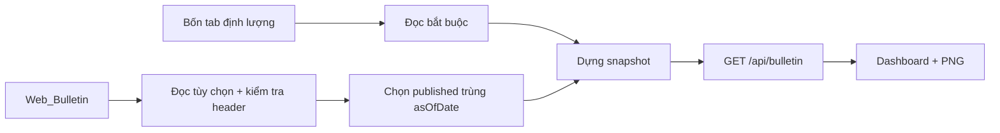
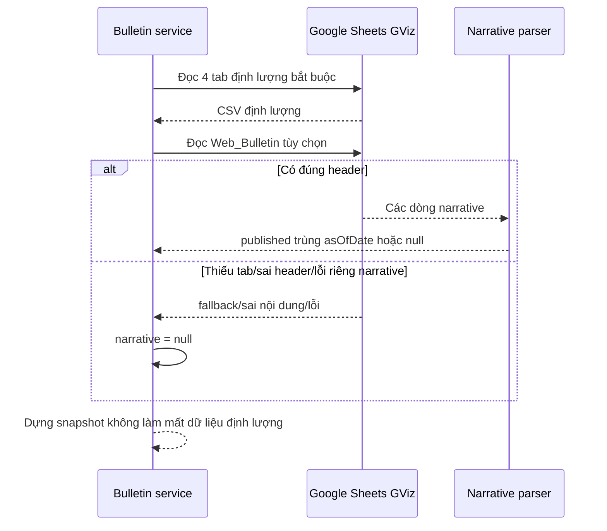

# Sửa dữ liệu Google Sheets và phần kết luận - Kế hoạch triển khai

## Giai đoạn 0: Làm rõ đầu vào

- Ứng dụng: Next.js App Router + TypeScript, dashboard công khai, server đọc Google Sheets qua CSV GViz.
- Lỗi dữ liệu trong ảnh không còn xuất hiện sau khi server được khởi động lại với `.env.local` và quyền mạng: `/api/bulletin` trả HTTP 200, đủ 22 ngành, 10 mã mạnh, 10 mã tiềm năng và dữ liệu MA.
- Lỗi còn lại đã xác nhận: API luôn trả `narrative: null`; tab `Web_Bulletin` chưa được tích hợp.
- Phạm vi: chỉ thêm đọc narrative tùy chọn từ Google Sheet; không thêm form sửa trên web, dependency, database, authentication hay thay đổi `.env`.
- Nguồn nhập nội dung: tab `Web_Bulletin` trong cùng Google Sheet, các cột `as_of_date`, `status`, `conclusion`, `action`, `footer`.

## Giai đoạn 1: Phân tích yêu cầu

### Yêu cầu EARS

| ID | Yêu cầu |
|---|---|
| R1 | KHI bốn tab định lượng hợp lệ, HỆ THỐNG PHẢI trả snapshot ngay cả khi tab `Web_Bulletin` chưa tồn tại hoặc sai cấu trúc. |
| R2 | KHI `Web_Bulletin` có bản ghi `published` trùng `asOfDate`, HỆ THỐNG PHẢI trả `conclusion`, `action`, `footer` trong `narrative`. |
| R3 | KHI bản ghi là `draft`, khác ngày, thiếu header hoặc thiếu nội dung bắt buộc, HỆ THỐNG PHẢI trả `narrative: null` và không dùng nội dung cũ. |
| R4 | KHI có nhiều bản ghi `published` cùng ngày, HỆ THỐNG PHẢI chọn dòng hợp lệ cuối cùng để việc sửa nội dung trên Sheet có kết quả xác định. |
| R5 | KHI người dùng cập nhật Google Sheet, HỆ THỐNG PHẢI phản ánh nội dung trong chu kỳ refresh hiện có mà không cần biến môi trường mới. |
| R6 | KHI server được khởi động với `.env.local` ở thư mục gốc và có quyền mạng, HỆ THỐNG PHẢI tải bốn tab dữ liệu như lần tái hiện HTTP 200. |

### Nghiên cứu và bằng chứng

- Next.js hiện tại tự nạp `.env*` ở thư mục gốc vào `process.env` phía server; Route Handler có thể dùng biến môi trường server mà không đưa sang browser.
- Tài liệu Google Sheets khuyến nghị đọc theo spreadsheet ID và range/A1 notation; nhiều vùng có thể đọc gộp. Bản sửa giữ nguyên cơ chế hiện có, không thêm credential hay API mới.
- Dữ liệu thực tế: bốn tab định lượng trả HTTP 200. Yêu cầu tab `Web_Bulletin` hiện trả nội dung của tab đầu tiên, cho thấy GViz có fallback âm thầm khi tên tab không tồn tại; do đó cần xác minh header trước khi parse.
- Snapshot hiện tại có `asOfDate=2026-07-06`, lấy từ dòng VNINDEX `06/07/2026` trong `Data_26D`. Dòng narrative chỉ được xuất bản khi ngày nhập khớp ngày này; nếu muốn ngày mới hơn, nguồn `Data_26D` phải được cập nhật trước.

### Ràng buộc đơn giản

- Không thêm package.
- Không sửa UI nếu dữ liệu `narrative` hiện tại đã được `NarrativePanel` hỗ trợ.
- Không làm tab narrative trở thành dependency bắt buộc của dữ liệu định lượng.
- Không tự suy đoán ngày hoặc dùng narrative gần nhất khác ngày.

## Giai đoạn 2: Đặc tả giải pháp

### Kiến trúc

### Hợp đồng tab `Web_Bulletin`

| Cột | Bắt buộc | Quy tắc |
|---|---:|---|
| `as_of_date` | Có | Ngày `dd/mm/yyyy`, `dd-mm-yyyy` hoặc serial date; phải trùng `snapshot.asOfDate`. |
| `status` | Có | Chỉ `published` được hiển thị; so sánh không phân biệt hoa thường. |
| `conclusion` | Có | Trim; rỗng thì dòng không hợp lệ. |
| `action` | Có | Trim; rỗng thì dòng không hợp lệ. |
| `footer` | Không | Trim; cho phép chuỗi rỗng. |

### Luồng xử lý

### Phân tích đánh đổi

| Phương án | Ưu điểm | Nhược điểm | Độ phức tạp | An toàn | Khuyến nghị |
|---|---|---|---|---|---|
| Form nhập trực tiếp trên web | Thuận tiện | Cần auth, API ghi, lưu trữ và phân quyền | Cao | Thấp nếu web công khai | Không chọn |
| Biến môi trường chứa kết luận | Nhanh | Phải redeploy/restart, không phù hợp daily | Thấp | Trung bình | Không chọn |
| Tab `Web_Bulletin` tùy chọn | Cùng nguồn vận hành, tự refresh, không thêm auth | Cần hợp đồng header/ngày/status | Thấp | Cao, chỉ đọc | **Chọn** |
| Dùng narrative gần nhất | Luôn có chữ | Có thể hiển thị nhận định sai ngày | Thấp | Thấp về tính đúng dữ liệu | Không chọn |

### Trường hợp biên

| Trường hợp | Điều kiện | Hành vi mong đợi | Truy vết |
|---|---|---|---|
| Chưa tạo tab | GViz trả tab đầu tiên hoặc response không có header narrative | `narrative: null`, dữ liệu định lượng vẫn hiển thị | R1, R3 |
| Tab trống | Chỉ có header hoặc không có dòng | `narrative: null` | R1, R3 |
| Bản ghi draft | `status=draft` | Không hiển thị | R3 |
| Sai ngày | `as_of_date` khác `asOfDate` | Không dùng narrative cũ/mới khác ngày | R3 |
| Trùng dòng | Nhiều dòng published cùng ngày | Chọn dòng hợp lệ cuối | R4 |
| Thiếu conclusion/action | Một trường bắt buộc rỗng | Bỏ qua dòng | R3 |
| Lỗi mạng chỉ ở narrative | Bốn tab chính thành công, tab narrative lỗi | Snapshot vẫn thành công với `narrative: null` | R1 |
| Server cũ chưa nạp env | Chạy trước khi tạo/sửa `.env.local` | Khởi động lại server; không sửa dữ liệu Sheet | R6 |

### Xử lý ngoại lệ

| Ngoại lệ | Nguồn | Chiến lược | Ảnh hưởng người dùng | Khôi phục |
|---|---|---|---|---|
| Bốn tab bắt buộc lỗi | Google/network/schema | Giữ hành vi lỗi snapshot hiện tại | Hiển thị trạng thái chưa sẵn sàng | Kiểm tra network/env/upstream và refresh |
| `Web_Bulletin` lỗi riêng | Google/network/tab thiếu | Bắt lỗi riêng, trả `null` | Chỉ thiếu kết luận | Sửa tab rồi chờ refresh |
| Header narrative sai | Sheet | Không parse | Chỉ thiếu kết luận | Đổi đúng 5 header |
| Ngày/status sai | Dữ liệu người nhập | Bỏ qua dòng | Hiển thị fallback chưa xuất bản | Sửa ngày/status |

### Race condition và concurrency

| Tài nguyên | Kịch bản | Rủi ro | Giảm thiểu |
|---|---|---|---|
| Google Sheet đang được chỉnh sửa khi polling | Một request đọc trong lúc người dùng sửa dòng | Snapshot tạm chưa có narrative hoàn chỉnh | Chỉ nhận dòng đủ trường; lần refresh sau tự cập nhật |
| Nhiều request dashboard | Nhiều client polling cùng lúc | Request upstream lặp | Không mở rộng cache trong bug này; giữ mô hình hiện tại |
| Hai dòng published cùng ngày | Người dùng thêm bản sửa mới | Kết quả không xác định | Chọn dòng hợp lệ cuối, deterministic |

## Giai đoạn 3: Kế hoạch triển khai

### Phân loại

- Loại: `Debug/Fix`
- Workflow: thu thập → root cause → thiết kế → test đỏ → sửa → xác minh → review.
- TDD: bắt buộc cho parser/chọn narrative.

### T1.1 — Viết kiểm thử hồi quy đỏ

- **Mục tiêu**: Chứng minh snapshot hiện chưa đọc `Web_Bulletin` và xác định contract.
- **Files**: `tests/bulletin-service.test.ts`
- **Phụ thuộc**: không có
- **Song song an toàn**: không; production code phải chờ test đỏ.
- **Thay đổi tối thiểu**: thêm case published cùng ngày, draft/khác ngày, thiếu header và lỗi narrative không làm mất dữ liệu chính.
- **Xác minh**: `npm run test -- bulletin-service`
- **Kết quả mong đợi trước sửa**: FAIL vì `narrative` vẫn `null` ở case published.
- **Rollback**: giữ test để bảo vệ contract; không xóa/giảm assertion.
- **Truy vết**: R1–R5.

### T2.1 — Tích hợp narrative tùy chọn

- **Mục tiêu**: Đọc và chọn đúng narrative mà không biến tab này thành dependency bắt buộc.
- **Files**: `lib/bulletin-service.ts`, `config/sheet-mapping.ts`
- **Phụ thuộc**: T1.1
- **Song song an toàn**: không; hai file cùng một behavior và test đỏ.
- **Thay đổi tối thiểu**: thêm range/tab `Web_Bulletin`, parser header/date/status, chọn dòng hợp lệ cuối; cô lập lỗi fetch narrative.
- **Xác minh**: `npm run test -- bulletin-service`
- **Kết quả mong đợi**: toàn bộ case mới PASS.
- **Rollback**: hoàn nguyên hai file production, giữ test đỏ để phản ánh lỗi chưa sửa.
- **Truy vết**: R1–R5.

### T3.1 — Xác minh đầy đủ và proof-of-fix

- **Mục tiêu**: Bảo đảm không hồi quy dữ liệu, build và API runtime.
- **Files**: không sửa production.
- **Phụ thuộc**: T2.1
- **Song song an toàn**: không; chạy tuần tự để tránh artifact build/dev xung đột.
- **Xác minh**: `npm run build`; `npm run lint`; `npm run test`; gọi `GET /api/bulletin` với tab chưa tạo phải HTTP 200 và `narrative: null`; sau khi có fixture/test published phải trả narrative đúng.
- **Kết quả mong đợi**: build/lint/test PASS, API vẫn có dữ liệu định lượng.
- **Rollback**: nếu thất bại, hoàn nguyên fix và quay lại chẩn đoán theo hypothesis ledger.
- **Truy vết**: R1–R6.

### Bản đồ phụ thuộc và song song

| ID task | Tên task | Phụ thuộc vào | Loại | Wave | Phạm vi file |
|---|---|---|---|---:|---|
| T1.1 | Kiểm thử hồi quy đỏ | Không có | Độc lập | 1 | `tests/bulletin-service.test.ts` |
| T2.1 | Tích hợp narrative tùy chọn | T1.1 | Phụ thuộc | 2 | `lib/bulletin-service.ts`, `config/sheet-mapping.ts` |
| T3.1 | Xác minh đầy đủ | T2.1 | Phụ thuộc | 3 | Không ghi source |

- Wave 1: T1.1.
- Wave 2: T2.1 sau khi test đỏ được chứng minh.
- Wave 3: T3.1 sau khi test chuyển xanh.

### Ma trận truy vết

| Yêu cầu | Task | Kiểm tra |
|---|---|---|
| R1 | T1.1, T2.1, T3.1 | Missing/wrong tab vẫn HTTP 200 với dữ liệu chính |
| R2 | T1.1, T2.1 | Published cùng ngày trả đúng 3 trường |
| R3 | T1.1, T2.1 | Draft/khác ngày/thiếu trường trả null |
| R4 | T1.1, T2.1 | Dòng hợp lệ cuối được chọn |
| R5 | T2.1, T3.1 | Không thêm env/dependency; API refresh dùng nguồn cũ |
| R6 | T3.1 | Restart và gọi API runtime thành công |

## Kiểm tra tính hoàn chỉnh của kế hoạch

- Có EARS, bằng chứng runtime, kiến trúc, đánh đổi, edge cases, ngoại lệ và concurrency.
- Không thêm auth/form/database/dependency.
- TDD Red → Green → full verification → review.
- Mọi task có dependency, phạm vi, lệnh xác minh và rollback.
- Không có hai task cùng wave ghi chung file.
