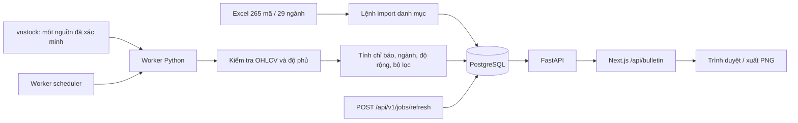
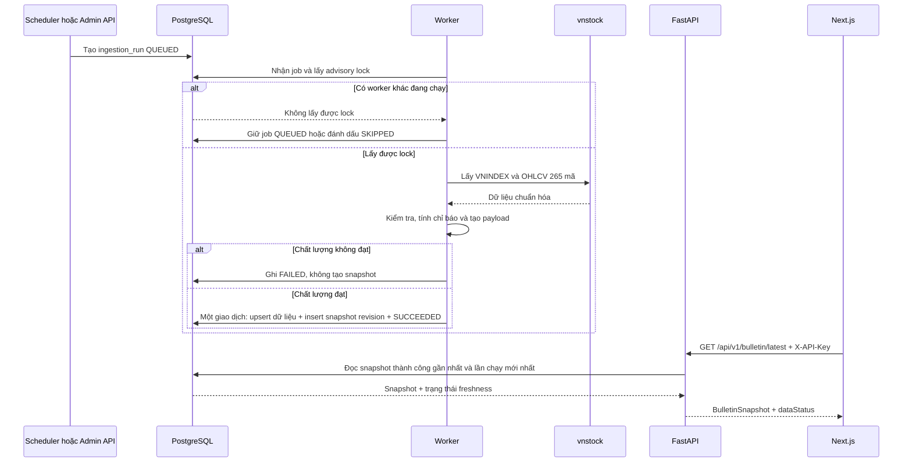

# Di chuyển dữ liệu bản tin sang backend vnstock - Kế hoạch triển khai

## Giai đoạn 0: Làm rõ đầu vào

### 0.1. Bối cảnh đã xác nhận

- Ứng dụng hiện tại là Next.js 16.3, React 19 và TypeScript; trình duyệt gọi `GET /api/bulletin` để nhận `BulletinSnapshot`.
- Dữ liệu định lượng hiện được tổng hợp từ các CSV công khai của Google Sheets trong `lib/bulletin-service.ts`.
- Nội dung nhập thủ công gồm ngày bản tin, kết luận, hành động, nhận định thị trường và danh sách vùng theo dõi vẫn được lưu trong trình duyệt; không chuyển vào backend ở đợt này.
- Phạm vi chứng khoán là đúng 265 mã thuộc 29 ngành trong `CNF_Phan_nganh_Co_phieu_2026-09-04.xlsx`.
- Công thức chuẩn lấy từ tài liệu `Bao_cao_cong_thuc_Data_Clean_v1` và đặc tả đã duyệt tại `docs/spec/spec_migration_vnstock-data-backend_20260923.md`.
- Backend chạy trên VPS bằng Docker Compose, gồm FastAPI, worker và PostgreSQL; frontend giữ nơi triển khai hiện tại.
- Dữ liệu cập nhật một lần sau phiên, mặc định đề xuất 17:30 theo `Asia/Ho_Chi_Minh`, đồng thời hỗ trợ yêu cầu làm mới thủ công.
- Chuyển thẳng sang backend mới sau khi nghiệm thu; không dùng Google Sheets làm dự phòng.
- Nếu lần làm mới mới thất bại, hệ thống giữ snapshot tốt gần nhất và đánh dấu dữ liệu cũ.
- Hệ thống chỉ dùng nội bộ/cá nhân, không cung cấp API dữ liệu công khai hoặc bán lại dữ liệu.

### 0.2. Phân loại và phạm vi thay đổi

- Loại kế hoạch: **Di chuyển công nghệ**.
- Công nghệ bị thay thế: Google Sheets CSV làm nguồn dữ liệu định lượng.
- Công nghệ đích: Python, `vnstock`, FastAPI, PostgreSQL và Docker Compose.
- Mức độ: đa mô-đun, có rủi ro tính đúng dữ liệu tài chính và vận hành.
- TDD: bắt buộc; `09-test` tạo kiểm thử thất bại trước, sau đó `06-implement` mới sửa mã sản xuất.
- Ngoài phạm vi: dữ liệu trong phiên, Buy Signal, thay đổi thiết kế bảng tin, thay đổi xuất PNG, giao diện tải Excel, đồng bộ nội dung định tính lên máy chủ.

### 0.3. Ràng buộc đơn giản hóa

- Chỉ một worker lập lịch; không dùng Celery hoặc Redis.
- Dùng PostgreSQL vừa làm kho dữ liệu vừa làm hàng đợi tối thiểu thông qua trạng thái `ingestion_runs`.
- Chỉ một nguồn dữ liệu đã được kiểm chứng cho toàn bộ một snapshot; không trộn nguồn giữa các mã trong cùng lần chạy.
- Không tạo API lịch sử hoặc trang quản trị khi chưa có yêu cầu.
- Không thêm lớp cache riêng; `bulletin_snapshots` là kết quả đã tính sẵn và API chỉ đọc bản gần nhất.
- Giữ hợp đồng frontend gần với `BulletinSnapshot` hiện tại; chỉ bổ sung trạng thái nguồn dữ liệu cần thiết.

## Giai đoạn 1: Phân tích yêu cầu

### 1.1. Kết quả khảo sát mã nguồn

| Khu vực | Hiện trạng | Tác động di chuyển |
|---|---|---|
| `app/api/bulletin/route.ts` | Route động, trả `no-store`, ánh xạ lỗi nguồn thành `503` | Giữ route công khai hiện tại nhưng thay service Google bằng máy khách FastAPI phía server |
| `lib/bulletin-service.ts` | Tải và ghép nhiều tab CSV Google, sau đó lọc dữ liệu | Được thay bằng máy khách backend; không còn tính toán dữ liệu tài chính trong Next.js |
| `lib/filters.ts` | Bộ lọc mạnh và tiềm năng, có cơ chế bổ sung gần ngưỡng chưa hoàn toàn được đặc tả | Chuyển logic chuẩn sang Python; giữ test TypeScript làm bộ đối chiếu trong giai đoạn tương thích |
| `lib/types.ts` | Khai báo `StockRow` và `BulletinSnapshot` | Giữ các trường hiển thị; bổ sung `dataStatus` tương thích ngược |
| `lib/bulletin-recovery.ts` | Lưu snapshot tốt gần nhất trong `localStorage` | Tiếp tục làm lớp phục hồi phía trình duyệt nếu backend/route không truy cập được |
| `components/bulletin-dashboard.tsx` | Polling, hiển thị dữ liệu cũ và khóa xuất ảnh khi dùng fallback cục bộ | Đọc thêm cờ stale từ backend và khóa xuất ảnh khi snapshot server đã cũ |
| `lib/google-sheets.ts`, `lib/published-csv.ts`, `lib/server-config.ts` | Hạ tầng Google cũ | Chỉ xóa ở giai đoạn dọn dẹp sau khi chuyển đổi được chứng minh |
| Bộ test Vitest | 11 tệp, 67 test đạt | Giữ làm hàng rào regression frontend; thêm test hợp đồng backend |

Baseline ngày 2026-09-23:

- `npm.cmd test -- --run`: 11 tệp test đạt, 67 test đạt.
- `npm.cmd run lint`: đạt.
- Có cảnh báo cấu hình Vite về `configLoader: 'native'`; đây không phải lỗi của migration và không mở rộng phạm vi xử lý.

### 1.2. Kết quả nghiên cứu chính thức

| Nguồn | Kết luận áp dụng |
|---|---|
| [Vnstock Market Data](https://www.vnstocks.com/docs/vnstock/du-lieu-thi-truong-market-data) | Bản cộng đồng có `Market`, hỗ trợ OHLCV cổ phiếu và `VNINDEX`; giao diện từ phiên bản 4 là Unified UI |
| [Vnstock Trading & Quote](https://www.vnstocks.com/docs/vnstock-data/du-lieu-giao-dich) | Gói `vnstock_data` mô tả rõ dữ liệu lịch sử là giá đã điều chỉnh và chuẩn hóa OHLCV; đây là gói khác với bản cộng đồng |
| [Lịch sử phiên bản Vnstock](https://vnstocks.com/docs/tai-lieu/lich-su-phien-ban) | Phiên bản và hành vi giới hạn nguồn có thể đổi; phải ghim phiên bản và kiểm thử lại trước khi nâng cấp |
| [Giấy phép Vnstock](https://vnstocks.com/onboard/giay-phep-su-dung) | Phù hợp sử dụng cá nhân/nội bộ theo phạm vi đã chốt; quyền đối với dữ liệu nguồn vẫn phải được người vận hành kiểm tra |
| [PostgreSQL advisory locks](https://www.postgresql.org/docs/17/explicit-locking.html) | Khóa tư vấn mức giao dịch tự giải phóng khi giao dịch kết thúc, phù hợp để ngăn hai lần refresh chạy đồng thời |
| [FastAPI Security](https://fastapi.tiangolo.com/reference/security/) | Có thể dùng `APIKeyHeader` cho token máy-chủ-đến-máy-chủ và endpoint quản trị |
| Tài liệu Next.js cục bộ `node_modules/next/dist/docs/01-app/02-guides/backend-for-frontend.md` | Route Handler là endpoint công khai; bí mật phải giữ phía server, xác thực đầu vào và không trả lỗi nội bộ nhạy cảm |

### 1.3. Điểm chưa được phép giả định

Tài liệu bản cộng đồng xác nhận OHLCV nhưng không khẳng định rõ toàn bộ chuỗi là giá điều chỉnh. Vì ROC, RS và MA sẽ sai quanh ngày chia tách/cổ tức nếu dùng giá không điều chỉnh, việc triển khai phải có cổng bắt buộc:

1. Ghim chính xác tên gói, phiên bản và nguồn dữ liệu.
2. Thử đủ 265 mã và `VNINDEX` trên VPS mục tiêu.
3. Đối chiếu 3–5 mã có sự kiện doanh nghiệp đã biết để xác nhận tính liên tục của chuỗi giá điều chỉnh.
4. Xác nhận đơn vị giá và khối lượng, độ trễ phiên T và khả năng lấy ít nhất 300 phiên.
5. Nếu bản cộng đồng không đáp ứng, dừng triển khai để người dùng quyết định dùng `vnstock_data` hoặc nguồn điều chỉnh hợp lệ khác; không tự ý đổi gói trả phí và không tự tạo hệ số điều chỉnh thiếu căn cứ.

### 1.4. Yêu cầu EARS

| ID | Yêu cầu có thể kiểm thử |
|---|---|
| R1 | KHI import tệp phân ngành hợp lệ HỆ THỐNG PHẢI lưu đúng 265 mã duy nhất, 29 ngành và sàn tương ứng trong một giao dịch nguyên tử. |
| R2 | KHI tệp phân ngành thiếu cột, trùng mã hoặc chứa sàn không hợp lệ HỆ THỐNG PHẢI từ chối toàn bộ lần import và không thay đổi danh mục đang hoạt động. |
| R3 | KHI bootstrap dữ liệu HỆ THỐNG PHẢI lấy tối thiểu 300 phiên cho từng mã có đủ lịch sử và cho `VNINDEX`, đồng thời chuẩn hóa về `time`, `open`, `high`, `low`, `close`, `volume`. |
| R4 | KHI nguồn chưa được chứng minh là giá điều chỉnh nhất quán HỆ THỐNG PHẢI dừng trước bước tính và công bố snapshot. |
| R5 | KHI chạy refresh HỆ THỐNG PHẢI xác định phiên mục tiêu từ phiên gần nhất của `VNINDEX`, không suy ra từ ngày dương lịch. |
| R6 | KHI không có phiên `VNINDEX` mới HỆ THỐNG PHẢI kết thúc với trạng thái `NO_NEW_SESSION` mà không tạo snapshot trùng. |
| R7 | KHI dữ liệu OHLCV không thỏa quan hệ giá, chứa giá không dương, volume âm hoặc khóa trùng HỆ THỐNG PHẢI đánh dấu lần chạy thất bại và giữ snapshot tốt gần nhất. |
| R8 | KHI tính chỉ báo HỆ THỐNG PHẢI áp dụng đúng ROC, MA, High-TB4D, Vol-TB10D, MA50-TB5D và RS thô theo đặc tả đã duyệt. |
| R9 | KHI tính RS Ranking cho một phiên HỆ THỐNG PHẢI dùng percentile chéo trên tập mã hợp lệ của phiên, xử lý hòa bằng hạng trung bình và cho kết quả từ 0 đến 100. |
| R10 | KHI tính trung bình RS ba phiên HỆ THỐNG PHẢI trung bình ba RS Ranking theo ba phiên giao dịch liên tiếp gần nhất, không trung bình RS thô. |
| R11 | KHI tổng hợp ngành HỆ THỐNG PHẢI tính trung bình cộng ROC26 của các thành viên hợp lệ và sắp xếp giảm dần. |
| R12 | KHI tính độ rộng MA HỆ THỐNG PHẢI dùng mẫu số riêng là số mã đủ lịch sử cho từng MA10, MA20, MA50 và MA200. |
| R13 | KHI lọc cổ phiếu mạnh HỆ THỐNG PHẢI giữ điều kiện volume trên 300.000, ưu tiên mã đạt ROC26 lớn hơn `VNINDEX`, rồi sắp xếp quyết định theo RS Ranking. |
| R14 | KHI lọc cổ phiếu tiềm năng HỆ THỐNG PHẢI áp dụng đầy đủ các điều kiện RS ba phiên, ROC26, MA, High-TB4D và tỷ lệ volume đã duyệt, không áp dụng Buy Signal. |
| R15 | KHI một danh sách nghiêm ngặt có dưới 10 mã HỆ THỐNG PHẢI bổ sung mã đủ điều kiện thanh khoản theo thuật toán khoảng cách đã khóa, không trùng mã và không gắn nhãn trên giao diện. |
| R16 | KHI toàn bộ kiểm tra chất lượng đạt HỆ THỐNG PHẢI công bố một revision snapshot mới nguyên tử; request đọc không được thấy trạng thái tính dở. |
| R17 | KHI refresh thất bại HỆ THỐNG PHẢI tiếp tục trả snapshot tốt gần nhất với `stale=true`, thời điểm thử gần nhất và lý do đã được làm sạch. |
| R18 | KHI hai trigger refresh xảy ra đồng thời HỆ THỐNG PHẢI chỉ cho một lần chạy xử lý dữ liệu và trả trạng thái đã xếp hàng/đang chạy cho trigger còn lại. |
| R19 | KHI Next.js gọi backend HỆ THỐNG PHẢI gửi token chỉ từ môi trường server và không đưa token hoặc lỗi nội bộ xuống trình duyệt. |
| R20 | KHI chuyển đổi được nghiệm thu HỆ THỐNG PHẢI không còn request Google Sheets trong luồng sản xuất nhưng vẫn giữ nguyên nhập nội dung thủ công và xuất PNG. |
| R21 | KHI API nhận token sai hoặc thiếu HỆ THỐNG PHẢI từ chối mà không tiết lộ token, cấu hình hay stack trace. |
| R22 | KHI danh mục được thay bằng tệp Excel mới HỆ THỐNG PHẢI hỗ trợ chạy lại lệnh import trên VPS và lưu dấu lần import. |

### 1.5. Yêu cầu phi chức năng và tiêu chí chất lượng

- Múi giờ duy nhất: `Asia/Ho_Chi_Minh`; mọi timestamp API dùng ISO 8601 có múi giờ.
- Giá trị tính toán lưu đủ độ chính xác; chỉ làm tròn hai chữ số khi tạo payload hiển thị.
- API snapshot mục tiêu phản hồi dưới 500 ms ở p95 trên VPS vì chỉ đọc dữ liệu đã tổng hợp.
- Mỗi request nguồn có timeout hữu hạn; retry có backoff và jitter, không retry vô hạn.
- Nhật ký không chứa token, chuỗi kết nối hoặc payload nguồn toàn bộ.
- PostgreSQL không mở cổng công khai; reverse proxy là điểm vào HTTPS duy nhất.
- Snapshot và lịch sử lần chạy phải tồn tại qua restart container bằng volume bền vững.
- Backup PostgreSQL hằng ngày; phải có ít nhất một lần diễn tập khôi phục trước bàn giao.

## Giai đoạn 2: Đặc tả giải pháp

### 2.1. Kiến trúc được chọn



Thành phần tối thiểu:

- `api`: đọc snapshot, trả health và ghi yêu cầu refresh ở trạng thái `QUEUED`.
- `worker`: một tiến trình lịch biểu; nhận job tự động hoặc job `QUEUED`, giữ advisory lock và chạy pipeline.
- `postgres`: lưu danh mục, OHLCV, chỉ báo, tổng hợp, snapshot và lịch sử chạy.
- `proxy`: kết thúc TLS và chỉ chuyển tiếp các endpoint cần thiết.
- Next.js: proxy server-to-server, kiểm tra schema payload và giữ token trong biến môi trường server.

### 2.2. Luồng refresh và công bố snapshot



### 2.3. Lựa chọn công nghệ và đánh đổi

| Phương án | Ưu điểm | Nhược điểm | Độ phức tạp | An toàn | Khuyến nghị |
|---|---|---|---|---|---|
| A. Next.js gọi `vnstock` hoặc tiến trình Python theo từng request | Ít dịch vụ nhìn bề ngoài | Chậm, dễ quá hạn, tính lặp lại 265 mã, không có snapshot nguyên tử | Trung bình | Thấp | Không chọn |
| B. Worker theo lịch + PostgreSQL + FastAPI snapshot | Ổn định, truy vết được, API nhanh, giữ bản tốt gần nhất | Cần VPS và vận hành cơ sở dữ liệu | Trung bình | Cao | **Chọn** |
| C. Worker xuất JSON tĩnh | Triển khai nhẹ | Khó theo dõi job, revision, import danh mục và phục hồi | Thấp | Trung bình | Không chọn |
| D. Celery + Redis + FastAPI | Hàng đợi mạnh, mở rộng ngang | Quá nhiều thành phần cho một job/ngày và một người dùng | Cao | Cao | Không chọn theo YAGNI |

Các đánh đổi được chấp nhận:

- Chấp nhận vận hành PostgreSQL để đổi lấy tính nguyên tử, lịch sử và phục hồi rõ ràng.
- Chấp nhận refresh theo lô thay vì realtime vì bản tin chỉ cần cuối ngày.
- Không tự động đổi nhà cung cấp trong một snapshot để tránh dữ liệu chéo nguồn không đồng nhất.
- Không giữ Google fallback vì người dùng đã chọn chuyển thẳng; rollback là quay lại bản phát hành trước, không phải fallback thời gian chạy.

### 2.4. Mô hình dữ liệu

| Bảng | Khóa/chỉ mục chính | Nội dung |
|---|---|---|
| `sectors` | `id`, `name UNIQUE` | 29 ngành chuẩn |
| `securities` | `symbol PRIMARY KEY`, chỉ mục `sector_id`, `active` | Mã, tên công ty, sàn, ngành, dấu import |
| `universe_imports` | `id`, `created_at` | Tệp, checksum, số dòng, kết quả import |
| `daily_prices` | `UNIQUE(symbol, trading_date)` | OHLC đã xác minh là điều chỉnh, volume thực tế, nguồn và thời điểm lấy |
| `index_prices` | `UNIQUE(index_code, trading_date)` | OHLCV `VNINDEX` |
| `daily_indicators` | `UNIQUE(symbol, trading_date)` | ROC9/26/33/52, RS thô/ranking, MA, slope và volume ratio |
| `sector_metrics` | `UNIQUE(sector_id, trading_date)` | ROC26 trung bình, số thành viên hợp lệ |
| `market_breadth` | `trading_date PRIMARY KEY` | Tỷ lệ và mẫu số trên MA10/20/50/200 |
| `ingestion_runs` | `id`, chỉ mục `status, requested_at` | `QUEUED`, `RUNNING`, `SUCCEEDED`, `FAILED`, `NO_NEW_SESSION`, lỗi đã làm sạch và thống kê |
| `bulletin_snapshots` | `UNIQUE(as_of_date, revision)` | JSONB bất biến, thời gian công bố, run tạo bản |

Quy tắc dữ liệu:

- Snapshot cùng ngày có thể có revision mới khi chạy lại sau sửa dữ liệu; không cập nhật JSONB của revision cũ.
- `GET latest` chọn revision được công bố mới nhất thuộc lần chạy `SUCCEEDED`.
- Upsert OHLCV là idempotent theo khóa ngày; dữ liệu cùng nguồn được phép sửa nếu checksum nội dung thay đổi và lần chạy mới được ghi nhận.
- Dữ liệu thiếu phiên không tự động điền giá hoặc volume bằng 0.

### 2.5. Công thức và quy tắc cửa sổ

```text
High-TB4D       = mean(High[t-3:t])
Vol-TB10D       = mean(Volume[t-9:t])
CompareVol_10D  = Volume[t] / Vol-TB10D * 100
ROC(N)          = (Close[t] - Close[t-N]) / Close[t-N] * 100
MA(N)           = mean(Close[t-N+1:t])
MA50-TB5D       = (MA50[t] - MA50[t-5]) / MA50[t-5]
RS_raw          = 0.4*ROC9 + 0.2*ROC26 + 0.2*ROC33 + 0.2*ROC52
RS_percentile   = (average_rank_ascending - 1) / (valid_count - 1) * 100
```

- Tất cả cửa sổ kết thúc tại phiên đang tính và bao gồm phiên đó.
- Nếu mẫu số bằng 0 hoặc thiếu lịch sử thì chỉ báo tương ứng là `NULL`, không phải 0.
- Nếu chỉ có một mã hợp lệ trong tập percentile, RS Ranking của mã đó là 100.
- So ngưỡng bằng số chưa làm tròn; payload hiển thị làm tròn hai chữ số.
- Ba phiên RS là ba phiên giao dịch theo lịch `VNINDEX`, không phải ba ngày dương lịch.

### 2.6. Thuật toán bổ sung dưới 10 mã

Quy tắc chung:

1. Volume hiện tại phải lớn hơn 300.000 và các trường cần xếp hạng phải hữu hạn; đây là điều kiện không được nới.
2. Mã đạt đủ điều kiện luôn đứng trước mã bổ sung.
3. Không gắn nhãn mã bổ sung trong payload hiển thị.
4. Mọi khóa hòa kết thúc bằng `symbol ASC` để kết quả lặp lại được.

Danh sách mạnh:

- Nhóm nghiêm ngặt: `ROC26 > VNINDEX_ROC26`, xếp `RS Ranking DESC`, `ROC26 DESC`, `symbol ASC`.
- Nhóm bổ sung: các mã còn lại đủ thanh khoản, xếp theo `rocGap = VNINDEX_ROC26 - ROC26 ASC`, sau đó `RS Ranking DESC`, `ROC26 DESC`, `symbol ASC`.

Danh sách tiềm năng:

- Điều kiện sau thanh khoản được biểu diễn thành 10 kiểm tra: ba RS riêng trong [75,90], RS trung bình trong [75,90], ROC26 trong [10,20], ROC26 lớn hơn chỉ số, Close trên MA20, MA20 trên MA50, slope dương, Close trên High-TB4D, volume ratio ít nhất 1,5. Ba RS riêng được coi là một nhóm điều kiện tổng hợp khi đếm lỗi để không làm lệch trọng số.
- Nhóm nghiêm ngặt đạt tất cả điều kiện, xếp `RS Average 3D DESC`, `ROC26 DESC`, `CompareVol_10D DESC`, `symbol ASC`.
- Nhóm bổ sung xếp theo số nhóm điều kiện thất bại tăng dần, rồi tổng khoảng cách chuẩn hóa tăng dần, rồi các khóa sức mạnh như nhóm nghiêm ngặt.
- Khoảng cách mỗi điều kiện dùng độ thiếu hụt chia cho độ rộng/ngưỡng tương ứng; điều kiện Boolean nhận 0 nếu đạt, 1 nếu trượt. Test fixture phải khóa chính xác các trường hợp biên 75, 90, 10, 20, 1,5 và dấu bằng.

### 2.7. Kiểm tra chất lượng và ngưỡng công bố

Một snapshot chỉ được công bố khi:

- Có bar `VNINDEX` cho phiên mục tiêu.
- Quan hệ OHLC hợp lệ, giá dương, volume không âm và không có khóa trùng.
- Nguồn/phiên bản đã vượt cổng giá điều chỉnh.
- Tập hoạt động là các mã có ít nhất một bar trong năm phiên `VNINDEX` gần nhất; độ phủ phiên mục tiêu trên tập này đạt ngưỡng cấu hình mặc định 95%.
- Mọi ngành có thành viên hoạt động đều báo số thành viên hợp lệ; ngành không còn mã hợp lệ bị loại khỏi bảng của phiên và tạo warning.
- Không có `NaN` hoặc vô hạn trong trường được xuất bản.
- Payload vượt qua schema hợp đồng.
- Snapshot có tối đa 10 mã mỗi danh sách, không trùng mã trong cùng danh sách.

Ngưỡng 95% là cấu hình vận hành duy nhất cho độ phủ; thay đổi ngưỡng phải có test và ghi vào log run.

### 2.8. Hợp đồng API và frontend

`GET /api/v1/bulletin/latest` trả cấu trúc hiện tại cùng phần bổ sung:

```json
{
  "asOfDate": "2026-09-23",
  "generatedAt": "2026-09-23T17:42:00+07:00",
  "vnIndexRoc26": 3.42,
  "sectors": [],
  "strongStocks": [],
  "potentialStocks": [],
  "marketBreadth": {},
  "narrative": null,
  "dataStatus": {
    "source": "vnstock",
    "stale": false,
    "lastAttemptAt": "2026-09-23T17:42:00+07:00",
    "warning": null
  }
}
```

- `GET /api/v1/health`: liveness, kết nối database, có/không có snapshot, ngày snapshot và trạng thái run gần nhất; không trả secrets.
- `POST /api/v1/jobs/refresh`: yêu cầu API key quản trị, tạo tối đa một job `QUEUED` hợp lệ và trả `202` cùng `runId`; nếu có job `QUEUED/RUNNING`, trả `202` với job hiện hữu.
- Endpoint đọc snapshot cũng dùng API key máy chủ để giới hạn backend cho Next.js; health liveness có thể công khai ở proxy.
- Next dùng `VNSTOCK_BACKEND_URL`, `VNSTOCK_BACKEND_API_KEY`, `VNSTOCK_BACKEND_TIMEOUT_MS`; không dùng biến `NEXT_PUBLIC_*` cho bí mật.
- Route Next luôn `no-store`, kiểm tra content type/schema, ánh xạ timeout/5xx thành lỗi tổng quát; trình duyệt không nhận URL backend, token hay stack trace.
- `dataStatus.stale=true` kích hoạt cảnh báo dữ liệu cũ và khóa xuất PNG giống fallback cục bộ hiện tại.

### 2.9. Trường hợp biên

| Trường hợp biên | Điều kiện kích hoạt | Hành vi mong đợi | Ảnh hưởng nếu bỏ qua | Yêu cầu |
|---|---|---|---|---|
| Cuối tuần/ngày lễ | Scheduler chạy nhưng `VNINDEX` không có phiên mới | `NO_NEW_SESSION`, không xuất bản | Snapshot trùng hoặc ngày sai | R5, R6 |
| Mã tạm ngừng giao dịch | Không có bar mục tiêu nhưng có trong danh mục | Không điền giả; loại khỏi mặt cắt và tính độ phủ theo tập hoạt động | Chỉ báo/volume sai | R7, R12 |
| Mã mới niêm yết | Không đủ 52/200 phiên | Chỉ tính trường đủ lịch sử; loại khỏi phép tính yêu cầu trường thiếu | `NaN` hoặc xếp hạng sai | R8, R9 |
| Sự kiện chia tách | Chuỗi giá có bước nhảy kỹ thuật | Cổng giá điều chỉnh phải phát hiện trước cutover | ROC/RS sai nghiêm trọng | R4, R8 |
| Hai mã cùng RS thô | Giá trị bằng nhau | Hạng trung bình | Kết quả không quyết định | R9 |
| Chỉ một mã hợp lệ | Tập percentile có kích thước 1 | Gán 100 | Chia cho 0 | R9 |
| Volume trung bình 0 | Không giao dịch 10 phiên | Ratio là `NULL`, không đạt bộ lọc | Vô hạn | R7, R14 |
| Chính xác tại ngưỡng | RS=75/90, ROC=10/20, ratio=1,5 | Biên đóng đạt; volume=300000 không đạt vì yêu cầu lớn hơn | Sai mã biên | R13–R15 |
| Dưới 10 mã nghiêm ngặt | Bộ lọc cho ít kết quả | Bổ sung theo khoảng cách quyết định | Bảng thiếu hoặc thay đổi ngẫu nhiên | R15 |
| Tệp Excel mới trùng mã | Hai hàng cùng symbol | Từ chối toàn bộ import | Danh mục mâu thuẫn | R2, R22 |
| Nguồn trả schema đổi | Thiếu/đổi cột OHLCV | Adapter từ chối, run thất bại | Gán sai cột âm thầm | R3, R7 |
| Backend chưa có snapshot | Cài mới trước bootstrap | API trả `503 NO_SNAPSHOT` có cấu trúc | UI hiểu nhầm danh sách rỗng | R17 |
| Snapshot cũ nhưng API khỏe | Refresh mới thất bại | Trả `200` cùng `stale=true` | Người dùng dùng dữ liệu cũ mà không biết | R17 |
| Máy chủ lệch múi giờ | VPS dùng UTC | Chuyển rõ sang `Asia/Ho_Chi_Minh` | Chạy sai ngày/phiên | R5 |

### 2.10. Xử lý ngoại lệ

| Loại ngoại lệ | Nguồn | Khả năng phục hồi | Chiến lược | Tác động người dùng | Hành động khôi phục |
|---|---|---|---|---|---|
| Timeout/5xx nguồn | `vnstock`/nguồn dưới | Có | Retry hữu hạn với backoff và jitter; sau đó `FAILED` | Dùng snapshot cũ có cảnh báo | Chạy lại job thủ công |
| Rate limit/challenge | Nguồn dữ liệu | Có sau thời gian chờ | Tôn trọng cooldown, không tăng song song | Snapshot cũ | Chờ cooldown rồi chạy lại |
| Schema nguồn đổi | Adapter | Không tự phục hồi | Fail-fast, lưu mã lỗi đã làm sạch | Snapshot cũ | Cập nhật adapter và fixture |
| Giá chưa điều chỉnh | Kiểm chứng dữ liệu | Không | Chặn cutover/công bố | Chưa có dữ liệu mới | Chọn gói/nguồn hợp lệ sau phê duyệt |
| Dữ liệu chất lượng thấp | Validator | Có thể | Không xuất bản, ghi thống kê thiếu | Snapshot cũ | Kiểm tra mã lỗi rồi chạy lại |
| Vi phạm unique | PostgreSQL | Có | Upsert idempotent hoặc rollback giao dịch | Không thấy dữ liệu dở | Sửa lỗi dữ liệu/migration |
| Mất kết nối database | API/worker | Có | Health fail, request trả `503`, worker retry ở lần sau | UI dùng local fallback nếu có | Khôi phục PostgreSQL |
| Token sai | FastAPI | Không | Trả `401/403`, log fingerprint request không log token | Không tải được dữ liệu | Sửa secret hai đầu |
| Payload backend sai schema | Next proxy | Không | Từ chối payload, trả lỗi tổng quát | UI dùng fallback | Sửa contract/backend |
| Lỗi không xác định | Mọi lớp | Không tại request | ID tương quan, log stack phía server, không lộ chi tiết | Thông báo chung | Điều tra log theo run/correlation ID |

### 2.11. Điều kiện tranh chấp và đồng thời

| Tài nguyên dùng chung | Kịch bản | Rủi ro | Biện pháp | Idempotency |
|---|---|---|---|---|
| Pipeline refresh | Scheduler và admin cùng trigger | Hai snapshot/ghi chồng dữ liệu | PostgreSQL transaction-level advisory lock | `ingestion_runs` tái sử dụng job đang hoạt động |
| Hàng đợi `ingestion_runs` | Hai worker cùng claim | Chạy một job hai lần | `SELECT ... FOR UPDATE SKIP LOCKED` và chỉ một worker cấu hình | Chuyển trạng thái có điều kiện |
| OHLCV | Rerun cùng ngày | Trùng bản ghi | `UNIQUE` + upsert theo checksum | Có |
| Snapshot | Rerun cùng phiên | Ghi đè bản đã công bố | Revision bất biến, unique `(as_of_date, revision)` | Có theo `run_id` |
| Import danh mục | Import trong lúc refresh | Ngành/mã thay đổi giữa pipeline | Import lấy advisory lock cùng họ và giao dịch nguyên tử | Checksum tệp ngăn import lặp |
| API đọc khi publish | Request đến giữa giao dịch | Thấy dữ liệu một phần | Snapshot insert và trạng thái run commit cùng giao dịch | GET thuần đọc |
| Frontend polling | Nhiều trình duyệt gọi cùng lúc | Tăng tải | API đọc một hàng đã tổng hợp; không mutable cache | GET idempotent |

### 2.12. Bảo mật và vận hành

- So sánh API key bằng hàm constant-time; không nhận token qua query string.
- Tách `READ_API_KEY` và `ADMIN_API_KEY`; có thể cùng giá trị ban đầu nhưng cấu hình độc lập để xoay vòng.
- CORS không cần mở rộng vì trình duyệt chỉ gọi Next.js cùng origin.
- Container chạy user không phải root nếu image hỗ trợ; database chỉ nằm trên network nội bộ Compose.
- Reverse proxy giới hạn kích thước request, timeout và rate limit endpoint refresh.
- Secrets nằm trong `.env` trên VPS, không commit; `.env.example` chỉ ghi tên biến và mô tả.
- Backup dùng `pg_dump` có retention cấu hình; khôi phục thử vào database tạm trước bàn giao.
- Ghim dependency bằng lockfile; nâng `vnstock` phải chạy lại probe giá điều chỉnh, contract và fixture tính toán.

## Giai đoạn 3: Kế hoạch triển khai

### 3.1. Quy trình di chuyển sáu giai đoạn

1. Phân tích phạm vi di chuyển.
2. Thiết kế chiến lược di chuyển.
3. Thiết lập lớp tương thích.
4. Di chuyển tăng dần.
5. Dọn dẹp và loại bỏ.
6. Tài liệu và hoàn tất.

Mọi nhiệm vụ bắt đầu ở trạng thái `NOT_STARTED`. Không nhiệm vụ mã nguồn nào được bắt đầu trước khi kế hoạch được người dùng phê duyệt. Các nhiệm vụ test Red thuộc `09-test` phải hoàn tất trước nhiệm vụ production tương ứng.

### 3.2. Cây task thực thi

#### Giai đoạn 1 — Phân tích phạm vi di chuyển

**Nhiệm vụ T1.1 — Khóa nguồn vnstock và giá điều chỉnh**  
Mục tiêu: Ghim gói/phiên bản/nguồn và chứng minh trên VPS rằng dữ liệu đủ cho 265 mã, `VNINDEX`, 300 phiên và các sự kiện doanh nghiệp mẫu.  
Tệp: `backend/scripts/probe_vnstock.py`, `backend/tests/fixtures/provider_probe_expected.json`, `docs/evidence/vnstock-provider-probe.md`.  
Phụ thuộc: không có.  
Có thể song song: có; không chạm file frontend.  
Thay đổi tối thiểu: Script chỉ đọc và báo cáo, chưa ghi database.  
Lệnh xác minh: `python backend/scripts/probe_vnstock.py --universe <excel> --output docs/evidence/vnstock-provider-probe.md`.  
Kết quả mong đợi: 265 mã và `VNINDEX` được phân loại rõ đạt/không đạt; giá điều chỉnh, đơn vị, độ trễ và coverage được kết luận PASS.  
Hoàn tác: Xóa script/fixture bằng revert riêng; không có dữ liệu sản xuất bị đổi.  
Truy vết: R3, R4.

**Nhiệm vụ T1.2 — Đóng băng hợp đồng BulletinSnapshot hiện tại**  
Mục tiêu: Lưu fixture đại diện và xác định chính xác các trường frontend đang dùng.  
Tệp: `tests/fixtures/bulletin-snapshot-contract.json`, `tests/bulletin-contract.test.ts`.  
Phụ thuộc: không có.  
Có thể song song: có; chỉ chạm test frontend.  
Thay đổi tối thiểu: Thêm fixture và test hợp đồng, không đổi production.  
Lệnh xác minh: `npm.cmd test -- tests/bulletin-contract.test.ts`.  
Kết quả mong đợi: Hợp đồng cũ đạt; test mô tả phần mở rộng `dataStatus` chưa có hoặc đang Red theo mục tiêu TDD.  
Hoàn tác: Revert hai tệp test/fixture.  
Truy vết: R17, R19, R20.

**Nhiệm vụ T1.3 — Tạo bộ dữ liệu chuẩn công thức**  
Mục tiêu: Tạo fixture nhỏ có kết quả biết trước cho ROC, MA, RS, percentile, ngành, độ rộng và ngưỡng lọc.  
Tệp: `backend/tests/fixtures/indicator_cases.json`, `backend/tests/fixtures/filter_cases.json`, `docs/evidence/formula-oracle.md`.  
Phụ thuộc: không có.  
Có thể song song: có; fixture độc lập.  
Thay đổi tối thiểu: Dữ liệu tổng hợp nhỏ, không sao chép dữ liệu thị trường có bản quyền.  
Lệnh xác minh: `python -m json.tool backend/tests/fixtures/indicator_cases.json` và tương tự cho filter.  
Kết quả mong đợi: JSON hợp lệ, có đủ trường hợp biên và giá trị tính tay.  
Hoàn tác: Revert fixture/tài liệu.  
Truy vết: R8–R15.

#### Giai đoạn 2 — Thiết kế chiến lược di chuyển

**Nhiệm vụ T2.1 — Khóa schema và migration PostgreSQL**  
Mục tiêu: Chuyển mô hình dữ liệu mục 2.4 thành đặc tả migration có khóa, kiểu dữ liệu và chỉ mục rõ ràng.  
Tệp: `backend/docs/database-schema.md`.  
Phụ thuộc: T1.1.  
Có thể song song: có; chỉ tài liệu thiết kế.  
Thay đổi tối thiểu: Không tạo bảng trước khi nguồn đạt gate.  
Lệnh xác minh: `rg -n "sectors|securities|daily_prices|bulletin_snapshots|ingestion_runs" backend/docs/database-schema.md`.  
Kết quả mong đợi: Đủ 10 bảng, unique key, revision và transaction boundary.  
Hoàn tác: Revert tài liệu.  
Truy vết: R1, R2, R7, R16–R18, R22.

**Nhiệm vụ T2.2 — Khóa hợp đồng API OpenAPI**  
Mục tiêu: Đặc tả ba endpoint, auth, lỗi và payload tương thích frontend.  
Tệp: `backend/docs/openapi-contract.yaml`.  
Phụ thuộc: T1.2.  
Có thể song song: có; không chạm schema database.  
Thay đổi tối thiểu: Chỉ hợp đồng cần cho bulletin, health và refresh.  
Lệnh xác minh: `python backend/scripts/validate_openapi.py backend/docs/openapi-contract.yaml`.  
Kết quả mong đợi: OpenAPI hợp lệ và có `dataStatus`, lỗi `NO_SNAPSHOT`, auth header.  
Hoàn tác: Revert hợp đồng/script kiểm tra.  
Truy vết: R17–R21.

**Nhiệm vụ T2.3 — Khóa thuật toán xếp hạng và bổ sung**  
Mục tiêu: Chuyển mục 2.5–2.6 thành bảng oracle quyết định cho mọi trường hợp hòa/ngưỡng.  
Tệp: `docs/evidence/ranking-filter-oracle.md`, `backend/tests/fixtures/filter_cases.json`.  
Phụ thuộc: T1.3.  
Có thể song song: có; không chung file với T2.1/T2.2.  
Thay đổi tối thiểu: Chỉ bổ sung expected order và khoảng cách chuẩn hóa.  
Lệnh xác minh: `rg -n "300000|75|90|10|20|1.5|symbol" docs/evidence/ranking-filter-oracle.md`.  
Kết quả mong đợi: Thứ tự dự kiến duy nhất cho mỗi fixture.  
Hoàn tác: Revert tài liệu và phần fixture thêm.  
Truy vết: R9, R10, R13–R15.

#### Giai đoạn 3 — Thiết lập lớp tương thích

**Nhiệm vụ T3.1 — Tạo bộ test Red cho import và schema**  
Mục tiêu: Định nghĩa hành vi import nguyên tử và model database trước production code.  
Tệp: `backend/tests/test_universe_import.py`, `backend/tests/test_models.py`.  
Phụ thuộc: T2.1 và kế hoạch được phê duyệt.  
Có thể song song: có; nhóm test database riêng.  
Thay đổi tối thiểu: Test phải thất bại do module/migration chưa tồn tại.  
Lệnh xác minh: `python -m pytest backend/tests/test_universe_import.py backend/tests/test_models.py -q`.  
Kết quả mong đợi: Red đúng vì thiếu implementation, không phải do fixture lỗi.  
Hoàn tác: Revert test.  
Truy vết: R1, R2, R22.

**Nhiệm vụ T3.2 — Tạo bộ test Red cho chỉ báo và bộ lọc**  
Mục tiêu: Khóa toàn bộ công thức và thứ tự top 10 bằng fixture.  
Tệp: `backend/tests/test_indicators.py`, `backend/tests/test_rankings.py`, `backend/tests/test_filters.py`.  
Phụ thuộc: T2.3 và kế hoạch được phê duyệt.  
Có thể song song: có; không chung file T3.1/T3.3.  
Thay đổi tối thiểu: Test thuần, không database/network.  
Lệnh xác minh: `python -m pytest backend/tests/test_indicators.py backend/tests/test_rankings.py backend/tests/test_filters.py -q`.  
Kết quả mong đợi: Red có chủ đích vì module tính chưa tồn tại.  
Hoàn tác: Revert test.  
Truy vết: R8–R15.

**Nhiệm vụ T3.3 — Tạo bộ test Red cho pipeline và API**  
Mục tiêu: Khóa publish nguyên tử, stale fallback, auth, queue và schema OpenAPI.  
Tệp: `backend/tests/test_pipeline.py`, `backend/tests/test_api.py`, `backend/tests/test_concurrency.py`.  
Phụ thuộc: T2.1, T2.2 và kế hoạch được phê duyệt.  
Có thể song song: có; nhóm test tích hợp riêng.  
Thay đổi tối thiểu: Dùng fake provider; không gọi mạng trong test tự động.  
Lệnh xác minh: `python -m pytest backend/tests/test_pipeline.py backend/tests/test_api.py backend/tests/test_concurrency.py -q`.  
Kết quả mong đợi: Red do implementation thiếu; các fixture/fake khởi tạo được.  
Hoàn tác: Revert test.  
Truy vết: R5–R7, R16–R21.

**Nhiệm vụ T3.4 — Tạo test Red cho proxy Next.js và trạng thái stale**  
Mục tiêu: Khóa việc giữ bí mật phía server, ánh xạ payload và giao diện stale.  
Tệp: `tests/backend-bulletin.test.ts`, `tests/bulletin-route.test.ts`, `tests/bulletin-dashboard.test.tsx`.  
Phụ thuộc: T1.2, T2.2 và kế hoạch được phê duyệt.  
Có thể song song: có; chỉ test TypeScript.  
Thay đổi tối thiểu: Mock FastAPI; kiểm tra token không xuất hiện trong response.  
Lệnh xác minh: `npm.cmd test -- tests/backend-bulletin.test.ts tests/bulletin-route.test.ts tests/bulletin-dashboard.test.tsx`.  
Kết quả mong đợi: Test mới Red do client/dataStatus chưa được cài.  
Hoàn tác: Revert test mới.  
Truy vết: R17, R19–R21.

#### Giai đoạn 4 — Di chuyển tăng dần

**Nhiệm vụ T4.1 — Tạo khung backend và cấu hình**  
Mục tiêu: Thiết lập Python package, cấu hình typed, logging và dependency lock tối thiểu.  
Tệp: `backend/pyproject.toml`, `backend/uv.lock`, `backend/app/__init__.py`, `backend/app/config.py`, `backend/app/logging.py`, `backend/.env.example`.  
Phụ thuộc: T3.1, T3.2, T3.3.  
Có thể song song: không; là nền cho các task backend.  
Thay đổi tối thiểu: FastAPI, SQLAlchemy/Alembic, psycopg, pandas/numpy, openpyxl, scheduler và gói vnstock đã qua gate.  
Lệnh xác minh: `cd backend; python -m pytest tests/test_config.py -q`.  
Kết quả mong đợi: Cấu hình bắt buộc fail-fast; secrets được che trong repr/log.  
Hoàn tác: Revert thư mục khung, không đụng frontend.  
Truy vết: R3, R19, R21.

**Nhiệm vụ T4.2 — Cài model và migration database**  
Mục tiêu: Làm test T3.1 về schema đạt.  
Tệp: `backend/app/db.py`, `backend/app/models/*.py`, `backend/alembic.ini`, `backend/alembic/versions/0001_initial.py`.  
Phụ thuộc: T4.1.  
Có thể song song: không; các task sau dùng schema.  
Thay đổi tối thiểu: Chỉ các bảng/chỉ mục mục 2.4.  
Lệnh xác minh: `cd backend; alembic upgrade head; python -m pytest tests/test_models.py -q`.  
Kết quả mong đợi: Migration lên/xuống database test thành công, constraints đạt.  
Hoàn tác: `alembic downgrade base` trên môi trường test rồi revert migration.  
Truy vết: R1, R2, R7, R16–R18, R22.

**Nhiệm vụ T4.3 — Cài import danh mục Excel**  
Mục tiêu: Import nguyên tử, validate và ghi checksum cho tệp phân ngành.  
Tệp: `backend/app/universe/importer.py`, `backend/app/cli.py`.  
Phụ thuộc: T4.2.  
Có thể song song: có với T4.4; không chung file.  
Thay đổi tối thiểu: Một lệnh `import-universe`, không có upload UI.  
Lệnh xác minh: `cd backend; python -m pytest tests/test_universe_import.py -q`.  
Kết quả mong đợi: Tệp chuẩn cho 265/29/190-44-31; fixture sai rollback toàn bộ.  
Hoàn tác: Revert module; database test rollback bằng transaction.  
Truy vết: R1, R2, R22.

**Nhiệm vụ T4.4 — Cài adapter vnstock**  
Mục tiêu: Chuẩn hóa nguồn đã khóa, timeout/retry/cooldown và schema OHLCV.  
Tệp: `backend/app/providers/base.py`, `backend/app/providers/vnstock_provider.py`, `backend/tests/test_provider.py`.  
Phụ thuộc: T1.1, T4.1.  
Có thể song song: có với T4.3; không chung file.  
Thay đổi tối thiểu: Một adapter nguồn, không tự đổi provider.  
Lệnh xác minh: `cd backend; python -m pytest tests/test_provider.py -q`.  
Kết quả mong đợi: Fake response chuẩn hóa đúng; schema/rate-limit lỗi được phân loại.  
Hoàn tác: Revert adapter/test.  
Truy vết: R3, R4, R7.

**Nhiệm vụ T4.5 — Cài máy tính chỉ báo và ranking**  
Mục tiêu: Làm test công thức, percentile và ba phiên đạt.  
Tệp: `backend/app/domain/indicators.py`, `backend/app/domain/rankings.py`.  
Phụ thuộc: T3.2, T4.1.  
Có thể song song: có với T4.3/T4.4; logic thuần.  
Thay đổi tối thiểu: Hàm thuần trên bảng chuẩn hóa, không truy cập database.  
Lệnh xác minh: `cd backend; python -m pytest tests/test_indicators.py tests/test_rankings.py -q`.  
Kết quả mong đợi: Mọi oracle và biên chia cho 0 đạt.  
Hoàn tác: Revert hai module.  
Truy vết: R8–R10.

**Nhiệm vụ T4.6 — Cài tổng hợp ngành, độ rộng và bộ lọc**  
Mục tiêu: Tạo kết quả bulletin quyết định, gồm cơ chế bổ sung dưới 10.  
Tệp: `backend/app/domain/aggregates.py`, `backend/app/domain/filters.py`.  
Phụ thuộc: T4.5.  
Có thể song song: không; dùng đầu ra ranking.  
Thay đổi tối thiểu: Hàm thuần; không chứa I/O.  
Lệnh xác minh: `cd backend; python -m pytest tests/test_filters.py tests/test_aggregates.py -q`.  
Kết quả mong đợi: Thứ tự đúng tuyệt đối theo fixture, không phụ thuộc thứ tự input.  
Hoàn tác: Revert module.  
Truy vết: R11–R15.

**Nhiệm vụ T4.7 — Cài pipeline ingestion và công bố nguyên tử**  
Mục tiêu: Nối provider, validator, tính toán, persistence và revision snapshot.  
Tệp: `backend/app/services/ingestion.py`, `backend/app/services/validation.py`, `backend/app/services/snapshot.py`, `backend/app/repositories/*.py`.  
Phụ thuộc: T4.2, T4.3, T4.4, T4.6.  
Có thể song song: không; là điểm tích hợp backend.  
Thay đổi tối thiểu: Một pipeline tuần tự, không queue ngoài PostgreSQL.  
Lệnh xác minh: `cd backend; python -m pytest tests/test_pipeline.py tests/test_concurrency.py -q`.  
Kết quả mong đợi: Failure không đổi snapshot; rerun idempotent; hai run không chạy đồng thời.  
Hoàn tác: Revert service/repository; schema giữ nguyên vì chưa cutover.  
Truy vết: R5–R7, R16–R18.

**Nhiệm vụ T4.8 — Cài scheduler và xử lý job thủ công**  
Mục tiêu: Chạy một lần/ngày giao dịch và claim job `QUEUED` an toàn.  
Tệp: `backend/app/worker.py`, `backend/app/scheduler.py`, `backend/tests/test_scheduler.py`.  
Phụ thuộc: T4.7.  
Có thể song song: có với T4.9; không chung file.  
Thay đổi tối thiểu: Một tiến trình worker, timezone cấu hình, không Celery/Redis.  
Lệnh xác minh: `cd backend; python -m pytest tests/test_scheduler.py tests/test_concurrency.py -q`.  
Kết quả mong đợi: Job tự động/thủ công cùng đi qua một lock và `NO_NEW_SESSION` đúng.  
Hoàn tác: Revert worker/scheduler.  
Truy vết: R5, R6, R18.

**Nhiệm vụ T4.9 — Cài FastAPI và auth**  
Mục tiêu: Làm contract bulletin, health, refresh và bảo mật token đạt.  
Tệp: `backend/app/main.py`, `backend/app/api/bulletin.py`, `backend/app/api/health.py`, `backend/app/api/jobs.py`, `backend/app/security.py`.  
Phụ thuộc: T4.7.  
Có thể song song: có với T4.8; API không sửa worker.  
Thay đổi tối thiểu: Ba endpoint đã duyệt, không mở API lịch sử.  
Lệnh xác minh: `cd backend; python -m pytest tests/test_api.py -q`.  
Kết quả mong đợi: OpenAPI khớp contract, token sai bị chặn, stale/latest đúng.  
Hoàn tác: Revert API/security.  
Truy vết: R17–R21.

**Nhiệm vụ T4.10 — Đóng gói Docker Compose và HTTPS proxy**  
Mục tiêu: Chạy `api`, `worker`, `postgres`, `proxy` với health check và volume bền vững.  
Tệp: `backend/Dockerfile`, `compose.yaml`, `.dockerignore`, `deploy/Caddyfile`, `.env.example`.  
Phụ thuộc: T4.8, T4.9.  
Có thể song song: có với T4.11; không chung file ngoại trừ `.env.example`, do đó T4.11 không sửa file này.  
Thay đổi tối thiểu: Một compose production; không thêm orchestration khác.  
Lệnh xác minh: `docker compose config` và `docker compose up -d --build`, sau đó health check.  
Kết quả mong đợi: Tất cả container healthy; PostgreSQL không publish port công khai.  
Hoàn tác: `docker compose down` không kèm `-v`, revert file cấu hình; dữ liệu volume còn nguyên.  
Truy vết: R16–R21.

**Nhiệm vụ T4.11 — Chuyển proxy Next.js sang backend**  
Mục tiêu: Thay service Google trong route bằng client FastAPI server-side và hỗ trợ `dataStatus`.  
Tệp: `lib/backend-bulletin.ts`, `lib/types.ts`, `app/api/bulletin/route.ts`, `components/bulletin-dashboard.tsx`.  
Phụ thuộc: T3.4, T4.9.  
Có thể song song: có với T4.10; không sửa file deploy.  
Thay đổi tối thiểu: Không đổi layout/nội dung thủ công/xuất PNG ngoài việc khóa ảnh khi stale.  
Lệnh xác minh: `npm.cmd test -- tests/backend-bulletin.test.ts tests/bulletin-route.test.ts tests/bulletin-dashboard.test.tsx`.  
Kết quả mong đợi: Test Green; token không xuất hiện client bundle/response; stale hiển thị đúng.  
Hoàn tác: Revert bốn file, route cũ vẫn tồn tại cho đến giai đoạn cutover.  
Truy vết: R17, R19–R21.

**Nhiệm vụ T4.12 — Chạy đối chiếu end-to-end trước cutover**  
Mục tiêu: Chứng minh backend tạo snapshot hợp lệ và frontend render/xuất PNG không regression.  
Tệp: `backend/tests/test_e2e_snapshot.py`, `tests/e2e/bulletin-backend.spec.ts`, `docs/evidence/pre-cutover-report.md`.  
Phụ thuộc: T4.10, T4.11.  
Có thể song song: không; gate cuối giai đoạn di chuyển.  
Thay đổi tối thiểu: Chỉ test/report; chưa xóa Google code.  
Lệnh xác minh: `docker compose exec api python -m pytest tests/test_e2e_snapshot.py -q`; `npm.cmd test`; `npm.cmd run lint`; `npm.cmd run build`.  
Kết quả mong đợi: Full gate đạt; snapshot có 29 ngành khi đủ dữ liệu, breadth hợp lệ, tối đa 10 mã/list, web render và xuất PNG.  
Hoàn tác: Revert test/report; không cutover nếu bất kỳ gate nào fail.  
Truy vết: R1–R21.

#### Giai đoạn 5 — Dọn dẹp và loại bỏ

**Nhiệm vụ T5.1 — Chuyển cấu hình sản xuất và quan sát một phiên**  
Mục tiêu: Bật backend cho deployment frontend, chạy refresh thật và xác nhận snapshot/stale trong một phiên vận hành.  
Tệp: cấu hình secrets ngoài Git, `docs/evidence/cutover-checklist.md`.  
Phụ thuộc: T4.12 và phê duyệt cutover.  
Có thể song song: không; thay đổi môi trường sản xuất.  
Thay đổi tối thiểu: Chỉ ba biến backend của Next và secrets VPS.  
Lệnh xác minh: gọi `GET /api/bulletin` ít nhất 5 lần, kiểm tra log run và mở trang thật.  
Kết quả mong đợi: 5/5 HTTP 200, dữ liệu cùng revision, không có request Google trong log/network.  
Hoàn tác: Redeploy commit trước và khôi phục biến Google cũ trong cửa sổ rollback; không bật fallback trong code.  
Truy vết: R16–R20.

**Nhiệm vụ T5.2 — Xóa luồng Google và dependency thừa**  
Mục tiêu: Sau quan sát đạt, loại bỏ code, test và cấu hình chỉ phục vụ Google Sheets.  
Tệp: `lib/bulletin-service.ts`, `lib/google-sheets.ts`, `lib/published-csv.ts`, `lib/server-config.ts`, test tương ứng, `package.json`, `package-lock.json`, `.env.example`.  
Phụ thuộc: T5.1.  
Có thể song song: không; cleanup sau cutover duy nhất.  
Thay đổi tối thiểu: Chỉ xóa đường dẫn không còn tham chiếu và `googleapis`; không xóa parser/utility còn dùng.  
Lệnh xác minh: `rg -n "Google Sheets|googleapis|GOOGLE_SHEETS|published-csv" app components lib config package.json .env.example`; chạy full test/lint/build.  
Kết quả mong đợi: Không còn request/config Google trong production; quality gates đạt.  
Hoàn tác: Revert riêng commit cleanup nếu phát hiện tham chiếu cần giữ.  
Truy vết: R20.

**Nhiệm vụ T5.3 — Diễn tập lỗi, backup và phục hồi**  
Mục tiêu: Chứng minh mất nguồn/database tạm thời không phá snapshot và backup khôi phục được.  
Tệp: `backend/scripts/backup.sh`, `backend/scripts/restore_check.sh`, `docs/evidence/recovery-drill.md`.  
Phụ thuộc: T5.1.  
Có thể song song: có với T5.2 sau khi snapshot production ổn định; không chung file.  
Thay đổi tối thiểu: Script vận hành, không thêm hệ thống backup bên thứ ba.  
Lệnh xác minh: chạy backup, restore vào database tạm, mô phỏng provider timeout rồi đọc latest.  
Kết quả mong đợi: Checksum/số row khớp; API trả snapshot cũ với stale; không mất dữ liệu.  
Hoàn tác: Xóa database tạm bằng lệnh an toàn đã kiểm tra đích; giữ file backup theo retention.  
Truy vết: R7, R16–R18.

#### Giai đoạn 6 — Tài liệu và hoàn tất

**Nhiệm vụ T6.1 — Viết hướng dẫn cài đặt và vận hành**  
Mục tiêu: Cho phép người dùng triển khai, import Excel, bootstrap, refresh, backup và xoay token.  
Tệp: `README.md`, `backend/README.md`, `docs/operations/runbook.md`.  
Phụ thuộc: T5.2, T5.3.  
Có thể song song: có với T6.2; không chung file.  
Thay đổi tối thiểu: Tài liệu đúng lệnh thực tế, không mô tả tính năng ngoài phạm vi.  
Lệnh xác minh: Thực hiện runbook trên môi trường sạch hoặc VPS staging.  
Kết quả mong đợi: Một người vận hành có thể dựng hệ thống và xử lý stale theo tài liệu.  
Hoàn tác: Revert tài liệu nếu chưa chính xác.  
Truy vết: R1–R22.

**Nhiệm vụ T6.2 — Hoàn tất review bảo mật và chất lượng**  
Mục tiêu: Review diff, dependency, secrets, license và kết quả test trước bàn giao.  
Tệp: `docs/evidence/final-review.md`; chỉ đọc toàn bộ diff.  
Phụ thuộc: T5.2, T5.3.  
Có thể song song: có với T6.1; chỉ tạo report riêng.  
Thay đổi tối thiểu: Không sửa production trong review; finding phải quay về task sở hữu.  
Lệnh xác minh: `git diff --check`; full Python/TypeScript test, lint, build, `docker compose config`, secret scan theo danh sách từ khóa.  
Kết quả mong đợi: Không finding nghiêm trọng/cao; mọi gate đạt; phạm vi license được ghi nhận.  
Hoàn tác: Không bàn giao nếu review fail; sửa theo retry policy rồi chạy lại.  
Truy vết: R1–R22.

**Nhiệm vụ T6.3 — Bàn giao và xác nhận vận hành**  
Mục tiêu: Ghi phiên bản, commit, ngày snapshot, thủ tục rollback và chủ sở hữu vận hành.  
Tệp: `docs/evidence/handover.md`, harness log/state.  
Phụ thuộc: T6.1, T6.2.  
Có thể song song: không; task kết thúc.  
Thay đổi tối thiểu: Chỉ tài liệu bàn giao và trạng thái pipeline.  
Lệnh xác minh: đối chiếu checklist bàn giao, gọi health/latest và mở web production.  
Kết quả mong đợi: Người dùng xác nhận dữ liệu, lịch, nhập thủ công và xuất PNG hoạt động.  
Hoàn tác: Giữ pipeline mở nếu chưa xác nhận; không đánh dấu hoàn tất.  
Truy vết: R16–R22.

### 3.3. Bản đồ phụ thuộc và song song

| ID nhiệm vụ | Tên nhiệm vụ | Phụ thuộc vào | Loại | Wave | Phạm vi file |
|---|---|---|---|---|---|
| T1.1 | Khóa nguồn và giá điều chỉnh | none | Độc lập | 1 | Probe/evidence backend |
| T1.2 | Đóng băng hợp đồng frontend | none | Độc lập | 1 | Test/fixture TypeScript |
| T1.3 | Tạo fixture công thức | none | Độc lập | 1 | Fixture/evidence backend |
| T2.1 | Khóa schema database | T1.1 | Phụ thuộc | 2 | Tài liệu schema |
| T2.2 | Khóa OpenAPI | T1.2 | Phụ thuộc | 2 | OpenAPI |
| T2.3 | Khóa oracle ranking/filter | T1.3 | Phụ thuộc | 2 | Oracle/fixture |
| T3.1 | Test Red import/schema | T2.1, approval | Phụ thuộc | 3 | Test Python database |
| T3.2 | Test Red chỉ báo/filter | T2.3, approval | Phụ thuộc | 3 | Test Python domain |
| T3.3 | Test Red pipeline/API | T2.1, T2.2, approval | Phụ thuộc | 3 | Test Python integration |
| T3.4 | Test Red proxy/stale | T1.2, T2.2, approval | Phụ thuộc | 3 | Test TypeScript |
| T4.1 | Khung backend/cấu hình | T3.1, T3.2, T3.3 | Phụ thuộc | 4 | Backend core config |
| T4.2 | Model/migration database | T4.1 | Phụ thuộc | 5 | DB/Alembic |
| T4.4 | Adapter vnstock | T1.1, T4.1 | Phụ thuộc | 5 | Provider adapter |
| T4.5 | Chỉ báo/ranking | T3.2, T4.1 | Phụ thuộc | 5 | Domain pure functions |
| T4.3 | Import Excel | T4.2 | Phụ thuộc | 6 | Universe importer |
| T4.6 | Ngành/breadth/filter | T4.5 | Phụ thuộc | 6 | Domain aggregates |
| T4.7 | Pipeline/publish | T4.2, T4.3, T4.4, T4.6 | Phụ thuộc | 7 | Services/repositories |
| T4.8 | Scheduler/worker | T4.7 | Phụ thuộc | 8 | Worker/scheduler |
| T4.9 | FastAPI/auth | T4.7 | Phụ thuộc | 8 | API/security |
| T4.10 | Docker/HTTPS | T4.8, T4.9 | Phụ thuộc | 9 | Deploy/compose |
| T4.11 | Next proxy/backend client | T3.4, T4.9 | Phụ thuộc | 9 | Next/lib/components |
| T4.12 | Đối chiếu end-to-end | T4.10, T4.11 | Phụ thuộc | 10 | Test/report E2E |
| T5.1 | Cutover và quan sát | T4.12, cutover approval | Phụ thuộc | 11 | Cấu hình production/report |
| T5.2 | Xóa Google/dependency | T5.1 | Phụ thuộc | 12 | Code/dependency cũ |
| T5.3 | Diễn tập phục hồi | T5.1 | Phụ thuộc | 12 | Ops scripts/report |
| T6.1 | Tài liệu vận hành | T5.2, T5.3 | Phụ thuộc | 13 | README/runbook |
| T6.2 | Review cuối | T5.2, T5.3 | Phụ thuộc | 13 | Final review report |
| T6.3 | Bàn giao | T6.1, T6.2 | Phụ thuộc | 14 | Handover/harness |

- Wave 1 chạy song song T1.1, T1.2, T1.3; không chung file.
- Wave 2 chạy song song T2.1, T2.2, T2.3; không chung file.
- Wave 3 chạy song song bốn nhóm test Red; không chung file và chưa sửa production.
- Wave 4 chỉ T4.1 vì là nền backend.
- Wave 5 chạy song song T4.2, T4.4, T4.5; phạm vi DB/provider/domain tách biệt.
- Wave 6 chạy song song T4.3 và T4.6; importer và domain tách biệt.
- Wave 7 chỉ T4.7 tại điểm tích hợp.
- Wave 8 chạy song song T4.8 và T4.9; worker và API tách file.
- Wave 9 chạy song song T4.10 và T4.11; deployment và frontend tách file.
- Wave 10–11 tuần tự vì là gate E2E và cutover.
- Wave 12 chạy song song cleanup code và recovery drill; không chung file.
- Wave 13 chạy song song tài liệu vận hành và review report.
- Wave 14 chỉ bàn giao.

### 3.4. Ma trận truy vết

| Yêu cầu | Nhiệm vụ thực hiện | Bằng chứng chấp nhận |
|---|---|---|
| R1–R2 | T2.1, T3.1, T4.2, T4.3 | Test import đúng 265/29 và rollback fixture sai |
| R3–R4 | T1.1, T4.4 | Probe VPS PASS, test adapter và báo cáo giá điều chỉnh |
| R5–R6 | T3.3, T4.7, T4.8 | Test lịch phiên và `NO_NEW_SESSION` |
| R7 | T3.3, T4.4, T4.7, T5.3 | Test validation fail không đổi snapshot |
| R8–R10 | T1.3, T2.3, T3.2, T4.5 | Oracle công thức/percentile/ba phiên đạt |
| R11–R12 | T3.2, T4.6 | Test ngành và mẫu số breadth |
| R13–R15 | T2.3, T3.2, T4.6 | Thứ tự top 10 và edge threshold đúng tuyệt đối |
| R16 | T3.3, T4.2, T4.7, T4.12 | Test transaction và API không thấy dữ liệu dở |
| R17 | T3.3, T3.4, T4.7, T4.9, T4.11, T5.3 | Backend/frontend đều hiển thị stale và giữ bản tốt |
| R18 | T3.3, T4.7–T4.9 | Concurrency test chỉ một run xử lý |
| R19 | T2.2, T3.4, T4.9, T4.11 | Test token server-only và response không lộ secret |
| R20 | T4.11, T4.12, T5.1, T5.2 | Network/log không còn Google; manual/PNG regression đạt |
| R21 | T3.3, T3.4, T4.9, T6.2 | Auth negative test và secret review |
| R22 | T3.1, T4.3, T6.1 | CLI import lại tệp và runbook được diễn tập |

### 3.5. Cổng nghiệm thu

#### Cổng A — Nguồn dữ liệu

- Không triển khai production nếu T1.1 không chứng minh giá điều chỉnh, coverage và đơn vị dữ liệu.
- Nếu cần chuyển từ `vnstock` cộng đồng sang `vnstock_data` hoặc dịch vụ trả phí, phải quay lại người dùng phê duyệt chi phí/giấy phép.

#### Cổng B — TDD

- T3.1–T3.4 phải Red đúng nguyên nhân trước T4.
- Mỗi implementation task chỉ hoàn thành khi test sở hữu chuyển Green và test liên quan vẫn Green.

#### Cổng C — Trước cutover

- Python unit/integration test đạt.
- 67 test baseline TypeScript và test mới đạt.
- Lint, Next build, Docker config/health đạt.
- Không có secret trong Git hoặc client bundle.
- Snapshot thật vượt ngưỡng chất lượng và đối chiếu thủ công các mã mẫu.

#### Cổng D — Xóa Google

- Chỉ thực hiện T5.2 sau một phiên production thành công và người dùng phê duyệt cutover.
- Commit cleanup tách riêng để có thể revert mà không mất backend/database.

#### Cổng E — Bàn giao

- Backup/restore drill đạt.
- Không còn finding nghiêm trọng/cao.
- Runbook được chạy thử.
- Người dùng xác nhận web, nhập nội dung thủ công và xuất PNG hoạt động.

### 3.6. Chiến lược rollback

- Trước cutover: không đổi production; xóa/revert từng task độc lập.
- Trong cutover: redeploy commit frontend trước migration và khôi phục biến môi trường cũ; database mới được giữ để điều tra, không xóa volume.
- Sau cleanup: revert riêng commit cleanup nếu cần quay lại code Google; đây là thao tác phát hành, không phải fallback runtime.
- Snapshot/database: không sửa snapshot cũ; publish revision mới sau khi khắc phục.
- Không dùng `git reset --hard`, không dùng `docker compose down -v`, không xóa backup khi rollback.

### 3.7. Điều kiện phê duyệt kế hoạch

Chưa sửa mã nguồn production ở bước lập kế hoạch này. Sau khi người dùng phê duyệt:

1. `09-test` thực hiện Wave 1–3 và chứng minh Red.
2. `06-implement` thực hiện Wave 4–12 theo dependency.
3. `10-review` thực hiện review cuối, quality gates và bàn giao.
4. Mọi thay đổi production/cutover vẫn tuân theo ranh giới quyền và cổng phê duyệt nêu trên.
