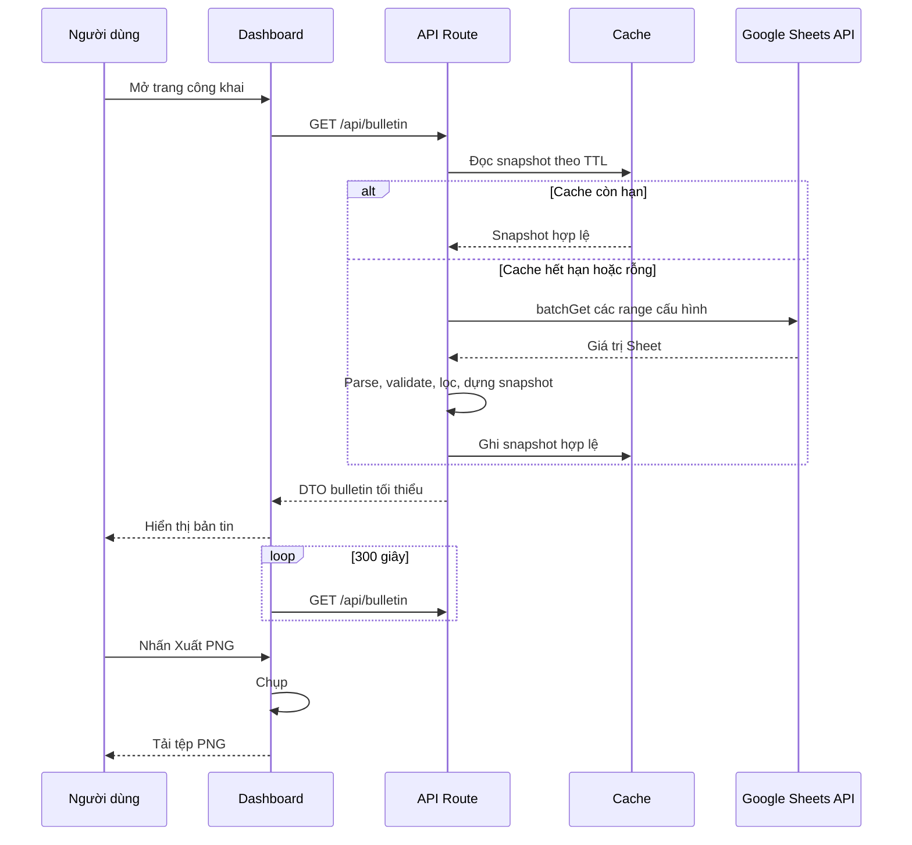

# CNF Daily Market Bulletin - Kế hoạch triển khai

## Giai đoạn 0: Làm rõ đầu vào

### Bối cảnh đã chốt

- Dự án mới, chưa có mã ứng dụng; chỉ có bản demo HTML/CSS/JavaScript, logo CNF, `Data.xlsx` và Google Sheets.
- Website công khai, không có đăng nhập; dữ liệu được lấy phía máy chủ qua Google Sheets API và làm mới phía trình duyệt mỗi 300 giây.
- Khu vực xuất ảnh có kích thước tuyệt đối 1920 × 1080 px; toolbar không nằm trong ảnh.
- UI/UX đã được phê duyệt tại `docs/ui-design/system_design.md`.
- `Buy Signal` và `Breakout` không tham gia Bộ lọc 2. Nếu tập mã đạt chuẩn ít hơn 10, bảng hiển thị thêm mã cận chuẩn mà không gắn nhãn.

### Giả định thực hiện

1. Google Sheet sẽ được chia sẻ quyền **Viewer** trực tiếp cho email service account; không dùng domain-wide delegation. Đây là cơ chế Google hướng dẫn cho truy cập một tài liệu cụ thể.
2. Các tab/range có thể đổi tên được đặt trong cấu hình máy chủ. Ứng dụng không tự đoán hoặc thay thế `ROC26_VNINDEX` khi thiếu dữ liệu này.
3. `Web_Bulletin` là tab được thêm vào Sheet để cung cấp `as_of_date`, `status` (`draft`/`published`), `conclusion`, `action` và `footer`. Chỉ bản ghi `published` trùng ngày dữ liệu mới được hiển thị.
4. Phiên bản đầu dùng một instance hoặc cache theo instance. Nếu sau này chạy đa instance có tải lớn, cache dùng chung là hạng mục mở rộng, không đưa vào v1.

### Câu hỏi vận hành còn lại, không chặn việc dựng khung

- Chủ sở hữu Sheet phải điền mapping/range thực tế cho `ROC26_VNINDEX` và `Web_Bulletin` trước khi dashboard dùng dữ liệu thật.
- Chủ sở hữu triển khai phải tạo và cấp quyền service account, sau đó đặt secrets trong môi trường hosting; không gửi key qua chat hay commit vào repository.

## Giai đoạn 1: Phân tích yêu cầu

### Nguồn tham chiếu đã khảo sát

- Google Sheets API cho phép đọc single/multiple ranges và khuyến nghị dùng `batchGet` khi lấy nhiều vùng nhằm giảm số request: [Google Sheets API — đọc giá trị](https://developers.google.com/workspace/sheets/api/guides/values).
- Google hướng dẫn chia sẻ riêng Google Sheet cho email service account khi chỉ cần truy cập một tài liệu; không cần quyền quản trị Workspace: [Google Workspace credentials](https://developers.google.com/workspace/guides/create-credentials).
- Secrets không có tiền tố `NEXT_PUBLIC_` chỉ có ở môi trường Node.js; biến mang tiền tố này có thể bị inline vào bundle trình duyệt: [Next.js environment variables](https://nextjs.org/docs/pages/guides/environment-variables).
- Route Handlers của Next.js là endpoint phù hợp cho API cùng ứng dụng; GET không mặc định cache: [Next.js Route Handlers](https://nextjs.org/docs/15/app/getting-started/route-handlers-and-middleware).
- Google khuyến nghị tránh service-account key khi nền tảng có identity tích hợp; nếu hosting ngoài GCP buộc phải dùng key, key phải là secret, có tối thiểu quyền và kế hoạch xoay vòng: [Google Cloud service-account security](https://docs.cloud.google.com/iam/docs/best-practices-service-accounts).
- `html-to-image` cung cấp `toPng` để xuất một DOM node; việc dùng thư viện này chỉ được thực hiện sau khi người dùng xác nhận thay đổi dependency: [html-to-image](https://www.npmjs.com/package/html-to-image).

### Yêu cầu chức năng theo EARS

| ID | Yêu cầu |
|---|---|
| R1 | KHI một người dùng mở đường dẫn công khai, HỆ THỐNG PHẢI hiển thị bản tin mà không yêu cầu đăng nhập. |
| R2 | KHI API cần dữ liệu, HỆ THỐNG PHẢI đọc các range cấu hình từ Google Sheets ở phía máy chủ và không trả credential hoặc dữ liệu thô không cần thiết cho trình duyệt. |
| R3 | KHI nhiều range Sheet được cần trong một lần tải, HỆ THỐNG PHẢI dùng một lời gọi đọc gộp để giảm số request upstream. |
| R4 | KHI trình duyệt đang mở dashboard, HỆ THỐNG PHẢI tải dữ liệu ban đầu và thử làm mới sau mỗi 300 giây. |
| R5 | KHI dữ liệu thiếu trường bắt buộc, sai kiểu số, hoặc không có `ROC26_VNINDEX`, HỆ THỐNG PHẢI từ chối snapshot đó, giữ snapshot hợp lệ gần nhất nếu có và trả trạng thái có thể hiểu được. |
| R6 | KHI lọc “Top 10 cổ phiếu mạnh nhất”, HỆ THỐNG PHẢI chỉ giữ mã có `KLGD > 300000` và `ROC26 > ROC26_VNINDEX`, sắp xếp `RS-TB3D` giảm dần và trả tối đa 10 mã. |
| R7 | KHI lọc “Top 10 cổ phiếu tiềm năng”, HỆ THỐNG PHẢI áp dụng toàn bộ điều kiện thanh khoản, ba phiên RS, ROC26, MA và khối lượng đã được phê duyệt, không dùng `Buy Signal`/`Breakout`, rồi sắp xếp theo RS-TB3D, ROC26, tỷ lệ volume giảm dần. |
| R8 | KHI tập mã đạt toàn bộ điều kiện của R7 ít hơn 10, HỆ THỐNG PHẢI bổ sung tối đa đến 10 mã cận chuẩn theo số điều kiện thỏa mãn rồi theo cùng quy tắc xếp hạng, nhưng API và UI không phát nhãn “cận chuẩn”. |
| R9 | KHI có dữ liệu ngành, breadth MA và narrative đã publish, HỆ THỐNG PHẢI trả chúng cùng một `as_of_date` và thời điểm snapshot. |
| R10 | KHI narrative cùng ngày đang là `draft` hoặc không tồn tại, HỆ THỐNG PHẢI hiển thị trạng thái chưa có nhận định thay vì dữ liệu cũ/không đúng ngày. |
| R11 | KHI người dùng bấm nút xuất ảnh, HỆ THỐNG PHẢI tạo và tải PNG từ đúng vùng `#bulletin-canvas` ở 1920 × 1080 px với tên `cnf-morning-bulletin_YYYY-MM-DD.png`. |
| R12 | KHI API hoặc xuất ảnh lỗi, HỆ THỐNG PHẢI cho biết lỗi bằng văn bản dễ hiểu, giữ giao diện thao tác được và cho phép thử lại. |

### Quy tắc dữ liệu và thuật toán

**Dữ liệu cổ phiếu tối thiểu**

```ts
type StockRow = {
  ticker: string;
  sector: string;
  close: number;
  highAvg4d: number;
  volume: number;
  averageVolume10d: number;
  rsLast3: readonly [number, number, number];
  rsAverage3d: number;
  roc26: number;
  ma20: number;
  ma50: number;
  ma50Slope5d: number;
};

type BulletinSnapshot = {
  asOfDate: string;
  generatedAt: string;
  vnIndexRoc26: number;
  sectors: Array<{ name: string; averagePercent: number }>;
  strongStocks: StockRow[];
  potentialStocks: StockRow[];
  marketBreadth: { ma10: number; ma20: number; ma50: number; ma200: number };
  narrative: { conclusion: string; action: string; footer: string } | null;
};
```

**Điều kiện Bộ lọc 1**

```text
volume > 300000
AND roc26 > vnIndexRoc26
→ sắp xếp rsAverage3d giảm dần
→ lấy 10 mã đầu tiên
```

**Điều kiện Bộ lọc 2 nghiêm ngặt**

```text
volume > 300000
AND từng giá trị rsLast3 nằm trong [75, 90]
AND rsAverage3d nằm trong [75, 90]
AND roc26 > vnIndexRoc26
AND roc26 nằm trong [10, 20]
AND close > ma20
AND ma20 > ma50
AND ma50Slope5d > 0
AND close > highAvg4d
AND volume / averageVolume10d >= 1.5
```

Mỗi điều kiện nghiêm ngặt có một định danh kiểm tra để tính điểm cho mã cận chuẩn. Chỉ các mã có dữ liệu số đầy đủ mới đủ điều kiện được xếp hạng; thiếu trường được tính là không thỏa điều kiện tương ứng, không được nội suy. Mã nghiêm ngặt đứng trước; nếu cần bổ sung thì chọn mã còn lại theo số điều kiện thỏa mãn giảm dần, tiếp theo `rsAverage3d`, `roc26`, `volume / averageVolume10d` giảm dần. Trả tối đa 10 mã, không trả cờ phân loại cho UI.

### Yêu cầu phi chức năng

- Bảo mật: không đưa spreadsheet ID nhạy cảm, email service account hay private key vào JS trình duyệt; `.env*` bị ignore.
- Độ tin cậy: cache snapshot hợp lệ gần nhất tối đa 5 phút; lỗi upstream không làm hiển thị dữ liệu nửa vời.
- Hiệu năng: dùng `batchGet`, parse một lần mỗi TTL; UI không tạo request song song cho cùng một chu kỳ refresh.
- Truy cập: theo `docs/ui-design/system_design.md`, hỗ trợ bàn phím, focus rõ, `aria-live`, không chỉ truyền trạng thái qua màu.
- Không thêm database, queue, login, CMS hay scheduler server trong v1.

## Giai đoạn 2: Đặc tả giải pháp

### Đánh đổi và lựa chọn

| Phương án | Ưu điểm | Nhược điểm | Độ phức tạp | Bảo mật | Khuyến nghị |
|---|---|---|---|---|---|
| Trình duyệt gọi Google Sheet trực tiếp | Ít mã backend | Lộ nguồn/credential hoặc phụ thuộc Sheet public; khó validate | Thấp | Thấp | Không chọn |
| Google Apps Script làm backend | Gần Sheet, setup ban đầu nhanh | Triển khai/quan sát lỗi và UI export khó kiểm soát; ràng buộc Apps Script | Trung bình | Trung bình | Không chọn |
| Next.js App Router + Route Handler + Google Sheets API | Credential ở server, có validation/filter rõ, một dự án cho UI/API | Cần setup Node và secrets hosting | Trung bình | Cao | **Chọn** |
| Next.js + database/cache dùng chung | Mở rộng tốt nhiều instance | Thêm chi phí, migration, vận hành không cần thiết ở v1 | Cao | Cao | Chưa dùng |

**Lựa chọn:** Next.js App Router + TypeScript, Route Handler `GET /api/bulletin`, thư viện `googleapis` ở server và `html-to-image` chỉ ở client. Cache TTL 300 giây nằm trong process với single-flight promise. Hướng này đáp ứng yêu cầu và không đưa vào database/scheduler/caching service chưa cần thiết.

### Kiến trúc và luồng dữ liệu

```mermaid
flowchart LR
  Sheet[Google Sheets] -->|batchGet, service account| Gateway[Google Sheets gateway phía máy chủ]
  Gateway --> Validate[Chuẩn hóa và kiểm tra dữ liệu]
  Validate --> Filters[Bộ lọc RS và tiềm năng]
  Filters --> Cache[Snapshot cache 300 giây]
  Cache --> API[GET /api/bulletin]
  API --> Page[Dashboard public]
  Page -->|mỗi 300 giây| API
  Page -->|nhấn xuất| PNG[PNG 1920 × 1080 trên trình duyệt]
```





### Cấu trúc dự án đề xuất

Đây là dashboard web, không thuộc năm nhóm dự án AI có reference structure bắt buộc; dùng cấu trúc tùy chỉnh tối giản theo lớp trách nhiệm.

```text
BC_daily/
├── app/                                      # Next.js App Router
│   ├── api/
│   │   └── bulletin/
│   │       └── route.ts                       # Endpoint snapshot công khai
│   ├── globals.css                            # Token và layout theo UI spec
│   ├── layout.tsx                             # Khai báo HTML/lang/font
│   └── page.tsx                               # Entry dashboard
├── components/
│   ├── bulletin-dashboard.tsx                 # Điều phối trạng thái tải và refresh
│   ├── bulletin-canvas.tsx                    # Vùng ảnh 1920×1080
│   ├── export-toolbar.tsx                     # Nút xuất và thông báo trạng thái
│   ├── market-breadth.tsx                     # Panel MA
│   ├── narrative-panel.tsx                    # Nhận định/hành động
│   ├── sector-ranking.tsx                     # Xếp hạng ngành
│   └── stock-table.tsx                        # Bảng Top 10 dùng chung
├── lib/
│   ├── bulletin-service.ts                    # Luồng đọc → validate → filter → cache
│   ├── filters.ts                             # Logic thuần hai bộ lọc
│   ├── google-sheets.ts                       # Client Sheets server-only
│   ├── parsers.ts                             # Chuyển hàng Sheet thành kiểu dữ liệu
│   └── types.ts                               # Kiểu DTO và domain
├── config/
│   ├── filters.ts                             # Ngưỡng lọc, TTL và giới hạn Top 10
│   └── sheet-mapping.ts                       # Tên tab/range/header được cấu hình
├── public/
│   └── assets/
│       └── cnf-logo.png                       # Logo được lấy từ demo được cung cấp
├── tests/
│   ├── filters.test.ts                        # Kiểm thử Bộ lọc 1 và 2
│   ├── parsers.test.ts                        # Kiểm thử dữ liệu Sheet không hợp lệ
│   └── bulletin-api.test.ts                   # Hợp đồng endpoint và trạng thái lỗi
├── .env.example                               # Danh sách tên biến, không có secret thật
├── .gitignore                                 # Bảo vệ .env* và artifact local
├── package.json                               # Scripts và dependency đã được xác nhận
├── tsconfig.json                              # Thiết lập TypeScript
├── vitest.config.ts                           # Cấu hình test tối thiểu
└── README.md                                  # Thiết lập, mapping Sheet, chạy/triển khai
```

### Cấu hình và secrets

`config/filters.ts` là nguồn duy nhất cho ngưỡng nghiệp vụ cố định đã phê duyệt: `refreshIntervalMs`, giới hạn 10, thanh khoản 300000, biên RS 75–90, ROC26 10–20, ngưỡng volume ratio 1.5. `config/sheet-mapping.ts` là nguồn duy nhất cho tên tab, header bắt buộc và A1 ranges. Không sao chép các giá trị này sang component.

Các giá trị thay đổi theo môi trường chỉ được đọc trong module server, kiểm tra lúc khởi tạo và không có tiền tố `NEXT_PUBLIC_`:

```text
GOOGLE_SHEETS_ID
GOOGLE_SERVICE_ACCOUNT_EMAIL
GOOGLE_SERVICE_ACCOUNT_PRIVATE_KEY
```

Private key có thể được hosting lưu dưới dạng secret một dòng; module server chuẩn hóa `\\n` thành newline khi tạo client. `.env.example` chỉ nêu tên biến và mô tả, không chứa ID/key/email thực. Không tạo endpoint ghi dữ liệu vào Sheet.

### Hợp đồng API tối thiểu

`GET /api/bulletin`

- Thành công `200`: trả `BulletinSnapshot` đã chuẩn hóa, không gồm raw rows, key, range mapping hoặc dữ liệu `draft`.
- Không có snapshot hợp lệ lần đầu `503`: `{ "error": { "code": "DATA_UNAVAILABLE", "message": "Dữ liệu bản tin chưa sẵn sàng." } }`.
- Cấu hình server thiếu/sai `500`: chỉ log chi tiết ở server, client nhận thông điệp chung.
- Sheet thiếu `ROC26_VNINDEX`/header bắt buộc: `503`, không bịa giá trị thay thế.

API chỉ dùng `GET`; giới hạn nội dung JSON theo DTO hiển thị. Trong v1, response dùng `Cache-Control: no-store` để thời gian refresh của client là nguồn điều khiển duy nhất, tránh CDN lưu bản tin lâu hơn 5 phút.

### Trường hợp biên và truy vết

| Tình huống biên | Điều kiện kích hoạt | Hành vi mong đợi | Rủi ro nếu bỏ qua | Yêu cầu |
|---|---|---|---|---|
| Thiếu `ROC26_VNINDEX` | Range rỗng/sai kiểu | Không lọc, giữ snapshot hợp lệ trước đó hoặc báo unavailable | Danh sách sai do so sánh với giá trị giả | R5 |
| Có ít hơn 10 mã mạnh | Dữ liệu đạt R6 < 10 | Trả tất cả mã đạt chuẩn, không thêm mã sai điều kiện | Gây hiểu lầm bộ lọc | R6 |
| Có ít hơn 10 mã tiềm năng | Mã strict < 10 | Bổ sung near-miss theo điểm và tie-breaker, không có nhãn UI | Bản tin thiếu danh sách kỳ vọng | R8 |
| Chia cho 0 | `averageVolume10d <= 0` | Điều kiện volume ratio là false | Infinity/NaN làm sai rank | R5, R7 |
| Giá trị RS thiếu một phiên | Không đủ ba số RS | Không đạt strict; có thể near-miss chỉ khi dữ liệu còn đủ để xếp hạng hợp lệ | Suy luận sai sức mạnh duy trì | R5, R7 |
| Dòng lặp ticker | Hai hàng cùng ticker | Giữ dòng có đầy đủ dữ liệu hơn; nếu ngang nhau giữ dòng xuất hiện sau cùng và log cảnh báo server | Hai vị trí Top 10 cùng một mã | R5 |
| Narrative vẫn draft | `status != published` hoặc khác ngày | Hiển thị panel chưa có nhận định | Hiển thị nội dung chưa duyệt/cũ | R10 |
| Lỗi Sheet sau lần tải thành công | Timeout/403/5xx | Phục vụ snapshot gần nhất còn hạn; hết hạn báo lỗi rõ | Dashboard trắng hoặc dữ liệu nửa vời | R5, R12 |
| Hai lần refresh chồng nhau | Tab visibility / mạng chậm | Client bỏ response cũ bằng request sequence/AbortController | UI quay lại dữ liệu cũ | R4 |
| Export khi font/logo chưa sẵn | Click ngay khi vừa tải | Disable nút đến khi `document.fonts.ready` và ảnh tải xong | PNG thiếu font/logo | R11, R12 |
| Nội dung narrative dài | Text vượt panel | Giới hạn hiển thị/ellipsis theo spec và báo lỗi dữ liệu ở server nếu vượt ngưỡng | Canvas tràn, PNG sai kích thước | R9, R11 |

### Chiến lược xử lý ngoại lệ

| Loại ngoại lệ | Nguồn | Cách xử lý | Tác động người dùng | Khôi phục |
|---|---|---|---|---|
| Thiếu env server | Khởi tạo Sheets client | Fail fast, log tên biến thiếu, trả lỗi chung | Thấy “dữ liệu chưa sẵn sàng” | Đặt secret đúng và deploy lại |
| 401/403 từ Google | Quyền service account | Không retry mù quáng, log mã lỗi | Không có dữ liệu mới | Chia sẻ Sheet đúng cho email service account |
| Timeout/5xx | Google Sheets API | Một retry ngắn có backoff; sau đó dùng snapshot hợp lệ gần nhất nếu còn hạn | Có thể thấy thời điểm dữ liệu cũ | Lần refresh tiếp theo tự thử lại |
| Header/range sai | Mapping Sheet | Từ chối snapshot, log tên header/range | Panel lỗi dữ liệu | Sửa `sheet-mapping.ts` và deploy |
| Số không hợp lệ | Parser | Đánh dấu dòng không hợp lệ, không nội suy; nếu trường toàn cục thiếu thì từ chối snapshot | Có thể ít hơn 10 mã | Sửa dữ liệu Sheet |
| Lỗi network client | Fetch API | Giữ dữ liệu đã vẽ, hiện thông báo và thử theo chu kỳ sau | Không mất màn hình đang đọc | Nút thử lại hoặc auto refresh |
| Lỗi tạo PNG | html-to-image/browser | Hoàn nguyên trạng thái nút, thông báo thử lại | Chưa tải được file | Đợi tài nguyên tải xong rồi thử lại |

### Đồng thời và tính nhất quán

| Tài nguyên dùng chung | Kịch bản truy cập đồng thời | Rủi ro | Giảm thiểu |
|---|---|---|---|
| Snapshot cache trong process | Nhiều người gọi API đúng lúc TTL hết | Nhiều request Sheet, snapshot ghi đè không tuần tự | `inFlight` promise đơn; mọi caller cùng chờ một lần fetch |
| Snapshot cache trong process | Request cũ hoàn thành sau request mới | Snapshot cũ ghi đè | Gắn generation/timestamp, chỉ chấp nhận kết quả mới nhất của lần fetch đang hoạt động |
| State dashboard client | Poll mới khi request trước chưa xong | Response cũ làm lùi dữ liệu UI | Abort request cũ hoặc so sánh sequence ID trước khi `setState` |
| Sheet đang được sửa | `batchGet` đọc trong thời gian editor cập nhật | Một số range có thể lệch thời điểm | Dùng `as_of_date`/ngày dữ liệu làm kiểm tra nhất quán; từ chối snapshot nếu các phần không khớp |
| Xuất PNG | Người dùng bấm nút nhiều lần | Tải nhiều ảnh và state lẫn nhau | Khóa nút khi `isExporting`; thao tác idempotent theo từng click hoàn tất |

Không có thao tác ghi vào Sheet hay database, vì vậy không cần transaction, lock dữ liệu hay idempotency key phía server trong v1.

## Giai đoạn 3: Kế hoạch triển khai

### Phân loại và workflow

- Phân loại: **New Project**.
- Workflow: 5 giai đoạn của dự án mới — thu thập/lập kế hoạch, kiến trúc, core implementation, integration/optimization, documentation/deployment.
- TDD: bắt buộc cho các hành vi lọc, parser và API. Thao tác tạo skeleton/CSS thuần không có behavior độc lập sẽ được xác minh bằng build/lint/kiểm tra thủ công.
- Cổng trước khi thực hiện: người dùng phải phê duyệt kế hoạch này; trước khi tạo hoặc sửa `package.json`, `.env.example`, `.gitignore` hay cài dependency, phải có xác nhận riêng vì đó là thay đổi high-risk theo quy tắc dự án.

### Cây công việc

```text
T0 — Xây dựng CNF Daily Market Bulletin
├── Giai đoạn 1 — Thu thập và khởi tạo
│   ├── T1.1 — Xác nhận dependency và bootstrap Next.js
│   └── T1.2 — Đưa logo/demo vào phạm vi dự án
├── Giai đoạn 2 — Kiến trúc dữ liệu
│   ├── T2.1 — Định nghĩa kiểu dữ liệu và cấu hình tập trung
│   ├── T2.2 — Viết test đỏ cho bộ lọc và parser
│   └── T2.3 — Tạo Google Sheets gateway server-only
├── Giai đoạn 3 — Logic và API
│   ├── T3.1 — Triển khai parser và hai bộ lọc
│   ├── T3.2 — Dựng snapshot service, cache và API route
│   └── T3.3 — Viết test hợp đồng API
├── Giai đoạn 4 — Dashboard và xuất ảnh
│   ├── T4.1 — Dựng canvas/panel theo UI spec
│   ├── T4.2 — Kết nối refresh, trạng thái lỗi và accessibility
│   └── T4.3 — Thêm xuất PNG 1920×1080
└── Giai đoạn 5 — Hoàn thiện
    ├── T5.1 — Kiểm thử, build, lint và rà soát mã
    └── T5.2 — Viết hướng dẫn cấu hình/triển khai
```

### Chi tiết từng công việc

#### T1.1 — Xác nhận dependency và bootstrap Next.js

- Mục tiêu: tạo skeleton Next.js TypeScript tối thiểu, script build/lint/test và cấu hình ignore secrets.
- Files: `package.json`, `tsconfig.json`, `app/*`, `.gitignore`, `vitest.config.ts`.
- Phụ thuộc: không có.
- Song song an toàn: không; các task sau cần cấu trúc dự án này.
- Thay đổi tối thiểu: Next.js App Router, TypeScript, `googleapis`, `html-to-image`, Vitest; không thêm UI library/database/auth.
- Xác minh: `npm run build`, `npm run lint`, `npm run test` sau khi các task liên quan hoàn thành.
- Rollback: xóa skeleton mới tạo nếu bootstrap bị hủy (chỉ sau xác nhận người dùng nếu xóa file).
- Truy vết: R1, R2, R11, R12.

#### T1.2 — Đưa logo/demo vào phạm vi dự án

- Mục tiêu: copy logo CNF từ archive người dùng cung cấp vào `public/assets/cnf-logo.png`; dùng demo chỉ làm nguồn tham khảo style, không mang `data.js` tĩnh vào app.
- Files: `public/assets/cnf-logo.png`.
- Phụ thuộc: T1.1.
- Song song an toàn: có với T2.1 sau T1.1 vì không chung file.
- Thay đổi tối thiểu: một asset logo duy nhất.
- Xác minh: ảnh được ứng dụng tải tại `/assets/cnf-logo.png` trong build local.
- Rollback: xóa asset chỉ khi người dùng yêu cầu.
- Truy vết: R1, R11.

#### T2.1 — Định nghĩa kiểu dữ liệu và cấu hình tập trung

- Mục tiêu: tạo DTO/domain types; centralize filter thresholds, polling TTL, mapping Sheet/header và server env validation.
- Files: `lib/types.ts`, `config/filters.ts`, `config/sheet-mapping.ts`, `lib/server-config.ts`.
- Phụ thuộc: T1.1.
- Song song an toàn: có với T1.2; không chung file.
- Thay đổi tối thiểu: types/config only, không có gọi Sheets hoặc React UI.
- Xác minh: `npx tsc --noEmit`.
- Rollback: hoàn nguyên các file cấu hình/task riêng.
- Truy vết: R2, R4, R5, R6, R7, R8, R9.

#### T2.2 — Viết test đỏ cho bộ lọc và parser

- Mục tiêu: tạo fixture tối thiểu và test failure chứng minh logic còn thiếu cho R5–R8.
- Files: `tests/filters.test.ts`, `tests/parsers.test.ts`, `tests/fixtures/*`.
- Phụ thuộc: T2.1.
- Song song an toàn: không; test contract dựa trên types/config đã hoàn tất.
- Thay đổi tối thiểu: chỉ test và fixture, không sửa production code.
- Xác minh: `npm run test -- filters parsers` phải FAIL vì hàm chưa được triển khai, với assertion về điều kiện strict/near-miss/thiếu ROC26 VNINDEX.
- Rollback: hoàn nguyên test files nếu user hủy dự án.
- Truy vết: R5, R6, R7, R8.

#### T2.3 — Tạo Google Sheets gateway server-only

- Mục tiêu: dùng `batchGet` để lấy range cấu hình qua service account, chỉ từ server runtime.
- Files: `lib/google-sheets.ts`, `lib/server-config.ts`.
- Phụ thuộc: T2.1.
- Song song an toàn: không; cùng `lib/server-config.ts` với T2.1 và phụ thuộc vào config hoàn chỉnh.
- Thay đổi tối thiểu: read-only client, không ghi Sheet, không expose client sang React.
- Xác minh: typecheck và unit test mock client (không dùng credential thật).
- Rollback: hoàn nguyên module gateway.
- Truy vết: R2, R3, R5.

#### T3.1 — Triển khai parser và hai bộ lọc

- Mục tiêu: làm test T2.2 chuyển xanh, bao gồm sắp xếp deterministic và fallback near-miss không lộ nhãn.
- Files: `lib/parsers.ts`, `lib/filters.ts`.
- Phụ thuộc: T2.2.
- Song song an toàn: không; là Green/Refactor trực tiếp cho test đỏ.
- Thay đổi tối thiểu: functions thuần, không gọi HTTP/UI.
- Xác minh: `npm run test -- filters parsers` phải PASS; kiểm tra test chia 0, RS ba phiên, tie-breakers.
- Rollback: hoàn nguyên changes trong hai module, giữ nguyên test để không che lỗi.
- Truy vết: R5, R6, R7, R8.

#### T3.2 — Dựng snapshot service, cache và API route

- Mục tiêu: kết hợp gateway, parser, filters và narrative thành một snapshot JSON đã validate; có fallback cache/single-flight.
- Files: `lib/bulletin-service.ts`, `app/api/bulletin/route.ts`.
- Phụ thuộc: T2.3, T3.1.
- Song song an toàn: không; phụ thuộc luồng dữ liệu hoàn chỉnh.
- Thay đổi tối thiểu: một `GET` endpoint; không auth, không database, không cron server.
- Xác minh: test mock Sheet cho success, config error, validation error và stale snapshot; `npm run build`.
- Rollback: hoàn nguyên service/route, không thay đổi Sheet.
- Truy vết: R2, R3, R5, R9, R10, R12.

#### T3.3 — Viết test hợp đồng API

- Mục tiêu: bổ sung test đỏ cho status/DTO tối thiểu và lỗi không lộ secrets.
- Files: `tests/bulletin-api.test.ts`.
- Phụ thuộc: T3.2.
- Song song an toàn: không; test cần endpoint prototype cụ thể.
- Thay đổi tối thiểu: test contract/mocks only.
- Xác minh: test trước tiên FAIL với case chưa có cache/fallback, sau đó T3.2 điều chỉnh tối thiểu để PASS.
- Rollback: giữ test để bảo toàn contract; rollback code qua pipeline fix nếu cần.
- Truy vết: R2, R5, R9, R10, R12.

#### T4.1 — Dựng canvas và các panel theo UI spec

- Mục tiêu: dựng `#bulletin-canvas` chính xác 1920×1080 và component trình bày ngành, hai Top 10, MA, narrative, footer.
- Files: `app/page.tsx`, `app/globals.css`, `components/bulletin-canvas.tsx`, `components/sector-ranking.tsx`, `components/stock-table.tsx`, `components/market-breadth.tsx`, `components/narrative-panel.tsx`.
- Phụ thuộc: T1.2, T2.1.
- Song song an toàn: có với T3.1/T3.2 vì phạm vi UI không chung file với logic/API.
- Thay đổi tối thiểu: UI theo `system_design.md`, không thêm chart library.
- Xác minh: `npm run build`, kiểm tra thủ công ở viewport 1920×1080 với mock snapshot.
- Rollback: hoàn nguyên component/CSS theo scope.
- Truy vết: R1, R9, R10, R12.

#### T4.2 — Kết nối refresh, trạng thái lỗi và accessibility

- Mục tiêu: dashboard client fetch API lần đầu/mỗi 300 giây, quản lý loading/error/stale và keyboard/ARIA theo UI spec.
- Files: `components/bulletin-dashboard.tsx`, `components/export-toolbar.tsx`, `app/page.tsx`.
- Phụ thuộc: T3.2, T4.1.
- Song song an toàn: không; cần API và canvas render ổn định.
- Thay đổi tối thiểu: polling client với cleanup/AbortController; không websocket hoặc background job.
- Xác minh: test component/manual browser: refresh không chồng request, focus button rõ, lỗi API không làm mất snapshot trước.
- Rollback: hoàn nguyên dashboard/toolbar/page trong scope.
- Truy vết: R1, R4, R9, R10, R12.

#### T4.3 — Thêm xuất PNG 1920×1080

- Mục tiêu: dùng `html-to-image` client-side để capture đúng `#bulletin-canvas`, đợi font/logo và khóa double-click khi đang export.
- Files: `components/export-toolbar.tsx`, `components/bulletin-dashboard.tsx`.
- Phụ thuộc: T4.1, T4.2.
- Song song an toàn: không; dùng component toolbar/dashboard đã có.
- Thay đổi tối thiểu: một event handler và status UI; không render ảnh trên server.
- Xác minh: manual browser kiểm metadata PNG là 1920×1080, tên file đúng ngày, toolbar không xuất hiện.
- Rollback: hoàn nguyên handler export, app vẫn hiển thị dashboard.
- Truy vết: R11, R12.

#### T5.1 — Kiểm thử, build, lint và rà soát mã

- Mục tiêu: chạy toàn bộ tests, typecheck, lint, build và review read-only theo pipeline.
- Files: không tạo production files; có thể bổ sung test chỉ khi thiếu case của R5–R12 và cần theo TDD.
- Phụ thuộc: T3.3, T4.3.
- Song song an toàn: các lệnh test/build có thể chạy song song nếu không cùng ghi artifact; review chỉ bắt đầu sau verification xanh.
- Thay đổi tối thiểu: không tự sửa lỗi ở bước review.
- Xác minh: `npm run test`, `npm run lint`, `npm run build`; review verdict PASS; mở browser kiểm manual export.
- Rollback: lỗi review được đưa sang bug pipeline, không patch ad-hoc.
- Truy vết: R1–R12.

#### T5.2 — Viết hướng dẫn cấu hình và triển khai

- Mục tiêu: cập nhật README với setup Node, service-account sharing, secrets, sheet mapping, scripts, local run và giới hạn cache v1.
- Files: `README.md`.
- Phụ thuộc: T5.1.
- Song song an toàn: không; cần lệnh cuối cùng đã xác minh.
- Thay đổi tối thiểu: docs vận hành cần thiết, không tài liệu thừa.
- Xác minh: đối chiếu từng lệnh README với `package.json`; kiểm tra README không có secret thật.
- Rollback: hoàn nguyên README.
- Truy vết: R2, R3, R4, R5, R11.

### Bản đồ phụ thuộc và song song

| ID task | Tên task | Phụ thuộc vào | Loại | Wave | Phạm vi file |
|---|---|---|---|---|---|
| T1.1 | Xác nhận dependency và bootstrap Next.js | không có | Độc lập | 1 | `package.json`, `app/*`, config toolchain |
| T1.2 | Đưa logo/demo vào phạm vi dự án | T1.1 | Phụ thuộc | 2 | `public/assets/cnf-logo.png` |
| T2.1 | Định nghĩa kiểu dữ liệu và cấu hình tập trung | T1.1 | Phụ thuộc | 2 | `lib/types.ts`, `config/*`, `lib/server-config.ts` |
| T2.2 | Viết test đỏ cho bộ lọc và parser | T2.1 | Phụ thuộc | 3 | `tests/filters.test.ts`, `tests/parsers.test.ts` |
| T2.3 | Tạo Google Sheets gateway server-only | T2.1 | Phụ thuộc | 3 | `lib/google-sheets.ts` |
| T3.1 | Triển khai parser và hai bộ lọc | T2.2 | Phụ thuộc | 4 | `lib/parsers.ts`, `lib/filters.ts` |
| T4.1 | Dựng canvas và các panel theo UI spec | T1.2, T2.1 | Phụ thuộc | 4 | `components/*`, `app/globals.css`, `app/page.tsx` |
| T3.2 | Dựng snapshot service, cache và API route | T2.3, T3.1 | Phụ thuộc | 5 | `lib/bulletin-service.ts`, `app/api/bulletin/route.ts` |
| T3.3 | Viết test hợp đồng API | T3.2 | Phụ thuộc | 6 | `tests/bulletin-api.test.ts` |
| T4.2 | Kết nối refresh, trạng thái lỗi và accessibility | T3.2, T4.1 | Phụ thuộc | 6 | `components/bulletin-dashboard.tsx`, `components/export-toolbar.tsx`, `app/page.tsx` |
| T4.3 | Thêm xuất PNG 1920×1080 | T4.2 | Phụ thuộc | 7 | `components/export-toolbar.tsx`, `components/bulletin-dashboard.tsx` |
| T5.1 | Kiểm thử, build, lint và rà soát mã | T3.3, T4.3 | Phụ thuộc | 8 | test/runtime/review read-only |
| T5.2 | Viết hướng dẫn cấu hình và triển khai | T5.1 | Phụ thuộc | 9 | `README.md` |

- Wave 1: T1.1.
- Wave 2: T1.2 và T2.1 chạy song song, không chung file.
- Wave 3: T2.2 và T2.3 chạy song song, không chung file.
- Wave 4: T3.1 và T4.1 chạy song song, không chung file.
- Wave 5: T3.2.
- Wave 6: T3.3 và T4.2 chạy song song, không chung file.
- Wave 7: T4.3.
- Wave 8: T5.1.
- Wave 9: T5.2.

### Ma trận truy vết

| Yêu cầu | Tasks chính | Kiểm tra |
|---|---|---|
| R1 | T1.1, T4.1, T4.2 | Browser manual + build |
| R2–R3 | T2.1, T2.3, T3.2 | Unit/API mock test |
| R4 | T2.1, T4.2 | Component/manual timer test |
| R5 | T2.2, T3.1, T3.2 | Parser/filter/API error tests |
| R6 | T2.2, T3.1 | `filters.test.ts` |
| R7–R8 | T2.2, T3.1 | Strict/near-miss/tie-breaker tests |
| R9–R10 | T3.2, T4.1, T4.2 | API DTO/manual panel states |
| R11 | T4.1, T4.3 | Browser manual inspect PNG dimensions |
| R12 | T3.2, T4.2, T4.3 | Error-state and retry checks |

## Giai đoạn 4: Tích hợp và tối ưu

1. Dùng fixture/mock để xác minh trước; không cần và không dùng private key thật trong test hoặc build CI.
2. Sau khi app chạy local, chủ sở hữu đặt secrets ở `.env.local` không commit và chia sẻ Sheet cho service account Viewer.
3. Xác minh thực tế endpoint trả một snapshot có cùng `as_of_date` cho ngành, breadth và narrative; nếu không khớp thì sửa mapping/dữ liệu Sheet, không viết logic “đoán ngày”.
4. Kiểm tra browser ở desktop 1920×1080 và một màn hình hẹp; kiểm tra PNG bằng công cụ metadata hoặc ImageMagick nếu có.
5. Nếu deploy nhiều instance gây request Sheet lặp lại đáng kể, đánh giá cache dùng chung ở phase riêng; không âm thầm thêm Redis/database.

## Giai đoạn 5: Tài liệu và triển khai

- README tối thiểu gồm: prerequisites Node, lệnh cài/chạy/test/build, tạo service account, cấp quyền Viewer cho Sheet, tên biến môi trường, sửa `sheet-mapping.ts`, quy tắc `draft/published`, giới hạn cache v1 và cách xuất PNG.
- Host phải có runtime Node.js; secrets đặt trong secret manager/environment của platform, không trong Git.
- Hướng triển khai được chốt sau khi build local xanh; không tạo Dockerfile/CI/CD trong phạm vi v1 vì người dùng chưa yêu cầu và đó là thay đổi high-risk.

## Kiểm tra tính hoàn chỉnh của kế hoạch

- Đã dùng workflow New Project 5 giai đoạn.
- Có 12 yêu cầu EARS, kiến trúc, hợp đồng dữ liệu/API, trade-off, edge cases, xử lý ngoại lệ và concurrency.
- Mỗi task có phụ thuộc, phạm vi, cách xác minh và rollback.
- Bản đồ wave không có hai task cùng wave ghi cùng file.
- KISS/YAGNI: không thêm auth, database, cron, queue, websocket, cache ngoài hoặc CMS trong v1.
- Bước tiếp theo cần thiết: người dùng phê duyệt kế hoạch; sau đó cần xác nhận riêng cho thay đổi dependencies/config trước Wave 1.
